# IKEA-Style Visual Assembly Guide (`v12s` / `v13` — 22.5" × 19.2" × 11.7")

> **Visual-First Build Guide:** Hardware is grouped into **4 Hardware Bags (`BAG A` – `BAG D`)** and **10 Printed Part Codes (`P1` – `P10`)**. Follow the 13 sheets in order (`0` → `12`).
> *(For full engineering tables and wire-cut schedules, see [`MANUAL.md`](MANUAL.md).)*

---

## Step 0 — Hardware Bags (`BAG A` – `BAG D`) & Parts (`P1` – `P10`)

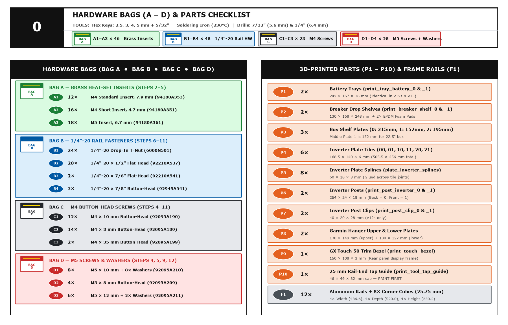

| Bag / Code | Qty | Part / Fastener | McMaster-Carr | Used In |
| :--- | :---: | :--- | :---: | :--- |
| **`BAG A` • `A1`** | **12×** | M4 × 0.7 Standard Heat-Set Insert (`7.9 mm`) | `94180A353` | Step 2 (`10×`), Step 3 (`2×`) |
| **`BAG A` • `A2`** | **16×** | M4 × 0.7 Short Heat-Set Insert (`4.7 mm`) | `94180A351` | Step 3 (`2×`), Step 4 (`14×`) |
| **`BAG A` • `A3`** | **18×** | M5 × 0.8 Heat-Set Insert (`6.7 mm`) | `94180A361` | Step 3 (`4×`), Step 4 (`8×`), Step 5 (`6×`) |
| **`BAG B` • `B1`** | **24×** | `1/4"-20` Drop-In T-Nut | `6000N501` | Step 6 (`16×` bottom, `8×` top) |
| **`BAG B` • `B2`** | **20×** | `1/4"-20 × 1/2"` Flat-Head Socket Screw | `92210A537` | Steps 8 (`8×`), 9 (`4×`), 10 (`4×`), 11 (`4×`) |
| **`BAG B` • `B3`** | **2×** | `1/4"-20 × 7/8"` Flat-Head Socket Screw | `92210A541` | Step 11 (`P7` Post Clips → Top Rail) |
| **`BAG B` • `B4`** | **2×** | `1/4"-20 × 7/8"` Button-Head Socket Screw | `92949A541` | Step 7 (`P6` Post Sills → Bottom Rail) |
| **`BAG C` • `C1`** | **12×** | M4 × 10 mm Button-Head Screw | `92095A190` | Steps 5 (`2×`), 9 (`4×`), 10 (`6×`) |
| **`BAG C` • `C2`** | **14×** | M4 × 8 mm Button-Head Screw | `92095A189` | Steps 4 (`8×`), 11 (`6×`) |
| **`BAG C` • `C3`** | **2×** | M4 × 35 mm Button-Head Screw | `92095A199` | Step 11 (`P7` Post Clips → `P6` Posts) |
| **`BAG D` • `D1`** | **8×** | M5 × 10 mm Button-Head + **8×** M5 Washers | `92095A210` | Steps 4 (`4×`), 9 (`4×`), 12 (snug `4×`) |
| **`BAG D` • `D2`** | **4×** | M5 × 8 mm Button-Head Screw | `92095A209` | Step 4 (MPPT 100/30) |
| **`BAG D` • `D3`** | **6×** | M5 × 12 mm Button-Head + **2×** M5 Washers | `92095A211` | Step 5 (SmartShunt `2×` + Bus Bars `4×`) |

---

## Step 1 — Cut & Tap Rails (`F1`) + Cut Panels

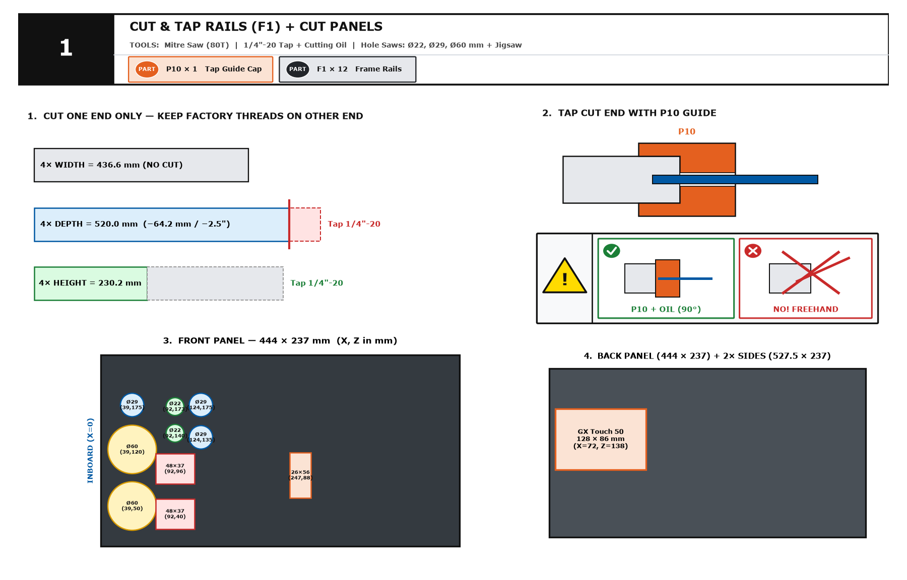

- **1.** Cut `4×` Depth rails to **`520.0 mm`** (`−2.5"`) and `4×` Height rails to **`230.2 mm`**. Leave `4×` Width rails uncut (**`436.6 mm`**).
- **2.** Slip **`P10`** Tap Guide over the 8 cut rail ends and tap `1/4"-20` with cutting oil.

---

## Step 2 — Battery Trays (`P1 × 2`): Press `10×` `BAG A • A1` Inserts

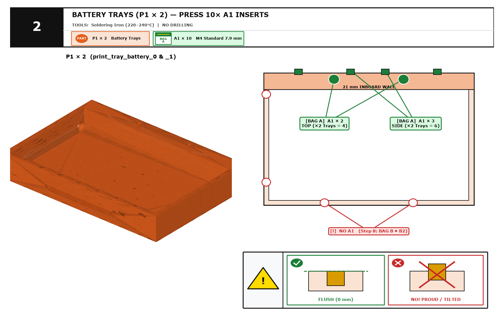

- **`[BAG A] A1 × 2` (per tray):** Press straight down into top of `21 mm` wall (`X = 81, 161 mm`).
- **`[BAG A] A1 × 3` (per tray):** Press horizontally into outer column face (`Z = 17 mm`).
- **`[!] ✗ A1`:** Leave the `4×` countersunk floor/end-wall holes empty (`BAG B • B2` in Step 8).

---

## Step 3 — Drop Shelves (`P2`), Garmin (`P8`) & Posts (`P6`): `BAG A` Inserts

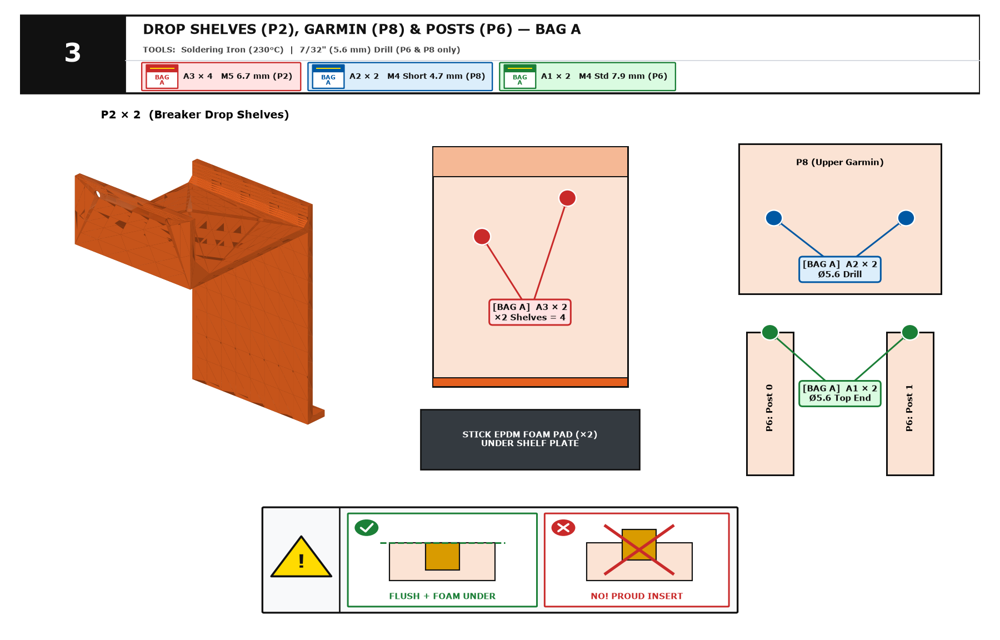

- **`P2 × 2`:** Press **`[BAG A] A3 × 2`** (`M5`) into top of each shelf + stick **EPDM Foam Pad** underneath.
- **`P8` (Upper Garmin):** Drill `2×` `Ø5.6 mm` → press **`[BAG A] A2 × 2`** (`M4 Short`).
- **`P6 × 2` (Posts):** Drill top end `Ø5.6 mm` → press **`[BAG A] A1 × 1`** (`M4 Std`) into each post.

---

## Step 4 — Inverter Plate (`P4 + P5`): Glue, Set `22×` `BAG A` Inserts & Mount Gear

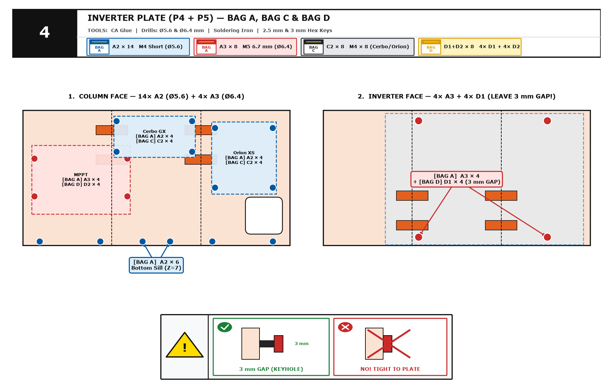

- **Column Face:** Press **`[BAG A] A2 × 14`** (`Ø5.6 mm`) + **`[BAG A] A3 × 4`** (`Ø6.4 mm`). Mount Cerbo & Orion with **`[BAG C] C2 × 8`** and MPPT with **`[BAG D] D2 × 4`**.
- **Inverter Face:** Press **`[BAG A] A3 × 4`** (`Ø6.4 mm`) and thread **`[BAG D] D1 × 4`** (`M5 × 10` + washers), leaving heads **`3 mm` proud** for MultiPlus keyholes.

---

## Step 5 — Bus Shelf (`P3 × 3`) & Garmin (`P8`): `BAG A`, `BAG C` & `BAG D`

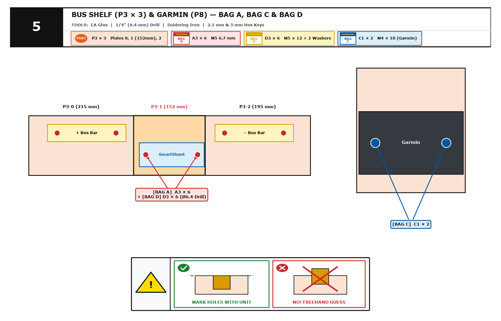

- **`P3` (`0 + 1 + 2`):** Glue half-laps (`P3-1` is **`152 mm`**). Drill `6×` `Ø6.4 mm` using SmartShunt & Bus Bars as templates → press **`[BAG A] A3 × 6`** → bolt down with **`[BAG D] D3 × 6`**.
- **`P8`:** Bolt Garmin bracket with **`[BAG C] C1 × 2`**.

---

## Step 6 — Bolt Lower Frame (`F1`), Slide Panels & Load `24×` `BAG B • B1` T-Nuts

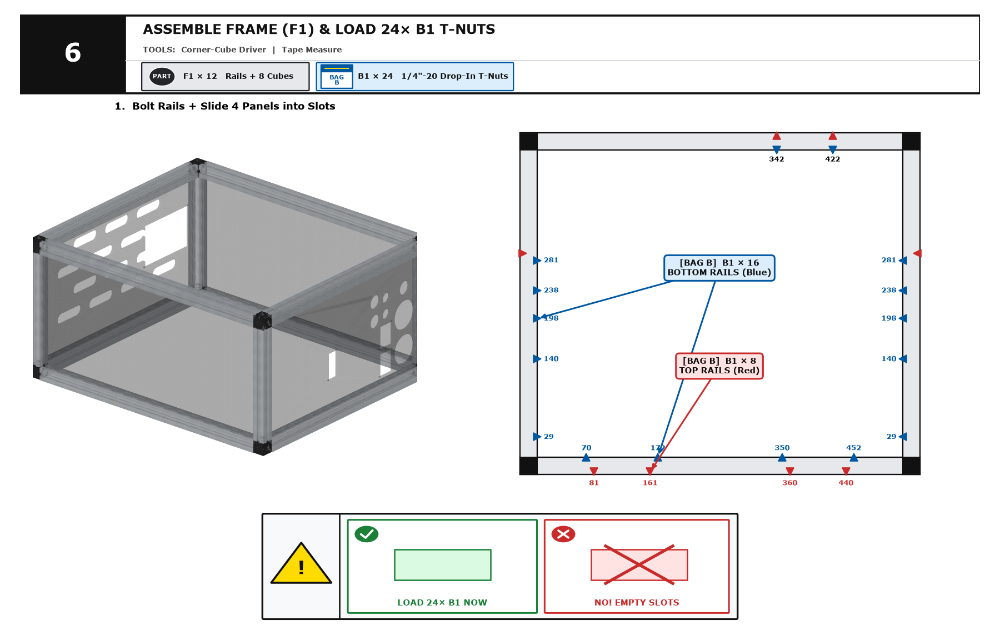

- Pre-load **`[BAG B] B1 × 16`** into bottom rails (Blue) and **`[BAG B] B1 × 8`** into top rails (Red) before locking corners.

---

## Step 7 — Inverter Posts (`P6 × 2`): `BAG B • B4`

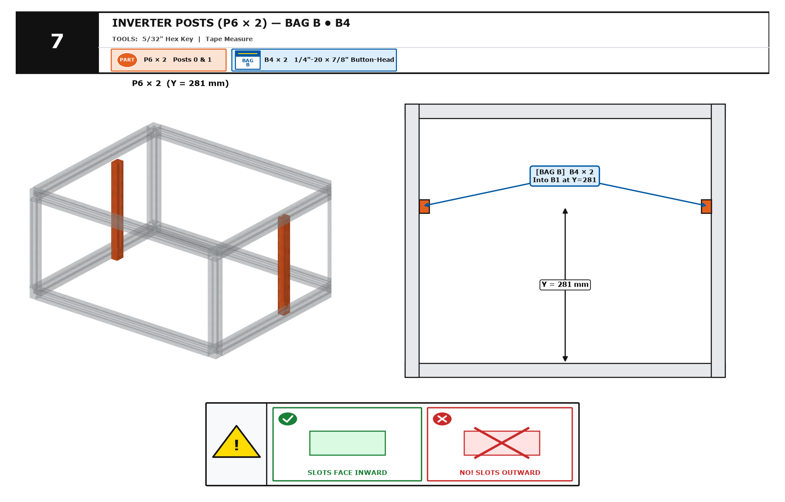

- Bolt `P6-0` (Back) and `P6-1` (Front) at **`Y = 281 mm`** using **`[BAG B] B4 × 2`** (`1/4"-20 × 7/8"` Button-Head).

---

## Step 8 — Battery Trays (`P1 × 2`): `BAG B • B2`

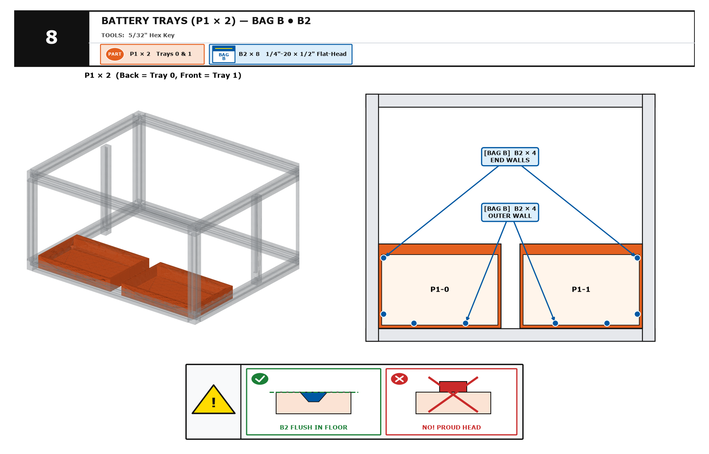

- Fasten both trays with **`[BAG B] B2 × 8`** (`4×` outer wall + `4×` end walls). Ensure all 8 heads sit **flush**.

---

## Step 9 — Batteries (`1st`) → Drop Shelves (`P2 × 2`): `BAG C`, `BAG B` & `BAG D`

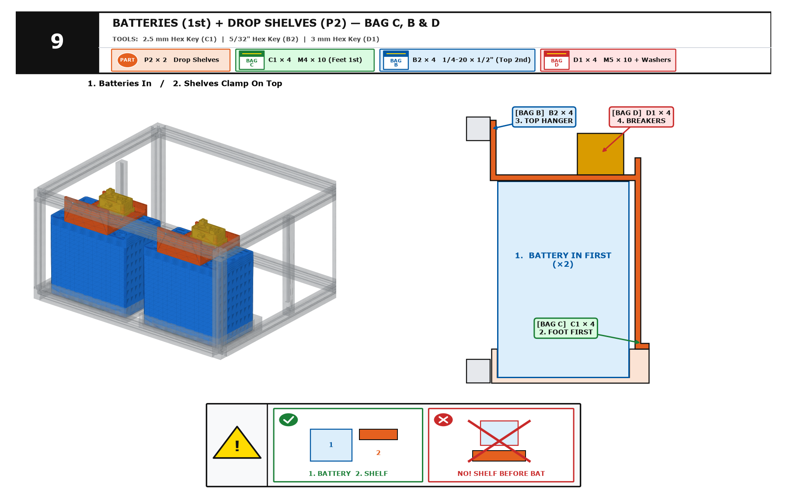

1. **Batteries in FIRST** (`2×` SuperPack 60Ah).
2. **`[BAG C] C1 × 4`** (`M4 × 10`) straight down through shelf feet into tray walls **FIRST**.
3. **`[BAG B] B2 × 4`** (`1/4"-20 × 1/2"`) through top hangers into Top Rail **SECOND**.
4. **`[BAG D] D1 × 4`** (`M5 × 10` + washers) to mount both 100A breakers.

---

## Step 10 — Bus Shelf (`P3`) Into Center Bay: `BAG C • C1` & `BAG B • B2`

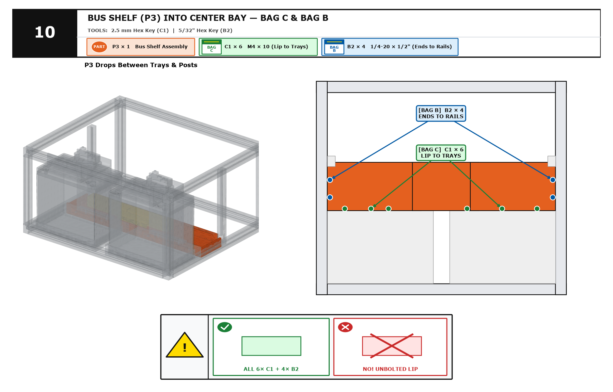

- **`[BAG C] C1 × 6`** (`M4 × 10`) horizontally through Bus Shelf lip into Tray 0 (`3×`) & Tray 1 (`3×`).
- **`[BAG B] B2 × 4`** (`1/4"-20 × 1/2"`) through Back & Front end walls into Width Rails (`Y = 198, 238 mm`).

---

## Step 11 — Inverter Plate, Post Clips (`P7`) & Garmin (`P8`): `BAG C` & `BAG B`

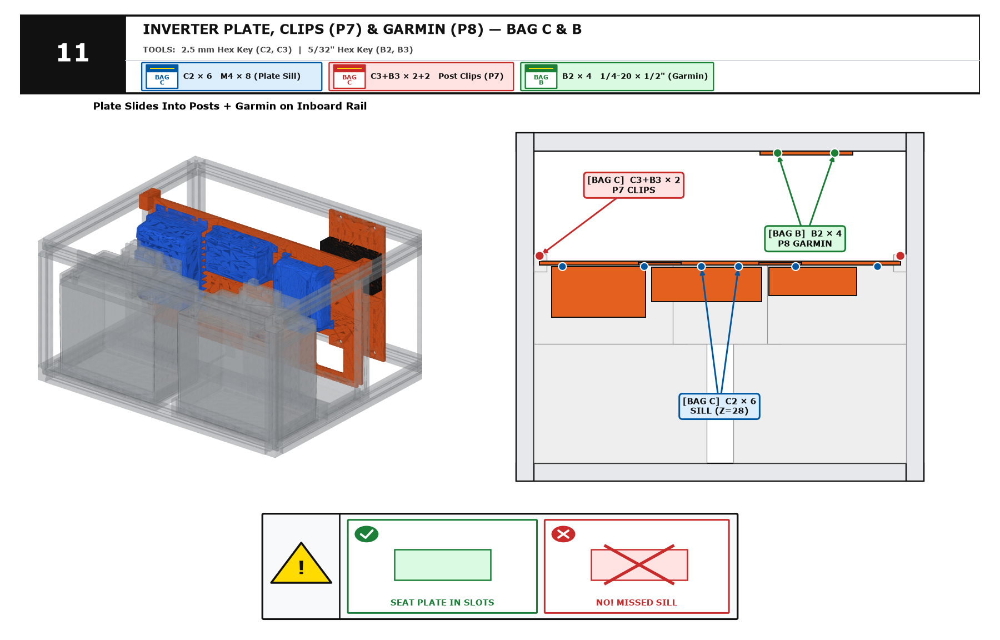

- Slide Plate into `P6` Post slots → drive **`[BAG C] C2 × 6`** (`M4 × 8`) through Bus Shelf wall into Plate sill.
- Lock `P7 × 2` Clips (`v12s`) with **`[BAG C] C3 × 2`** (`M4 × 35`) + **`[BAG B] B3 × 2`** (`1/4"-20 × 7/8"`).
- Bolt `P8 × 2` Garmin plates with **`[BAG B] B2 × 4`** (`X = 341.5, 421.5 mm`).

---

## Step 12 — Hang MultiPlus (`BAG D • D1`), Connect `4 AWG` Lugs & Fit Lid

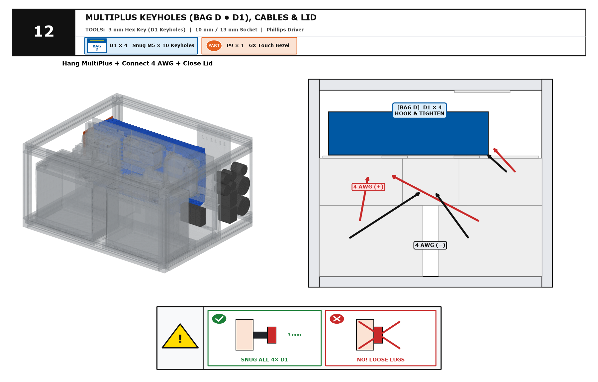

- Hook MultiPlus keyholes onto the `4×` proud **`[BAG D] D1`** screws and tighten from above.
- Connect `4 AWG` DC cables, mount `P9` GX Touch 50 bezel & front ports, and close the lid.
