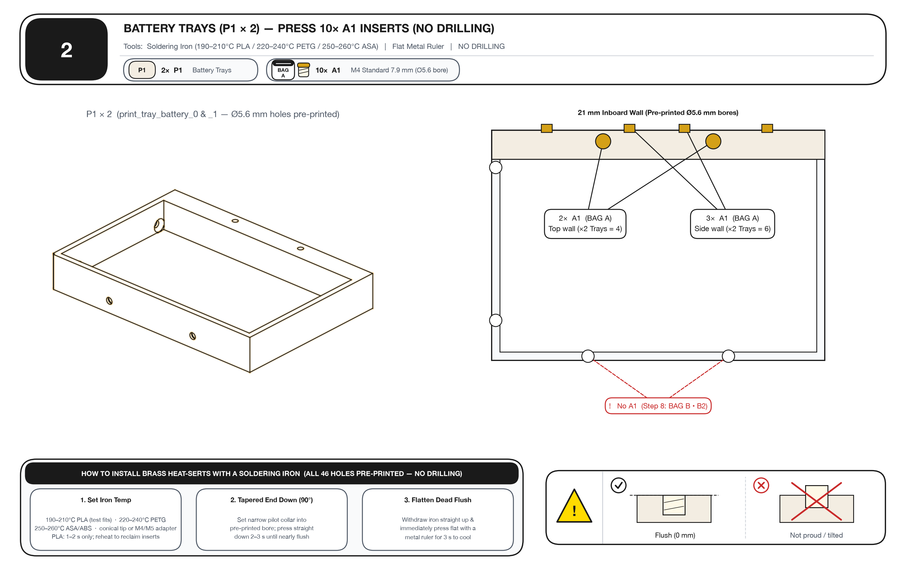
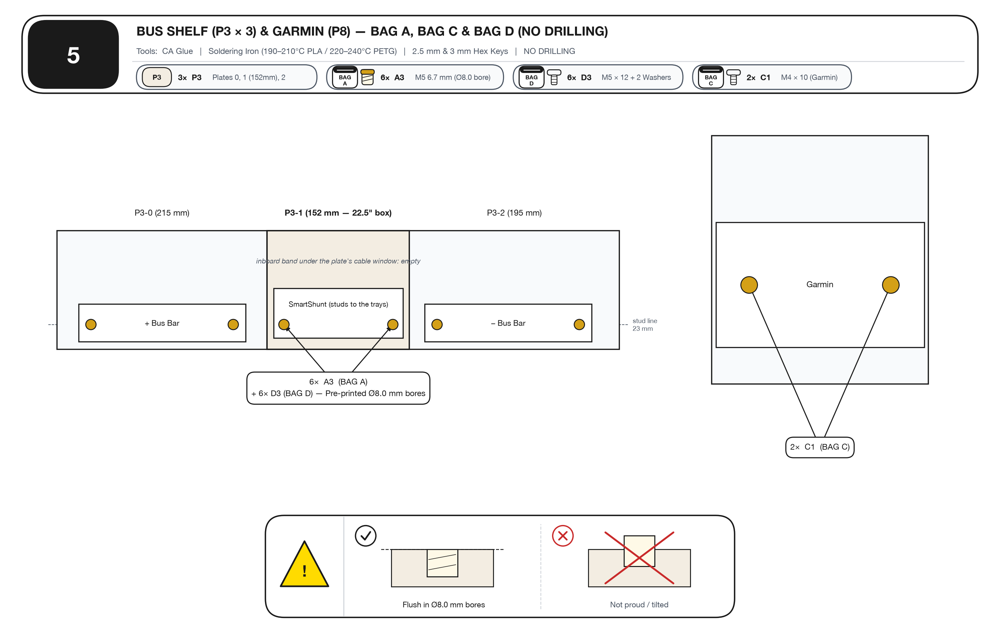
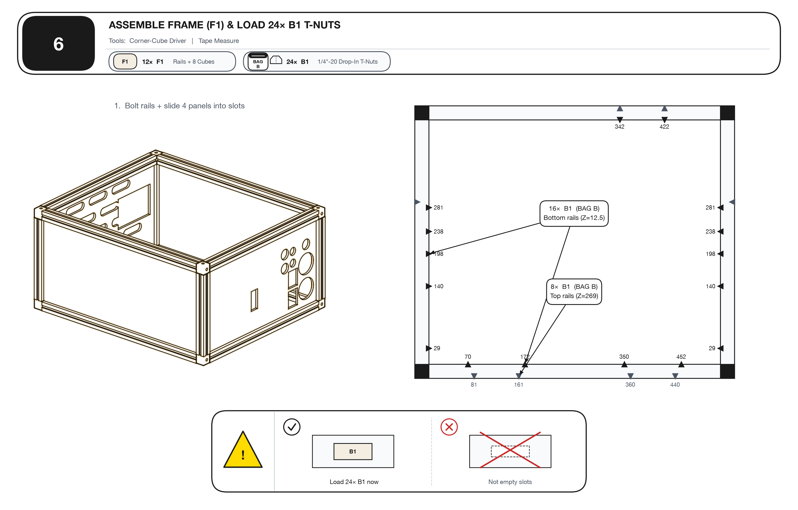
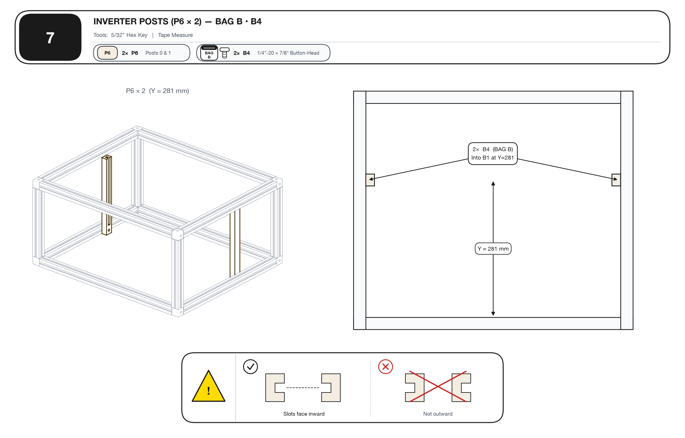
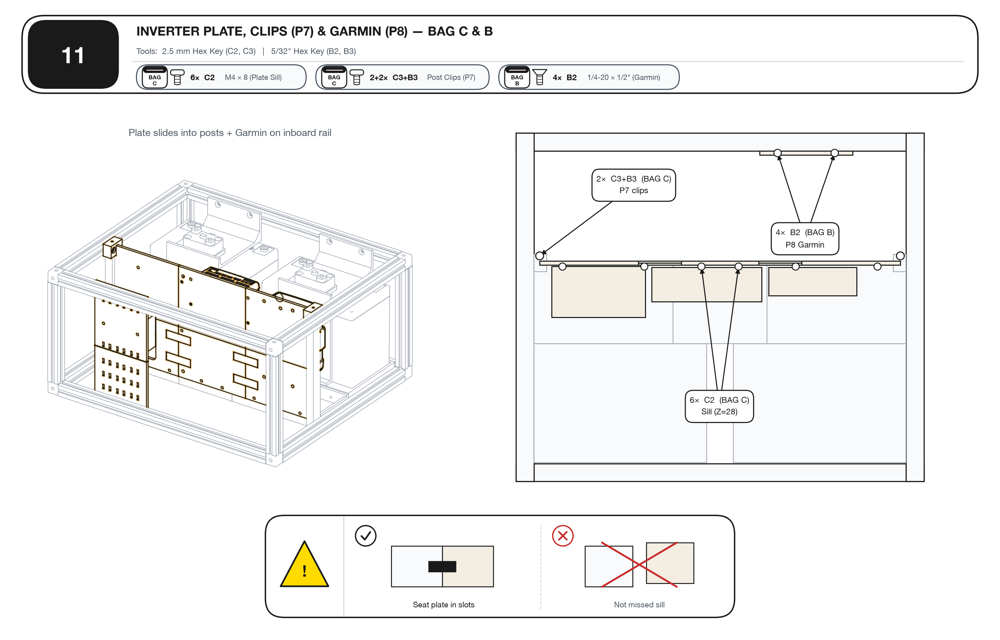
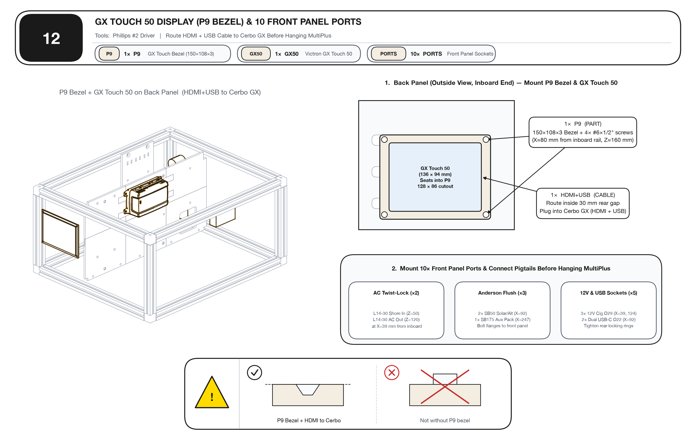
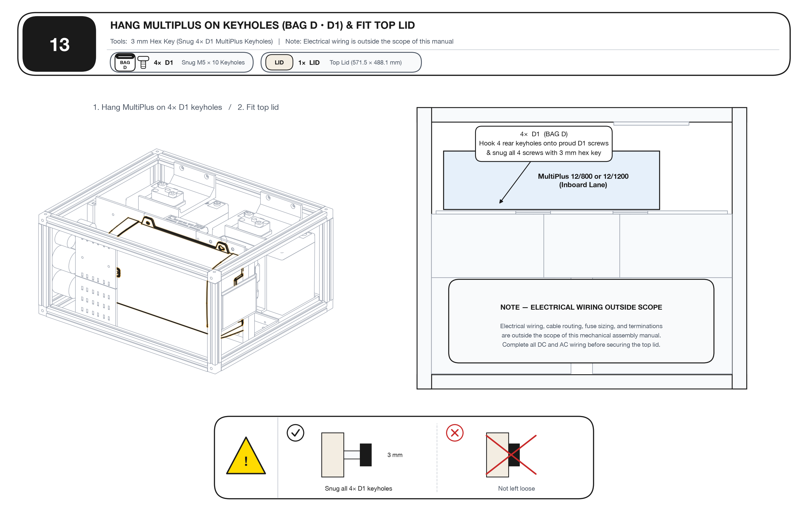

# IKEA-Style Visual Assembly Guide (`v12s` / `v13` — 22.5" × 19.2" × 11.1")

> **Visual-First Build Guide:** Hardware is grouped into **4 Hardware Bags (`BAG A` – `BAG D`)** and **10 Printed Part Codes (`P1` – `P10`)**. Follow the 14 sheets in order (`0` → `13`).
> **Zero Drilling on 3D Prints:** All 46 heat-set insert holes are pre-printed to exact size (`Ø 5.6 mm` for `M4` Std `A1`, `Ø 6.0 mm` for `M4` Short `A2`, `Ø 8.0 mm` with an `8°` tapered mouth for `M5` `A3`).
> *(For full engineering tables and wire-cut schedules, see [`MANUAL.md`](MANUAL.md).)*

---

## Step 0 — Hardware Bags (`BAG A` – `BAG D`) & Parts (`P1` – `P10`)

| Bag / Code | Qty | Part / Fastener | McMaster-Carr | Used In |
| :--- | :---: | :--- | :---: | :--- |
| **`BAG A` • `A1`** | **12×** | M4 × 0.7 Standard Heat-Set Insert (`7.9 mm`, `Ø 5.6 mm` bore) | `94180A353` | Step 2 (`10×`), Step 3 (`2×`) |
| **`BAG A` • `A2`** | **16×** | M4 × 0.7 Short Heat-Set Insert (`4.7 mm`, `Ø 6.0 mm` bore) | `94180A351` | Step 3 (`2×`), Step 4 (`14×`) |
| **`BAG A` • `A3`** | **18×** | M5 × 0.8 Tapered Heat-Set Insert (`6.7 mm`, `Ø 8.0 mm` bore, tapered mouth) | `94180A361` | Step 3 (`4×`), Step 4 (`8×`), Step 5 (`6×`) |
| **`BAG B` • `B1`** | **24×** | `1/4"-20` Drop-In T-Nut | `6000N501` | Step 6 (`16×` bottom, `8×` top) |
| **`BAG B` • `B2`** | **20×** | `1/4"-20 × 1/2"` Flat-Head Socket Screw | `92210A537` | Steps 8 (`8×`), 9 (`4×`), 10 (`4×`), 11 (`4×`) |
| **`BAG B` • `B3`** | **2×** | `1/4"-20 × 7/8"` Flat-Head Socket Screw | `92210A541` | Step 11 (`P7` Post Clips → Top Rail) |
| **`BAG B` • `B4`** | **2×** | `1/4"-20 × 7/8"` Button-Head Socket Screw | `92949A541` | Step 7 (`P6` Post Sills → Bottom Rail) |
| **`BAG C` • `C1`** | **12×** | M4 × 10 mm Button-Head Screw | `92095A190` | Steps 5 (`2×`), 9 (`4×`), 10 (`6×`) |
| **`BAG C` • `C2`** | **14×** | M4 × 8 mm Button-Head Screw | `92095A189` | Steps 4 (`8×`), 11 (`6×`) |
| **`BAG C` • `C3`** | **2×** | M4 × 35 mm Button-Head Screw | `92095A199` | Step 11 (`P7` Post Clips → `P6` Posts) |
| **`BAG D` • `D1`** | **8×** | M5 × 10 mm Button-Head + **8×** M5 Washers | `92095A210` | Steps 4 (`4×`), 9 (`4×`), 13 (snug `4×`) |
| **`BAG D` • `D2`** | **4×** | M5 × 8 mm Button-Head Screw | `92095A209` | Step 4 (MPPT 100/30) |
| **`BAG D` • `D3`** | **6×** | M5 × 12 mm Button-Head + **2×** M5 Washers | `92095A211` | Step 5 (SmartShunt `2×` + Bus Bars `4×`) |

---

## Step 1 — 22.5" (`571.5 mm`) Box: Cut & Tap Rails (`F1`) + Cut 5 Panels

> **22.5" (`571.5 mm`) Box Cut Schedule (Shortened `2.5"` / `64.2 mm` from `25"` / `635.7 mm` Donor IceBox):**
> - **12× Aluminum Rails (`F1`, between `25.75 mm` corner cubes):**
>   - **`4×` Width Rails (`Y`):** **`436.6 mm` (`17.19"`) — DO NOT CUT** (`3×` donor + `1×` Mod Kit `x.31` bar for front-bottom).
>   - **`4×` Depth Rails (`X`):** **`520.0 mm` (`20.47"`) — Cut `64.2 mm` (`2.5"`) off ONE end** of `584.2 mm` (`23.0"`) donor rail + tap cut end `1/4"-20`.
>   - **`4×` Height Rails (`Z`):** **`230.2 mm` (`9.06"`) — Cut `277.8 mm` (`10.94"`) off ONE end** of `508.0 mm` (`20.0"`) donor rail + tap cut end `1/4"-20`.
>   - **Tap Guide (`P10`):** Slip **`P10`** over each of the 8 cut rail ends and tap `1/4"-20` with cutting oil.
> - **5× Phenolic Plywood Panels (`6.0 mm` thick):**
>   - **`2×` Side Panels (Outboard & Inboard):** **`527.5 × 237.0 mm` (`20.77" × 9.33"`)** — shortened **`64.2 mm` (`2.5"`)** from the `591.7 mm` donor side panels (`520.0 mm` rail span + `2 × 3.75 mm` slot tongues).
>   - **`1×` Front Panel (Ports):** **`444.0 × 237.0 mm` (`17.48" × 9.33"`)** — cut from a `591.7 × 277.8 mm` side-panel offcut + 10 port holes.
>   - **`1×` Back Panel (Perforated):** **`444.0 × 237.0 mm` (`17.48" × 9.33"`)** — cut to `237.0 mm` tall + **`128 × 86 mm` GX Touch 50 cutout** (`X = 83 mm` from inboard panel edge / `80 mm` from inboard rail, `Z = 138 mm` from bottom panel edge / `160 mm` from box bottom).
>   - **`1×` Top Lid Panel:** **`571.5 × 488.1 mm` (`22.50" × 19.22"`)** flat lid on top of rails (`v12s`), or **`527.5 × 444.0 mm` (`20.77" × 17.48"`)** slot-captured lid (`v13`, shortened `2.5"` from `591.7 mm`).

---

## Step 2 — Battery Trays (`P1 × 2`): Press `10×` `BAG A • A1` Inserts + Soldering-Iron Guide

> **🔥 How to Install Brass "Heat-Serts" with a Soldering Iron (All 46 Holes Pre-Printed — NO DRILLING):**
> 1. **Set Temperature:** Set soldering iron to **`190–210 °C`** for **PLA** (the fit-and-finish test prints), **`220–240 °C`** for **PETG** (or **`250–260 °C`** for **ASA/ABS**). Use an M4/M5 heat-set tip or standard conical tip. PLA flows fast: `1–2 s` of pressure is enough, and the inserts come back out of a PLA test part with the same iron (heat `2 s`, lift with pliers) for reuse in the PETG parts.
> 2. **Tapered Pilot End Down (`90°`):** Set the insert's narrow tapered pilot collar into the pre-printed bore (`Ø 5.6 mm` std `M4`, `Ø 6.0 mm` short `M4`, `Ø 8.0 mm` tapered-mouth `M5`). Press straight down (`90°`) with gentle, steady pressure for `2–3 seconds` until the insert is `~0.5 mm` above flush.
> 3. **Flatten Dead Flush (`0 mm`):** Withdraw the iron straight up and immediately press a flat metal ruler or steel blade across the insert for `3 seconds` while the plastic cools so it sits **100% flush (`0 mm`)** with zero proud rim.

- **`[BAG A] A1 × 2` (per tray):** Press straight down into top of `21 mm` wall (`X = 81, 161 mm`).
- **`[BAG A] A1 × 3` (per tray):** Press horizontally into outer column face (`Z = 17 mm`).
- **`[!] ✗ A1`:** Leave the `4×` countersunk floor/end-wall holes empty (`BAG B • B2` in Step 8).

---

## Step 3 — Drop Shelves (`P2`), Garmin (`P8`) & Posts (`P6`): `BAG A` Inserts (No Drilling)

- **`P2 × 2`:** Press **`[BAG A] A3 × 2`** (`M5`, pre-printed `Ø 8.0 mm` bores) into top of each shelf + stick **EPDM Foam Pad** underneath.
- **`P8` (Upper Garmin):** Press **`[BAG A] A2 × 2`** (`M4 Short`, pre-printed `Ø 6.0 mm` bores) flush from the Garmin side.
- **`P6 × 2` (Posts):** Press **`[BAG A] A1 × 1`** (`M4 Std`, pre-printed `Ø 5.6 mm` top bore) into the top end of each post.

---

## Step 4 — Inverter Plate (`P4 + P5`): Glue, Set `22×` `BAG A` Inserts & Mount Gear

- **Column Face (No Drilling):** Press **`[BAG A] A2 × 14`** (pre-printed `Ø 6.0 mm`) + **`[BAG A] A3 × 4`** (pre-printed `Ø 8.0 mm`). Mount **MPPT 100/30** upright (`130 × 186 mm` at `X = 50 mm`) with **`[BAG D] D2 × 4`**, **Cerbo GX** (`X = 190 mm`) with **`[BAG C] C2 × 4`**, and **Orion XS** (`X = 354 mm`) with **`[BAG C] C2 × 4`**.
- **Inverter Face (No Drilling):** Press **`[BAG A] A3 × 4`** (pre-printed `Ø 8.0 mm`) and thread **`[BAG D] D1 × 4`** (`M5 × 10` + washers), leaving heads **`3 mm` proud** for MultiPlus keyholes.

---

## Step 5 — Bus Shelf (`P3 × 3`) & Garmin (`P8`): `BAG A`, `BAG C` & `BAG D` (No Drilling)

- **`P3` (`0 + 1 + 2`):** Glue half-laps (`P3-1` is **`152 mm`** for the `22.5"` box). Press **`[BAG A] A3 × 6`** into the 6 pre-printed `Ø 8.0 mm` floor bores → bolt down **SmartShunt** and **two Bus Bars** with **`[BAG D] D3 × 6`**.
- **`P8`:** Bolt Garmin bracket with **`[BAG C] C1 × 2`**.

---

## Step 6 — Bolt Lower Frame (`F1`), Slide Panels & Load `24×` `BAG B • B1` T-Nuts

- Pre-load **`[BAG B] B1 × 16`** into bottom rails (Blue) and **`[BAG B] B1 × 8`** into top rails (Red) before locking corners.

---

## Step 7 — Inverter Posts (`P6 × 2`): `BAG B • B4`

- Bolt `P6-0` (Back) and `P6-1` (Front) at **`Y = 281 mm`** using **`[BAG B] B4 × 2`** (`1/4"-20 × 7/8"` Button-Head).

---

## Step 8 — Battery Trays (`P1 × 2`): `BAG B • B2`

- Fasten both trays with **`[BAG B] B2 × 8`** (`4×` outer wall + `4×` end walls). Ensure all 8 heads sit **flush**.

---

## Step 9 — Batteries (`1st`) → Drop Shelves (`P2 × 2`): `BAG C`, `BAG B` & `BAG D`

1. **Batteries in FIRST** (`2×` SuperPack 60Ah).
2. **`[BAG C] C1 × 4`** (`M4 × 10`) straight down through shelf feet into tray walls **FIRST**.
3. **`[BAG B] B2 × 4`** (`1/4"-20 × 1/2"`) through top hangers into Top Rail **SECOND**.
4. **`[BAG D] D1 × 4`** (`M5 × 10` + washers) to mount both Bussmann 285 breakers.

---

## Step 10 — Bus Shelf (`P3`) Into Center Bay: `BAG C • C1` & `BAG B • B2`

- **`[BAG C] C1 × 6`** (`M4 × 10`) horizontally through Bus Shelf lip into Tray 0 (`3×`) & Tray 1 (`3×`).
- **`[BAG B] B2 × 4`** (`1/4"-20 × 1/2"`) through Back & Front end walls into Width Rails (`Y = 198, 238 mm`).

---

## Step 11 — Inverter Plate, Post Clips (`P7`) & Garmin (`P8`): `BAG C` & `BAG B`

- Slide Plate into `P6` Post slots → drive **`[BAG C] C2 × 6`** (`M4 × 8`) through Bus Shelf wall into Plate sill.
- Lock `P7 × 2` Clips (`v12s`) with **`[BAG C] C3 × 2`** (`M4 × 35`) + **`[BAG B] B3 × 2`** (`1/4"-20 × 7/8"`).
- Bolt `P8 × 2` Garmin plates with **`[BAG B] B2 × 4`** (`X = 341.5, 421.5 mm`).

---

## Step 12 — Install GX Touch 50 Display Panel (`P9` Bezel) & 10 Front Panel Ports

- **`P9` GX Touch 50 Trim Bezel (`print_touch_bezel.stl`, `150 × 108 × 3 mm`):** Position `P9` over the `128 × 86 mm` Back Panel cutout (`X = 80 mm` from inboard rail / `83 mm` from inboard panel edge, `Z = 160 mm` from box bottom) to cover the perforated panel slots, and fasten its 4 corners (`140 × 98 mm` centers) with `4× #6 × 1/2"` pan-head wood screws.
- **GX Touch 50 Display (`136 × 94 × 12 mm`):** Feed the combined HDMI + USB power cable through `P9`, press the display flush into the bezel, and plug HDMI + USB into the **Cerbo GX** on the Inverter Plate before hanging the MultiPlus.
- **10 Front Panel Ports:** Install the `2× L14-30` AC twist-locks, `2× SB50` + `1× SB175` Anderson flush mounts, `3× 12V` sockets, and `2× Dual USB-C` sockets into the Front Panel.

---

## Step 13 — Hang MultiPlus (`BAG D • D1`) & Fit Top Lid

- Hook MultiPlus keyholes onto the `4×` proud **`[BAG D] D1`** screws on the Inverter Plate and tighten from above with a `3 mm` hex key.
- Secure the `571.5 × 488.1 mm` (`22.50" × 19.22"`) top lid panel (`v12s`) or slide the `527.5 × 444.0 mm` (`20.77" × 17.48"`) lid into the top-rail slots (`v13`).

> **⚡ Note — Electrical Wiring Outside Scope:** Electrical wiring, cable routing, fuse sizing, and terminations are outside the scope of this mechanical assembly manual. Complete all DC and AC wiring before securing the top lid.
