# 4Runner Electronics Box: Build Manual (`v12s`)

> [!TIP]
> **Want the picture-first IKEA version with almost zero reading?** Open **[`IKEA-MANUAL.md`](IKEA-MANUAL.md)** (13 visual step sheets with hardware codes `H1`–`H11` and part codes `P1`–`P10`).

Step-by-step assembly of the **`v12s`** box: the frame of a 25 in Goose Gear IceBox 1.3 cut down to **281.7 mm** tall and **571.5 mm (22.5 in)** deep, holding a MultiPlus 12/800 (modelled to the 12/1200 envelope) and two Victron SuperPack 60Ah batteries, with the charge gear on a printed plate, a full-height Garmin PowerSwitch tie-down hanger in the inboard lane, and an Eaton Bussmann 285 breaker on a hold-down drop shelf over each battery.

Every diagram is rendered directly from the CAD model ([`cad/cage.py`](cad/cage.py), variant `v12s`), so what you see matches the exported STLs. Parts placed in a step are shown in colour; parts already in place are grey. The front of the box (with the ports) is on the right in every isometric view.

- **Outer dimensions (as built):** **571.5 × 488.1 × 281.7 mm (22.5 × 19.2 × 11.1 in)** (`25.0 mm` metric 25-series rails, `25.75 mm` corner cubes)
- **Loaded weight:** ~42 kg (frame 15 kg, batteries 15 kg, inverter 8 kg, prints and gear 4 kg)

> [!IMPORTANT]
> **Three rules govern the entire build:**
> 1. **Inner-face rail slots only:** The IceBox panels sit in the rails' centre slots, so a rail's top and bottom slots are taken. Every structural tie to the frame is a horizontal `1/4-20` into a rail's **inner-face slot** through a **drop-in T-nut** (`24` total), which can be added or slid into position after the frame is closed.
> 2. **No loose nuts inside the box:** Printed parts carry brass heat-set inserts; the only nuts are the drop-in T-nuts in the rails. Every fastener is reached from above or along the open center column with a hex key.
> 3. **Lift by the bottom rails, never the lid:** The box has no structural floor panel—the battery trays hang from the bottom rails in shear (`4 × 1/4-20` per tray plus `5 × M4` into the bus shelf and drop shelf) so the frame carries the full load as one unit.

---

## 1. What You Need

### 1.1 From the Donor IceBox 1.3 (25 in Model) + Mod Kit Bar

| Part | Use | Cut / Preparation |
|---|---|---|
| **8 corner cubes** (`25.75 mm`) | Box corners | None (reuse corner-cube screws) |
| **3 width rails** (`436.6 mm`) | Back top, back bottom, front top | None (factory tapped both ends) |
| **1 added width rail** (`436.6 mm`) | **Front bottom** (the donor IceBox has no rail here because the fridge slide uses the opening) | One bar from a Goose Gear **Extrusion Frame Modification Kit x.31** (ordered 2026-10-30): same profile and finish, pre-tapped. No cut, no tap. Measure against a donor width rail on arrival (`436.6 mm`) |
| **4 depth rails** (`584.2 mm`) | Sides, top and bottom | **Cut to `520.0 mm`** (`20.47 in`), cut one end only, re-tap cut end `1/4-20` |
| **4 height rails** (`508.0 mm`) | Vertical corners | **Cut to `230.2 mm`** (`9 1/16 in`, done), cut one end only, re-tap cut end `1/4-20` |
| **2 side panels** (`6 mm` phenolic ply) | Outboard & inboard sides | Cut to **`237 mm` tall × `527.5 mm` long** (the `520.0 mm` between the corner cubes plus two `3.75 mm` slot tongues; panel tongues stop at the cubes) |
| **Perforated rear panel** | Back panel (against main IceBox) | Cut to **`237 mm` tall** (`444 mm` wide, slots and all); cut the **GX Touch 50 opening** at its inboard end (centre `80 mm` from the inboard corner rail, `160 mm` up; size from Victron's flush-kit template, modelled `128 × 86 mm`) |
| **1 side-panel offcut** (`635 × 322 mm`) | **Front panel** (ports) | Cut to **`444 × 237 mm`**, then cut the 10 port openings (§2.2) |
| **Flat lid panel** (sourced separately) | Top lid | Flat **`571.5 × 488 × 6 mm`** panel laid on top of the top rails, held by drop-in T-nuts in the top rails' top-face slots. *(The donor's slot-captured `591 × 443 mm` top panel would sit 16 mm down inside the frame on top of the inverter plate, so it is spare.)* |

**Why these cut lengths:** Rail length = outside dimension − `2 × 25.75 mm` (one corner cube at each end):
- **Height:** `281.7 − 51.5 = 230.2 mm`
- **Depth:** `571.5 − 51.5 = 520.0 mm`
- **Width:** `436.6 + 51.5 = 488.1 mm` (uncut)

> [!WARNING]
> **Pre-cut & pre-tap caliper checks (see [`manual/audit-2026-10-30.md`](manual/audit-2026-10-30.md)):**
> - **Width rail length & profile:** Measure an uncut donor width rail (`436.6 mm`) and rail cross-section (`25.0 × 25.0 mm`, `6.5 mm` slot).
> - **Donor cube bolt thread:** Metric 25-series bores are M6-sized. Check one removed factory corner-cube screw against a `1/4-20` nut before tapping the depth rails to confirm whether the factory screws are `1/4-20` or `M6`.
> - **Top front width rail:** Confirm the donor frame includes the top front width rail (used by the front post clip and lid hold-down).
> - **Panel thickness:** Caliper a cut panel edge (modelled at `6.0 mm`) before cutting the front panel tongues.

---

### 1.2 Printed Parts (`stl/v12s/`)

All printable files are in [`stl/v12s/`](stl/v12s/). Every `print_*.stl` and `plate_*.stl` is exported **already lying in its print orientation** at the bed origin (`cad/plates.py` rules) and verified to fit inside a `256 × 256 × 256 mm` Bambu P1P/P1S bed: load, slice, and print without rotating.

- **Material:** **PETG or ASA** for all structural parts—never PLA (a closed vehicle in summer exceeds PLA's creep temperature, and the trays hang under continuous bolt/insert load).
- **Nozzle & Slicer Preset:** **0.4 mm nozzle, 0.20 mm layer height**, brim on every part. (A 0.6 mm nozzle at 0.30 mm is also fine for the trays and shelves.)
- **Total filament & time:** ~2.5 kg, ~35 hours. Visual renders of individual parts are in [Section 4](#4-the-printed-parts).

| Part | Qty | File(s) | Bed Orientation | Walls / Infill | Dimensions (mm) & Notes |
|---|---|---|---|---|---|
| **Battery tray** | 2 | [`print_tray_battery_0.stl`](stl/v12s/print_tray_battery_0.stl), [`print_tray_battery_1.stl`](stl/v12s/print_tray_battery_1.stl) | Flat, floor down (loads wall bolts along layers) | 5 / 40% (100% floor recommended) | `242 × 167 × 36`. Pocket is `0.5 mm` clear per side (snug, no strap groove), outer corner notched `2 mm` for the `25.75 mm` cube. Tray 0 bolts through its back wall; Tray 1 through its front wall |
| **Breaker drop shelf** | 2 | [`plate_breaker_shelf.stl`](stl/v12s/plate_breaker_shelf.stl) (**print twice**; two do not fit one bed) | Pre-laid on its `130 mm` vertical edge, no supports (full-length ribs keep cross-section uniform) | 4 / 40% gyroid | `130 × 168 × 243` (~400 g, ~9 h each). **Never print flat on the plate** (the leg would be 189 mm of overhang and foot bolts would pull across layers) |
| **Bus shelf plate** | 3 | [`0`](stl/v12s/print_bus_shelf_0.stl), [`1`](stl/v12s/print_bus_shelf_1.stl), [`2`](stl/v12s/print_bus_shelf_2.stl) | Flat, floor down, no supports (20 mm half-laps are in the vertical walls; floors butt) | 4 / 30% | `215 × 110 × 34` (plate 0), `152 × 110 × 34` (plate 1, middle), `195 × 110 × 34` (plate 2). Plates 0 and 2 carry the end walls that bolt to the width rails |
| **Inverter plate tile** | 6 | [`00`](stl/v12s/print_plate_inverter_tile_00.stl), [`01`](stl/v12s/print_plate_inverter_tile_01.stl), [`10`](stl/v12s/print_plate_inverter_tile_10.stl), [`11`](stl/v12s/print_plate_inverter_tile_11.stl), [`20`](stl/v12s/print_plate_inverter_tile_20.stl), [`21`](stl/v12s/print_plate_inverter_tile_21.stl) | Flat on each tile's untouched face (lower row has rabbets/pockets on inverter face; upper row on column face). Zero bridges, no supports | 4 / 30% | `168.5 × 140 × 6`. First digit = column from back (`0..2`), second = row from bottom (`0..1`). Exact `Ø 5.6 mm` (M4) and `Ø 6.4 mm` (M5) insert holes are pre-printed in place (no drilling) |
| **Plate spline** | 8 | [`plate_inverter_splines.stl`](stl/v12s/plate_inverter_splines.stl) (all 8 on one bed) | Flat, as exported | 4 / 100% | `60 × 18 × 3`. Glued with CA into flush pockets across the two vertical column joints (2 per row per joint) |
| **Inverter post + clip** | 2 + 2 | [`plate_inverter_posts.stl`](stl/v12s/plate_inverter_posts.stl) (both posts + both clips on one bed) | Pre-laid: posts flat on solid backs, slot up, at 45° across bed; clips on plain outer face, countersink up | 5 / 50% | Posts `254 × 24 × 18`, clips `40 × 20 × 27.7`. Mirror pairs (`0` = back rail, `1` = front rail)—mark them as they come off the bed |
| **Garmin hanger, upper** | 1 | [`print_garmin_hanger.stl`](stl/v12s/print_garmin_hanger.stl) | Flat on plain back, insert pilots up | 4 / 40% | `130 × 149 × 6`. Hangs from top inboard rail's inner slot (`2 × 1/4-20` countersunk); carries Garmin bracket (`2 × M4` short inserts) and two rows of cable-tie slots |
| **Garmin hanger, lower** | 1 | [`print_garmin_hanger_lower.stl`](stl/v12s/print_garmin_hanger_lower.stl) | Flat on plain back | 4 / 40% | `130 × 127 × 6`. Stands on bottom inboard rail's inner slot (`2 × 1/4-20` countersunk), `1 mm` below upper plate, with three rows of cable-tie slots |
| **GX Touch 50 bezel** | 1 | [`print_touch_bezel.stl`](stl/v12s/print_touch_bezel.stl) | Flat, as exported | 4 / 100% | `150 × 108 × 3`. Trim frame over the rear-panel display cutout; mounts with four `#6 × 1/2 in` wood screws into the plywood |
| **Tool: rail-end tap guide** | 1 | [`print_tool_tap_guide.stl`](stl/v12s/print_tool_tap_guide.stl) | Pocket up, as exported | 4 / 100% | `46 × 46 × 32` cap with a `25.3 mm` square pocket (14 mm deep) that slips over a `25 mm` rail end and a `6.5 mm` centre bore to start the `1/4-20` tap square. **Print this first** |

---

### 1.3 Hardware & Fasteners

For direct McMaster-Carr links, pack quantities, and a copy-paste Order Pad block, see **[`manual/mcmaster-order.md`](manual/mcmaster-order.md)**.

**Screw-length rule for rail T-nuts:** `screw length = plastic thickness under the head + 6 to 7 mm`. A `3/4 in` flat-head screw in a `6 mm` countersunk wall leaves `13 mm` protruding and bottoms out in the rail slot before clamping (a drop-in T-nut has ~7 mm of thread depth), so all `6 mm` walls use **`1/2 in` flat-head screws**.

| Item | McMaster PN | Qty Used (Pack) | Where It Goes |
|---|---|---|---|
| **1/4"-20 drop-in T-nuts** (10-series / 25-series `6.5 mm` slot) | `6000N501` (or 80/20 `#3382`) | **24** (6 packs of 4) | Every tie into a rail's inner slot (trays 8, bus shelf 4, drop shelves 4, posts 2, clips 2, Garmin hanger plates 4). *(Add extra for lid hold-downs if bolting lid to top slots)* |
| **1/4"-20 × 1/2 in flat-head** (82° countersunk), 18-8 SS | `92210A537` | **20** (50) | All `6 mm` walls into rail T-nuts: tray outer & end walls (8), bus shelf end walls (4), drop-shelf hangers (4), Garmin upper & lower hanger plates (4) |
| **1/4"-20 × 7/8 in flat-head** (82° countersunk), 18-8 SS | `92210A541` | **2** (25) | Post clips into top width rails (2) |
| **1/4"-20 × 7/8 in button-head**, 18-8 SS | `92949A541` | **2** (25) | Post sills into bottom width rails (2, plain hole, head on post's inner face) |
| **M4 × 0.7 heat-set inserts, standard** (`7.9 mm` long) | `94180A353` | **12** (50) | Thick printed parts: tray inboard wall faces (6, for bus shelf lip), tray inboard wall tops (4, for drop-shelf feet), inverter post tops (2, for clips) |
| **M4 × 0.7 heat-set inserts, short** (`4.7 mm` long, for `6 mm` plates) | `94180A351` | **16** (100) | `6 mm` plates: inverter plate bottom band (6, for bus shelf wall), Cerbo GX (4), Orion XS (4), Garmin upper hanger plate (2) |
| **M4 × 10 button-head**, 18-8 SS | `92095A190` | **12** (100) | Bus shelf lip into tray inboard walls (6), drop-shelf feet into tray wall tops (4), Garmin bracket into upper hanger plate (2) |
| **M4 × 8 button-head**, 18-8 SS | `92095A189` | **14** (100) | Bus shelf inboard wall into inverter plate bottom band (6), Cerbo GX (4), Orion XS (4) — stays flush on opposite face of `6 mm` plate |
| **M4 × 35 button-head**, 18-8 SS | `92095A199` | **2** (25) | Down through each post clip into the post top insert (2) |
| **M5 × 0.8 heat-set inserts** (`6.7 mm` long) | `94180A361` | **18** (25) | MultiPlus keyholes (4), MPPT keyholes (4), Bussmann 285 breakers on drop shelves (4), bus bars on bus shelf (4), SmartShunt on bus shelf (2) |
| **M5 flat washers** (`5.3 mm` ID × `10 mm` OD) | `93475A240` | **10** (100) | Under screw heads on MultiPlus keyholes (4), Bussmann 285 breakers (4), and SmartShunt (2) |
| **M5 × 10 button-head**, 18-8 SS | `92095A208` | **8** (50) | MultiPlus keyholes (4, with washer, left `3 mm` proud), Bussmann 285 breakers on drop shelves (4, with washer) |
| **M5 × 8 button-head**, 18-8 SS | `92095A207` | **4** (50) | MPPT 100/30 keyholes (4, left `3 mm` proud so keyholes drop over them without protruding on the inverter side) |
| **M5 × 12 button-head**, 18-8 SS | `92095A210` | **6** (50) | Bus bars (4) and SmartShunt (2, with washer) into bus shelf floor |
| **Cyanoacrylate (CA) glue**, medium viscosity | `74765A63` | 1 | Gluing the 8 inverter-plate splines and tacking the tile and bus-shelf half-laps |
| **Closed-cell EPDM foam pad**, adhesive-backed (`130 × 140 mm`) | — | 2 | `1/16 in` (`1.5 mm`) firm or `1/8 in` (`3 mm`) soft foam glued under each drop-shelf plate to press onto the battery top (`1 mm` modelled gap) |

#### Unit-to-Plate Fastener Reference (Why Screw Lengths Matter)

The MultiPlus covers the inverter side of the `6 mm` plate from `x = 21` to `396 mm` (measured from the back rail face), so two of its keyhole inserts sit behind the MPPT and Orion on the column side, and the units' backs stand only `2–3 mm` off the plate. Every screw in the `6 mm` plate is sized so it **never protrudes through the far face**:

| Unit | Mounting Pattern | Insert in Plate | Screw | Installed From |
|---|---|---|---|---|
| **MultiPlus 12/800 or 12/1200** | 4 keyholes (`243.8 × 220.6 mm`) | `M5` (`94180A361`) | `M5 × 10` button head + `10 mm` washer, left **`3 mm` proud** (`5.5 mm` in plate → flush on column side) | Inverter side |
| **SmartSolar MPPT 100/30** (upright) | 4 keyholes (`71.5 × 176 mm`) | `M5` (`94180A361`) | `M5 × 8` button head, left **`3 mm` proud** (`5 mm` in plate → flush under MultiPlus) | Column side |
| **Cerbo GX** | 4 corner ears (`143 × 58 mm`) | Short `M4` (`94180A351`) | `M4 × 8` button head (flush under MultiPlus) | Column side |
| **Orion XS 12/12-50A** | 4 corner lugs (`109.3 × 113 mm`) | Short `M4` (`94180A351`) | `M4 × 8` button head (flush under MultiPlus) | Column side |
| **Bus shelf inboard wall** | 6 holes along bottom band (`z = 28 mm`) | Short `M4` (`94180A351`) | `M4 × 8` button head through `4 mm` wall | Column side |
| **Garmin PowerSwitch** (on upper hanger) | Bracket, 2 holes | Short `M4` (`94180A351`) | `M4 × 10` button head | Inboard lane |
| **Bussmann 285 breakers × 2** (on drop shelves) | 2 × `6.6 mm` diagonal holes (`56.6 × 26.7 mm`) | `M5` (`94180A361`) | `M5 × 10` (or `M5 × 12`) + `10 mm` washer | Drop shelf top |

---

### 1.4 Tools

- **Drivers & wrenches:** Hex keys (`2.5`, `3`, `4`, `5 mm`, plus `5/32 in` for the `1/4-20` flat-head screws)
- **Heat-set inserts (no drilling needed):** Temperature-controlled soldering iron (`220–240 °C` for PETG, `250–260 °C` for ASA) with M4/M5 heat-set tips (or standard conical tip) and a flat metal ruler/steel blade to press inserts dead flush (`0 mm`) while warm. All 46 heat-set insert holes across every printed part are pre-printed to exact size (`Ø 5.6 mm` for `M4`, `Ø 6.4 mm` for `M5`).
- **Rail cutting & tapping:** Mitre saw with an 80–100T non-ferrous carbide blade (Diablo `D1084L`) or bandsaw; disc sander or mill file; machinist's square and caliper; `1/4-20` HSS spiral-point (gun) tap or the plug tap from a Milwaukee SAE tap set; T-handle tap wrench; tapping fluid (Tap Magic Aluminum or WD-40 Specialist cutting oil); **printed rail-end tap guide** (`print_tool_tap_guide.stl`)
- **Panel cutting & ports:** Table saw with the same Diablo `D1084L` 80-tooth blade; `22 mm`, `29 mm`, and `60 mm` hole saws for round sockets/inlets; fine jigsaw blade for the rectangular `SB50`, `SB175`, and `GX Touch 50` cutouts
- **Electrical:** Cable lug crimper, wire strippers, heat gun

---

## 2. Bench Work (Before Frame Assembly)

Complete these four visual bench stages (**Bench 1 → Bench 4**) before bolting the aluminum frame together.

---

### Bench 1: Cut & Tap the Rails + Cut the Panels & Port Holes

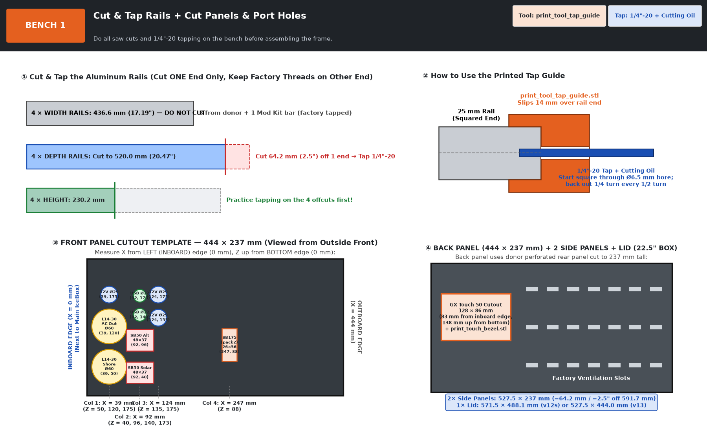

* **① Cut the Aluminum Rails (Cut ONE End Only — Keep Factory Threads on the Other End):**
  * **4 × Width Rails (`436.6 mm` / `17.19 in`):** **DO NOT CUT** (`3` from donor IceBox + `1` from Goose Gear Mod Kit `x.31`).
  * **4 × Depth Rails (`584.2 mm` → `520.0 mm` / `20.47 in`):** Cut **`64.2 mm` (`2.5 in`)** off **one end only**, square to `520.0 mm`, and tap the cut end `1/4"-20` (`30 mm` deep).
  * **4 × Height Rails (`508.0 mm` → `230.2 mm` / `9 1/16 in`):** Cut **one end only** to `230.2 mm` and tap `1/4"-20`. *(Practice tapping on the 4 offcuts first!)*
* **② Tap Square with the Printed Guide (`print_tool_tap_guide.stl`):**
  * Slip the orange printed cap over the squared rail end, add cutting oil, and run the `1/4"-20` tap through the `Ø 6.5 mm` guide bore (backing out `1/4` turn every `1/2` turn to clear chips).
* **③ Cut the Front Panel (`444 × 237 mm`) & 10 Port Openings:**
  * Measure **`X` from the left (inboard) edge (`0 mm`)** and **`Z` up from the bottom edge (`0 mm`)**:

| Column | Port | Centre `(X, Z)` (mm) | Cutout Size |
| :--- | :--- | :--- | :--- |
| **Col 1 (`X = 39 mm`)** | **L14-30 shore power inlet** | `(39, 50)` | `Ø 60 mm` hole saw |
| **Col 1 (`X = 39 mm`)** | **L14-30 inverter AC outlet** | `(39, 120)` | `Ø 60 mm` hole saw |
| **Col 1 (`X = 39 mm`)** | **12 V accessory socket** | `(39, 175)` | `Ø 29 mm` hole saw |
| **Col 2 (`X = 92 mm`)** | **SB50 solar inlet** | `(92, 40)` | `48 × 37 mm` rectangle |
| **Col 2 (`X = 92 mm`)** | **SB50 alternator inlet** | `(92, 96)` | `48 × 37 mm` rectangle |
| **Col 2 (`X = 92 mm`)** | **USB socket (lower)** | `(92, 140)` | `Ø 22 mm` hole saw |
| **Col 2 (`X = 92 mm`)** | **USB socket (upper)** | `(92, 173)` | `Ø 22 mm` hole saw |
| **Col 3 (`X = 124 mm`)** | **12 V accessory socket (lower)** | `(124, 135)` | `Ø 29 mm` hole saw |
| **Col 3 (`X = 124 mm`)** | **12 V accessory socket (upper)** | `(124, 175)` | `Ø 29 mm` hole saw |
| **Col 4 (`X = 247 mm`)** | **SB175 umbilical inlet (`pack2`)** | `(247, 88)` | `26 × 56 mm` rectangle |

* **④ Cut the Back Panel (`444 × 237 mm`), 2 Side Panels (`527.5 × 237 mm`, shortened `2.5 in` / `64.2 mm` from `591.7 mm` for the `22.5 in` box) & Lid (`571.5 × 488.1 mm`):**
  * Cut the donor perforated rear panel to `237 mm` tall and jigsaw the **`128 × 86 mm` GX Touch 50 opening** at its inboard end (centre `80 mm` from inboard rail / `83 mm` from inboard panel edge, `160 mm` up from box bottom / `138 mm` from bottom panel edge).
  * Cut the `2 ×` donor solid side panels down `64.2 mm` (`2.5 in`) in length from `591.7 mm` to **`527.5 × 237.0 mm`** (`20.77 × 9.33 in`).

---

### Bench 2: Set Heat-Set Inserts — Trays, Drop Shelves, Posts & Garmin Hanger (No Drilling)

> **🔧 Soldering Iron (`220–240 °C` PETG / `250–260 °C` ASA) + Flat Metal Ruler  |  🔩 `12 × M4 Std 7.9 mm` (`94180A353`)  •  `2 × M4 Short 4.7 mm` (`94180A351`)  •  `4 × M5 6.7 mm` (`94180A361`)**

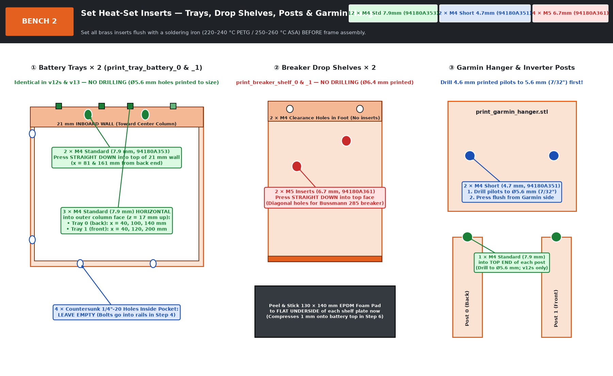

> [!TIP]
> **How to Install Brass Heat-Set Inserts ("Heat-Serts") with a Soldering Iron (Zero Drilling):**
> 1. **Set Temperature:** Set your iron to **`220–240 °C`** for **PETG** (or **`250–260 °C`** for **ASA/ABS**).
> 2. **Tapered End Down (`90°`):** Place the narrow tapered pilot collar of the brass insert into the pre-printed bore (`Ø 5.6 mm` for `M4`, `Ø 6.4 mm` for `M5`). Press straight down (`90°`) with light, steady pressure for `2–3 seconds` until the insert is `~0.5 mm` shy of flush.
> 3. **Flatten Dead Flush (`0 mm`):** Pull the iron straight out and immediately press a flat metal ruler or steel putty knife against the insert face for `3 seconds` so it cools dead flush (`0 mm`) with the plastic surface.

* **① Battery Trays × 2 (`print_tray_battery_0` & `_1` — identical in `v12s` & `v13`, pre-printed `Ø 5.6 mm` bores):**
  * **Press `2 × M4 Standard (7.9 mm)` straight DOWN** into the top of the `21 mm` inboard wall (`x = 81` & `161 mm`).
  * **Press `3 × M4 Standard (7.9 mm)` HORIZONTALLY** into the outer column face of the `21 mm` wall (`z = 17 mm` up; **Tray 0:** `x = 40, 100, 140 mm`; **Tray 1:** `x = 40, 120, 200 mm`).
  * *Leave the 4 countersunk holes inside the battery pocket empty (those take `1/4"-20` rail screws in Step 4).*
* **② Breaker Drop Shelves × 2 (`print_breaker_shelf_0` & `_1` — pre-printed `Ø 6.4 mm` bores):**
  * **Press `2 × M5 (6.7 mm)` straight DOWN** into the two diagonal breaker holes on top of each shelf plate.
  * **Peel and stick the `130 × 140 mm` EPDM foam pad** onto the flat underside of each shelf plate now.
* **③ Garmin Hanger (`print_garmin_hanger`) & Inverter Posts (`print_post_inverter_0..1` — pre-printed `Ø 5.6 mm` bores):**
  * **Garmin Hanger:** Press **`2 × M4 Short (4.7 mm)`** flush into the pre-printed `Ø 5.6 mm` bores from the Garmin side.
  * **Inverter Posts (`v12s` only):** Press **`1 × M4 Standard (7.9 mm)`** flush into the pre-printed `Ø 5.6 mm` top hole of each post.

---

### Bench 3: Inverter Plate Sub-Assembly (Glue 6 Tiles, Set 22 Inserts & Mount Units — No Drilling)

> **🔧 Soldering Iron (`220–240 °C`) + `2.5 mm` & `3 mm` Hex Keys  |  🔩 `14 × M4 Short 4.7 mm` (`94180A351`)  •  `8 × M5 6.7 mm` (`94180A361`)  •  `8 × Splines` + CA Glue**

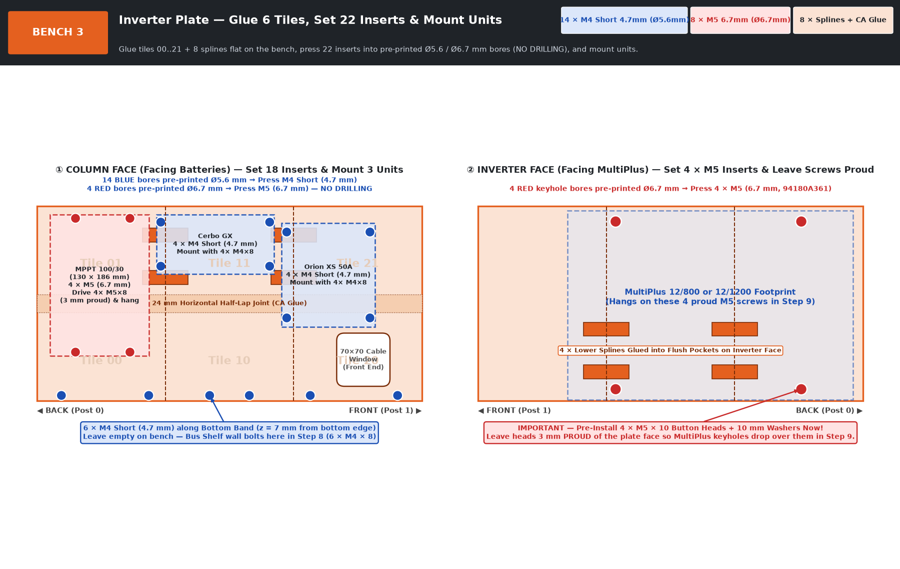

* **① Join the 6 Tiles (`00..21`) + 8 Splines (`plate_inverter_splines.stl`):**
  * Glue the horizontal half-laps with CA glue, and glue **4 splines** into the flush pockets on the **Column Face** (top row) and **4 splines** on the **Inverter Face** (bottom row).
* **② Press the 22 Brass Inserts into Pre-Printed Bores (No Drilling):**
  * **Column Face (`-Y`, facing batteries — 18 inserts):**
    * Press **`14 × M4 Short (4.7 mm)`** into the **14 pre-printed `Ø 5.6 mm` BLUE bores** (`6` along the bottom band, `4` for Cerbo GX, `4` for Orion XS).
    * Press **`4 × M5 (6.7 mm)`** into the **4 pre-printed `Ø 6.4 mm` RED bores** (for MPPT 100/30).
  * **Inverter Face (`+Y`, facing MultiPlus — 4 inserts):**
    * Flip the plate over and press **`4 × M5 (6.7 mm)`** into the **4 pre-printed `Ø 6.4 mm` RED keyhole bores**.
* **③ Pre-Mount Units & Keyhole Screws on the Bench:**
  * **On the Inverter Face:** Drive **`4 × M5 × 10` button heads + `10 mm` washers** into the 4 MultiPlus inserts and **leave the heads `3 mm` proud** (the MultiPlus hooks over these in Step 9).
  * **On the Column Face:** Drive **`4 × M5 × 8` button heads** (`3 mm` proud), hang the **MPPT 100/30** upright (`130 × 186 mm` at `x = 50 mm`) and snug them; bolt down the **Cerbo GX** (`x = 190 mm`, `4 × M4 × 8`) and **Orion XS** (`x = 354 mm`, `4 × M4 × 8`). *(Leave the 6 bottom-band `M4` inserts empty for Step 8.)*

---

### Bench 4: Bus Shelf (`Plates 0 + 1 + 2`) & Garmin Hanger Sub-Assemblies (No Drilling)

> **🔧 Soldering Iron (`220–240 °C`) + `2.5 mm` & `3 mm` Hex Keys  |  🔩 `6 × M5 6.7 mm` Inserts (`94180A361`)  •  `6 × M5 × 12` Screws + `2` Washers  •  `2 × M4 × 10` Screws**

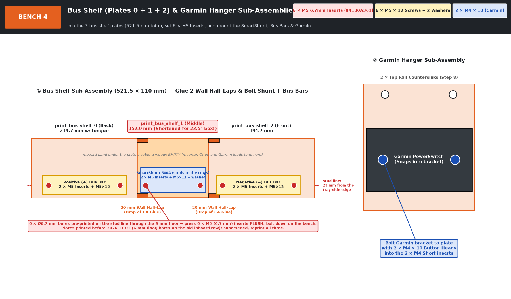

* **① Bus Shelf Sub-Assembly (`521.5 × 110 mm` total):**
  * Fit **`print_bus_shelf_0` (`214.7 mm`, back)** + **`print_bus_shelf_1` (`152.0 mm`, shortened middle plate for the `22.5 in` box)** + **`print_bus_shelf_2` (`194.7 mm`, front)** together on the bench and tack the two `20 mm` vertical-wall half-laps with a drop of CA glue.
  * Press **`6 × M5 (6.7 mm)` inserts** flush into the 6 pre-printed `Ø 6.4 mm` floor bores (`2` on Plate 0 for `+` Bus Bar, `2` on Plate 1 for SmartShunt, `2` on Plate 2 for `−` Bus Bar), and bolt the **SmartShunt 500A** and **two 5-stud bus bars** down with **`6 × M5 × 12` button heads** (use `M5` washers on the SmartShunt).
* **② Garmin Hanger Sub-Assembly (`print_garmin_hanger.stl`):**
  * Bolt the **Garmin PowerSwitch** bracket to the hanger plate with **`2 × M4 × 10` button heads** into the `2 × M4 Short` inserts, then snap the Garmin unit into its bracket.

<details>
<summary><strong>📋 Click to Expand: Complete Master Heat-Set Insert Reference Table (All 46 Inserts — Zero Drilling)</strong></summary>

| Printed Part (STL) | Inserts per Part | Insert Type & McMaster P/N | Pre-Printed Bore | Press Direction & Exact Hole Locations |
| :--- | :--- | :--- | :--- | :--- |
| **Battery Tray 0 (back)** (`print_tray_battery_0.stl`) | **5** (`3` side + `2` top) | **`M4` Standard (`7.9 mm`)** `94180A353` | **`Ø 5.6 mm`** (No drilling) | **• 3 × Column face (`z = 17 mm`):** `x = 40, 100, 140 mm`.<br>**• 2 × Top of `21 mm` wall (`z = 36 mm`):** `x = 81, 161 mm`. |
| **Battery Tray 1 (front)** (`print_tray_battery_1.stl`) | **5** (`3` side + `2` top) | **`M4` Standard (`7.9 mm`)** `94180A353` | **`Ø 5.6 mm`** (No drilling) | **• 3 × Column face (`z = 17 mm`):** `x = 40, 120, 200 mm`.<br>**• 2 × Top of `21 mm` wall (`z = 36 mm`):** `x = 81, 161 mm`. |
| **Breaker Drop Shelves (`×2`)** (`print_breaker_shelf_0..1.stl`) | **2 each** (`4` total) | **`M5` (`6.7 mm`)** `94180A361` | **`Ø 6.4 mm`** (No drilling) | **• 2 × Top face of shelf plate:** Diagonal holes for Bussmann 285 breaker. |
| **Inverter Posts (`×2`)** (`print_post_inverter_0..1.stl`) | **`1` each** (`v12s`) | **`M4` Standard (`7.9 mm`)** `94180A353` | **`Ø 5.6 mm`** (No drilling) | **• 1 × Top end face (`z = 254 mm`):** For top post clip (`v12s` only; `0` in `v13`). |
| **Garmin Hanger Plate** (`print_garmin_hanger.stl`) | **2** | **`M4` Short (`4.7 mm`)** `94180A351` | **`Ø 5.6 mm`** (No drilling) | **• 2 × Garmin face (`-Y`):** `85 mm` apart horizontally. |
| **Inverter Plate Tiles (`00..21`)** (`print_plate_inverter_tile_*.stl`) | **22 total** (`14 × M4` Short + `8 × M5`) | **`14 × M4` Short** `94180A351`<br>+ **`8 × M5`** `94180A361` | **`14 × Ø 5.6 mm`**<br>**`8 × Ø 6.4 mm`** (No drilling) | **• Column Face (`18`):** `6 × M4 Short` bottom sill (`z = 28`), `4 × M5` MPPT, `4 × M4 Short` Cerbo, `4 × M4 Short` Orion.<br>**• Inverter Face (`4`):** `4 × M5` MultiPlus keyholes. |
| **Bus Shelf Plates (`0..2`)** (`print_bus_shelf_0..2.stl`) | **6 total** | **`M5` (`6.7 mm`)** `94180A361` | **`Ø 6.4 mm`** (No drilling) | **• 6 × Floor top (`z = 6 mm`):** `2` on Plate 0 (`+` Bus Bar), `2` on Plate 1 (SmartShunt), `2` on Plate 2 (`−` Bus Bar). |

</details>

---

## 3. Step-by-Step Box Assembly

Work from the top with the lid off. Every fastener is reached from above or along the open center column.

---

### Steps 1 & 2: Assemble Frame, Slide in 4 Panels & Load All 24 Drop-In T-Nuts

> **🔧 Factory Corner-Cube Driver  |  🔩 `8 × Corner Cubes` + `12 × Rails` + `4 × Panels` + `24 × 1/4"-20 Drop-In T-Nuts` (`6000N501`)**

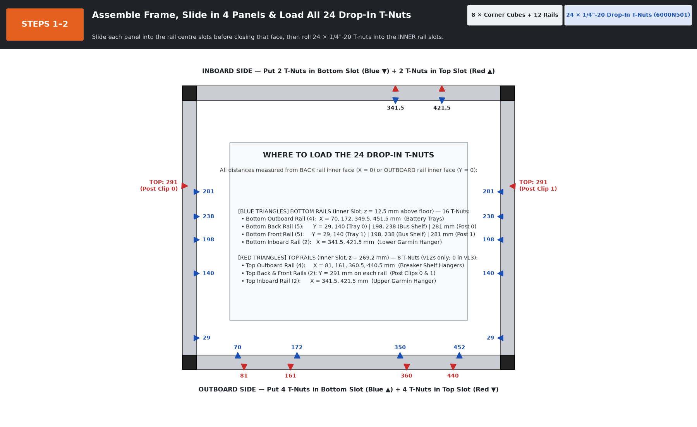

| 3D Step 1: Bare Frame | 3D Step 2: Panels Slid Into Centre Slots |
| :---: | :---: |
| 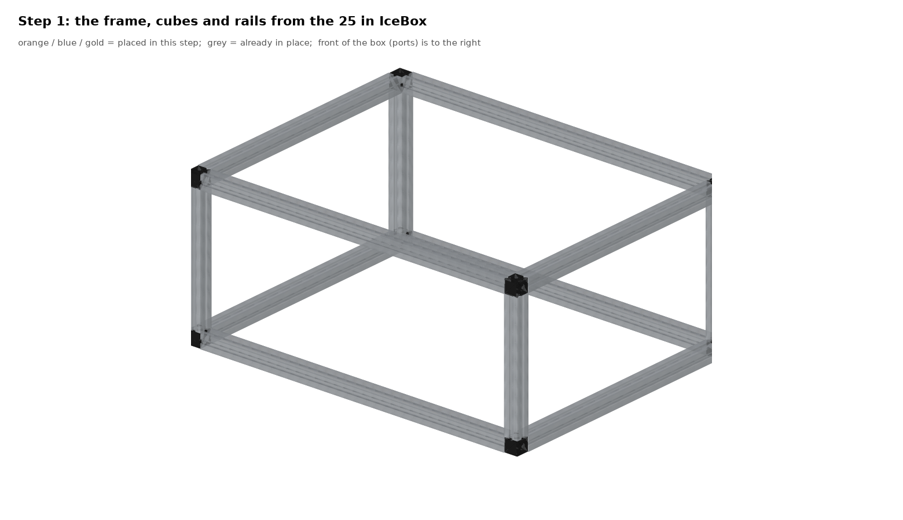 | 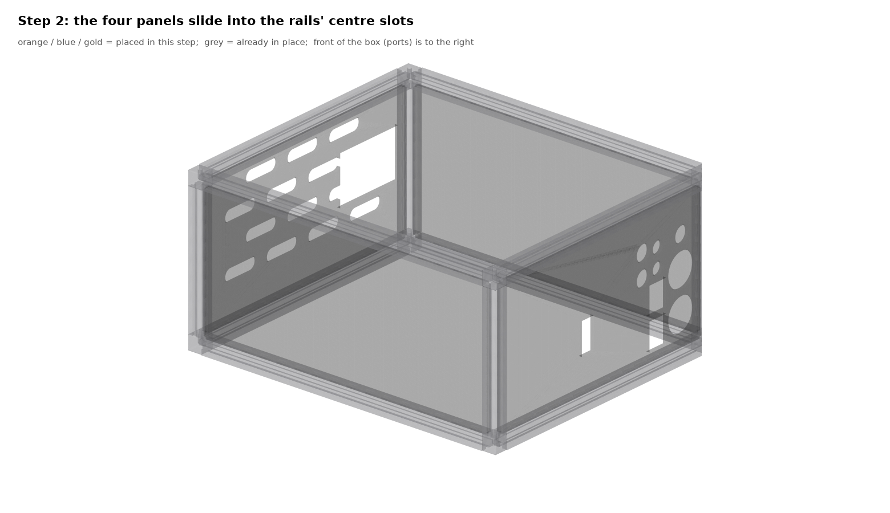 |

* **① Bolt the Frame & Slide in the 4 Panels:** Slide each panel's `3.75 mm` tongues into the rails' centre slots before closing that face (perforated GX Touch panel at **BACK**, port panel at **FRONT** with the port cluster on the **INBOARD** side, solid panels on both sides; leave top lid off).
* **② Load 16 Drop-In T-Nuts into the BOTTOM Rails' Inner Slots (`z = 12.5 mm`):**
  * **Bottom Outboard Rail (`4`):** `X = 70, 172, 349.5, 451.5 mm`
  * **Bottom Back Rail (`5`):** `Y = 29, 140, 198, 238, 281 mm`
  * **Bottom Front Rail (`5`):** `Y = 29, 140, 198, 238, 281 mm`
  * **Bottom Inboard Rail (`2`):** `X = 341.5, 421.5 mm`
* **③ Load 8 Drop-In T-Nuts into the TOP Rails' Inner Slots (`z = 269.2 mm`, `v12s` only):**
  * **Top Outboard Rail (`4`):** `X = 81, 161, 360.5, 440.5 mm`
  * **Top Back & Front Rails (`1 each = 2`):** `Y = 291 mm`
  * **Top Inboard Rail (`2`):** `X = 341.5, 421.5 mm`

<details>
<summary><strong>📐 Click to Expand: Full Part Coordinate & Rail Slot Reference Tables</strong></summary>

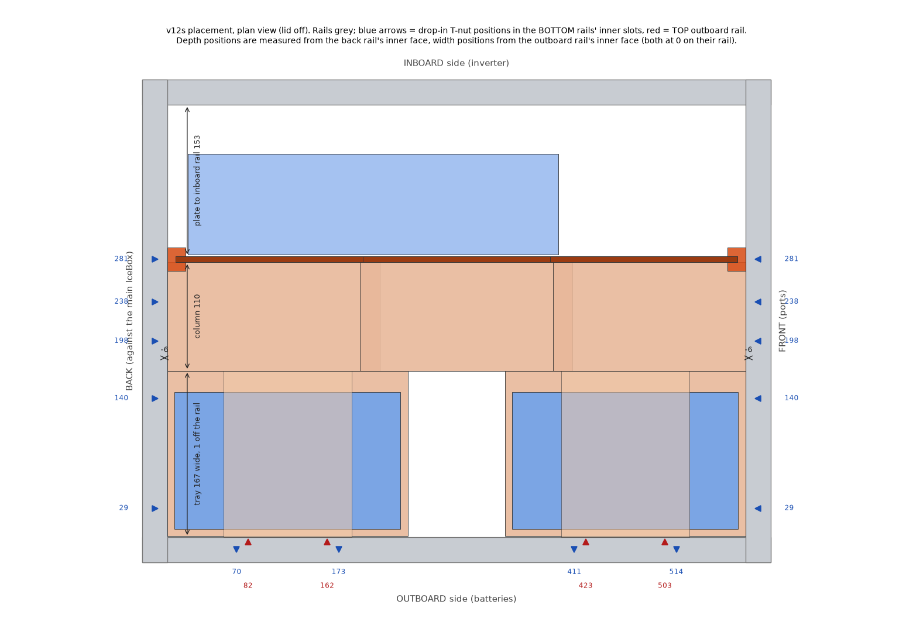

| Part | Depth `X` from Back Rail Face (mm) | Width `Y` from Outboard Rail Face (mm) | Height `Z` (mm) |
|---|---|---|---|
| **Tray 0 (back)** | `0` to `242` (butts back rail) | `1` to `168` | `0` to `36` |
| **Tray 1 (front)** | `279.5` to `521.5` (butts front rail) | `1` to `168` | `0` to `36` |
| **Post 0 / Post 1** | `0` to `18` / `503.5` to `521.5` | `269` to `293` (centre `281`) | `0` to `254` |
| **Drop shelf 0 / 1** | `56` to `186` / `335.5` to `465.5` | `0` to `168` | `36` to `278.7` |
| **Bus shelf plates 0, 1, 2** | `0` to `214.7`, `194.7` to `346.8`, `326.8` to `521.5` | `168` to `278` | `0` to `34` |
| **Inverter plate** | `8` to `513.5` (captured in post slots) | `278` to `284` | `21` to `277` |
| **MultiPlus** | `21` to `395.6` | `286` to `387.3` | `22` to `271` |
| **Garmin hanger (upper & lower)** | `316.5` to `446.5` | `432.1` to `438.1` | `2` to `129`, `130` to `278.7` |

</details>

---

### Step 3: Install the Two Inverter-Plate Posts (`Post 0` & `Post 1`)

> **🔧 `5/32 in` Hex Key  |  🔩 `2 × 1/4"-20 × 7/8 in` Button-Head Screws (`92949A541`)**

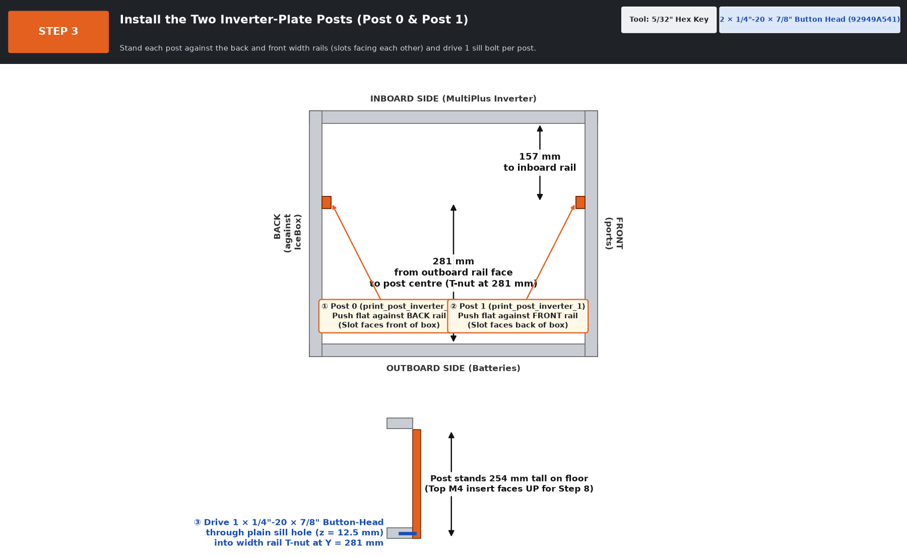

| 3D Isometric View | 3D Top-Down View |
| :---: | :---: |
| 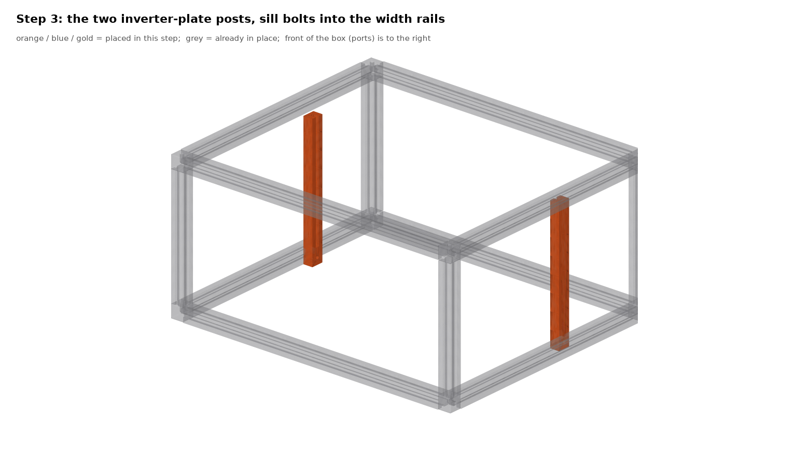 | 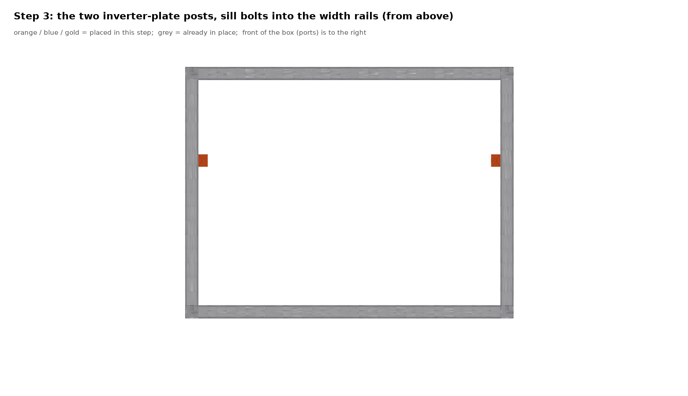 |

* **① Place Post 0 (`print_post_inverter_0`) against the BACK rail** and **② Post 1 (`print_post_inverter_1`) against the FRONT rail**, centred at **`Y = 281 mm`** from the outboard rail (`156 mm` from the inboard rail), with their vertical slots facing each other.
* **③ Drive `1 × 1/4"-20 × 7/8 in` button-head screw** through each post's lower sill hole (`z = 12.5 mm`) into the bottom width rail's T-nut at `Y = 281 mm`.

---

### Step 4: Bolt the Two Battery Trays to the Bottom Rails

> **🔧 `5/32 in` Hex Key  |  🔩 `8 × 1/4"-20 × 1/2 in` Flat-Head Countersunk Screws (`92210A537`)**

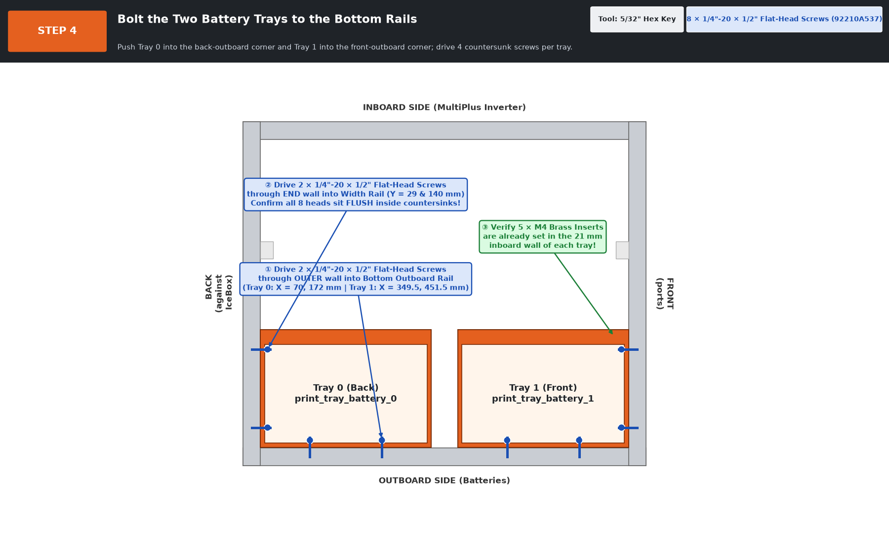

| 3D Isometric View | 3D Top-Down View |
| :---: | :---: |
| 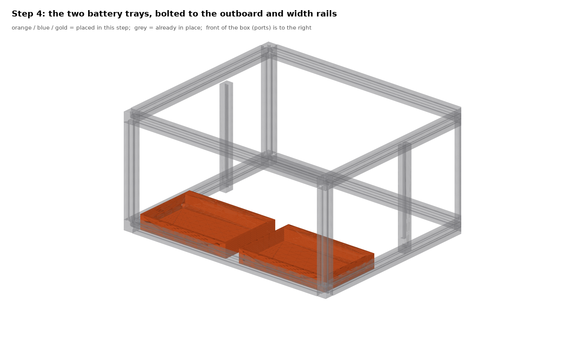 | 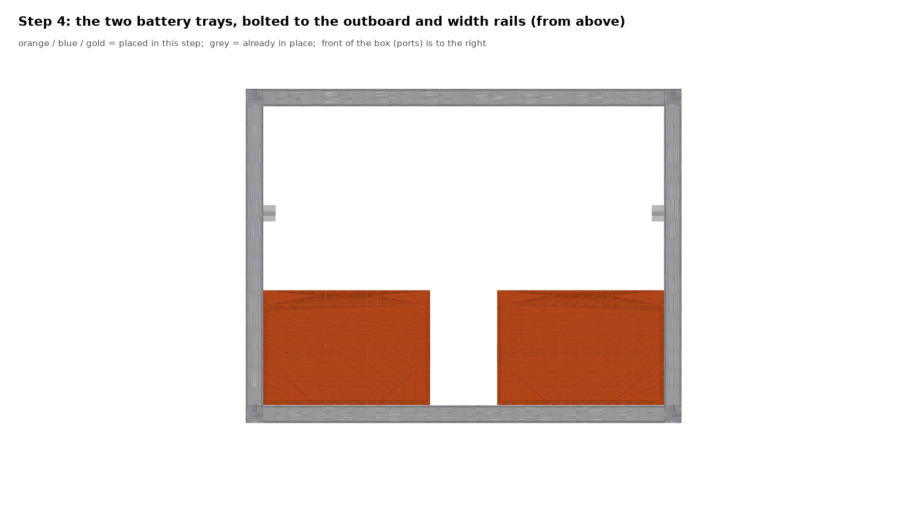 |

* **① Push Tray 0 (`print_tray_battery_0`) into the back-outboard corner** and **Tray 1 (`print_tray_battery_1`) into the front-outboard corner** (`1 mm` off the outboard rail; corner notch clears the corner cube).
* **② From inside each empty pocket, drive `4 × 1/4"-20 × 1/2 in` flat-head screws per tray:**
  * **2 through the outer wall** into the bottom outboard rail (`X = 70, 172 mm` for Tray 0; `X = 349.5, 451.5 mm` for Tray 1).
  * **2 through the end wall** into the bottom back/front width rail (`Y = 29` and `140 mm`).
* **③ Confirm all 8 screw heads sit completely flush** inside their countersinks so nothing touches the battery case.

---

### Steps 5 & 6: Drop In Batteries (Step 5), Then Install Breaker Drop Shelves & Breakers (Step 6)

> **🔧 `2.5 mm`, `3 mm` & `5/32 in` Hex Keys  |  🔩 `4 × M4 × 10` (`92095A190`)  •  `4 × 1/4"-20 × 1/2 in` Flat-Head (`92210A537`)  •  `4 × M5 × 10` + `M5` Washers**

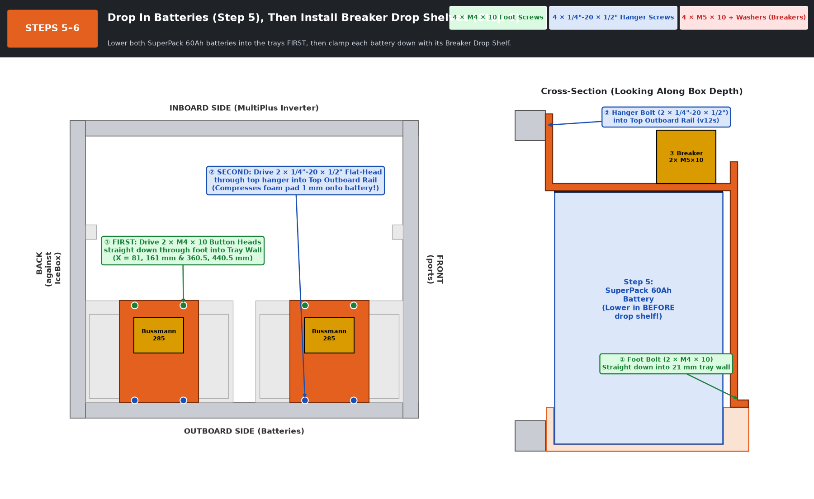

| Step 5: Batteries Lowered Into Trays | Step 6: Drop Shelves & Breakers Installed | Step 6: Top-Down View |
| :---: | :---: | :---: |
| 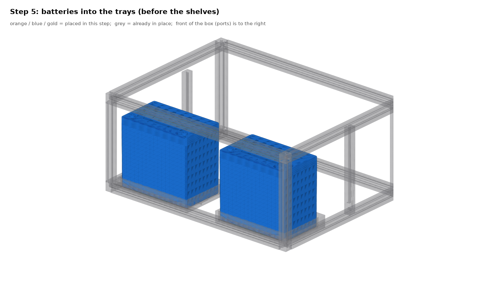 | 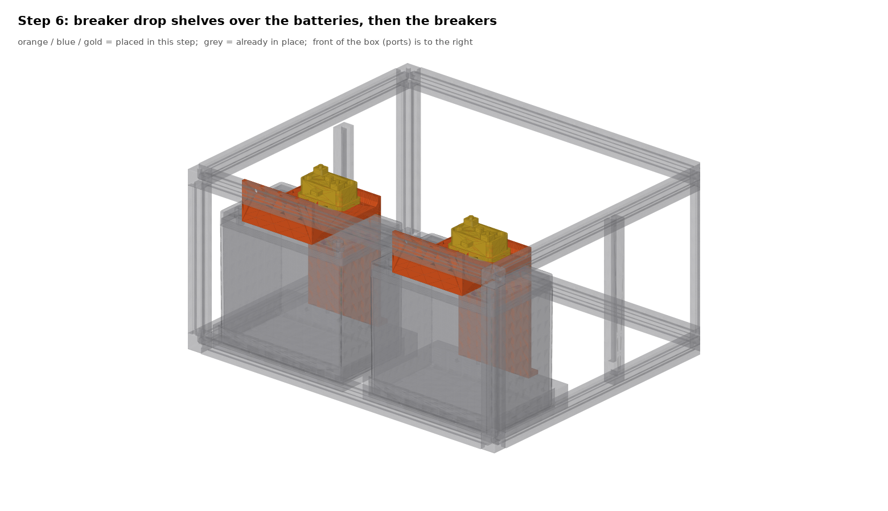 | 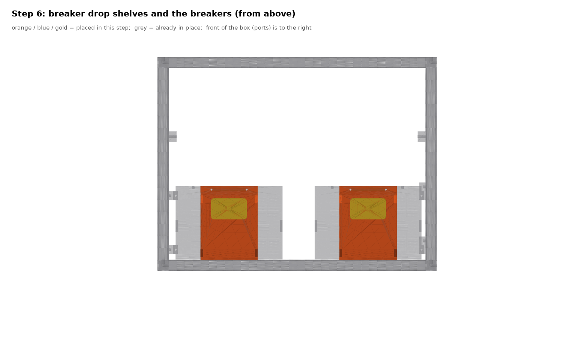 |

* **Step 5 — Lower Both Batteries In FIRST:** Lower each **Victron SuperPack 60Ah** straight down into its tray pocket before installing the shelves (a battery cannot pass under a shelf once installed).
* **Step 6 ① — Bolt the Shelf Feet FIRST (`4 × M4 × 10`):** Set each drop shelf (`print_breaker_shelf_0..1`, with EPDM foam pad underneath) over the middle of its battery and drive **`2 × M4 × 10` button heads** straight down through the inboard foot into the tray wall's top `M4` inserts (`X = 81, 161 mm` and `360.5, 440.5 mm`).
* **Step 6 ② — Bolt the Top Hangers SECOND (`4 × 1/4"-20 × 1/2 in`):** Drive **`2 × 1/4"-20 × 1/2 in` flat-head screws** through each shelf's top hanger into the top outboard rail's T-nuts (`X = 81, 161 mm` and `360.5, 440.5 mm`), compressing the foam pad `~1 mm` onto the battery top.
* **Step 6 ③ — Mount the Breakers (`4 × M5 × 10` + Washers):** Bolt each **Eaton Bussmann 285 breaker** onto the diagonal `M5` inserts on top of the shelf plate (studs facing the center column).

---

### Step 7: Drop In the Assembled Bus Shelf & Bolt to Trays and Width Rails

> **🔧 `2.5 mm` & `5/32 in` Hex Keys  |  🔩 `6 × M4 × 10` Button Heads (`92095A190`)  •  `4 × 1/4"-20 × 1/2 in` Flat-Head Screws (`92210A537`)**

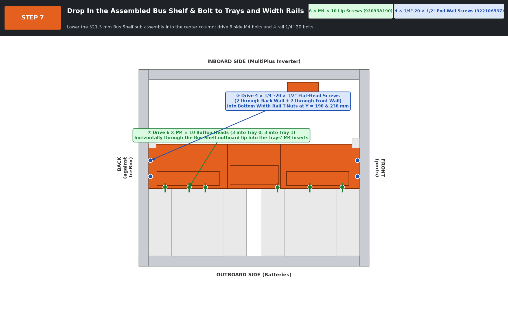

| 3D Isometric View | 3D Top-Down View |
| :---: | :---: |
| 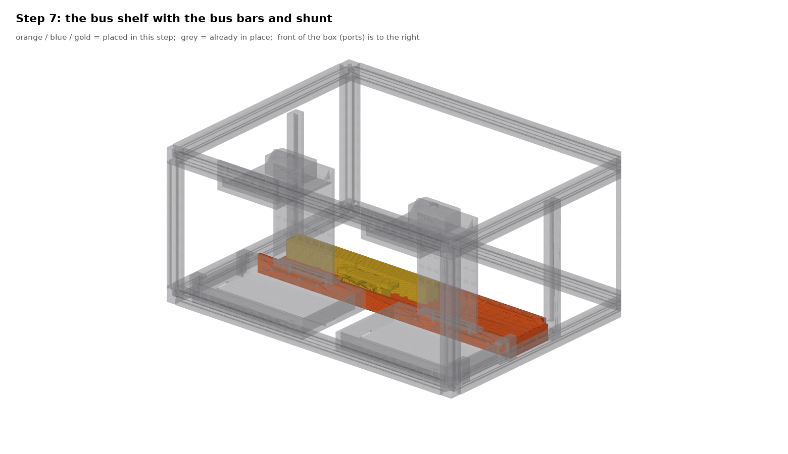 | 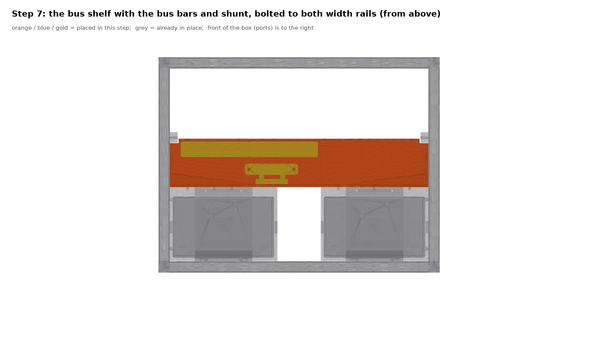 |

* **① Bolt the Outboard Lip to the Trays (`6 × M4 × 10`):** Lower the `521.5 mm` Bus Shelf sub-assembly into the center column and drive **`6 × M4 × 10` button heads** (`3` into Tray 0, `3` into Tray 1) horizontally through the shelf lip into the trays' inboard wall `M4` inserts.
* **② Bolt the End Walls to the Width Rails (`4 × 1/4"-20 × 1/2 in`):** Drive **`2 × 1/4"-20 × 1/2 in` flat-head screws** through the back wall (`Y = 198, 238 mm`) and **`2 × 1/4"-20 × 1/2 in` flat-head screws** through the front wall (`Y = 198, 238 mm`).

---

### Step 8: Slide In Inverter Plate, Bolt Sill & Post Clips, Mount Garmin Hangers

> **🔧 `2.5 mm` & `5/32 in` Hex Keys  |  🔩 `6 × M4 × 8` (`92095A189`)  •  `2 × M4 × 35` (`92095A199`)  •  `2 × 1/4"-20 × 7/8 in` Flat-Head (`92210A541`)  •  `4 × 1/4"-20 × 1/2 in` Flat-Head (`92210A537`)**

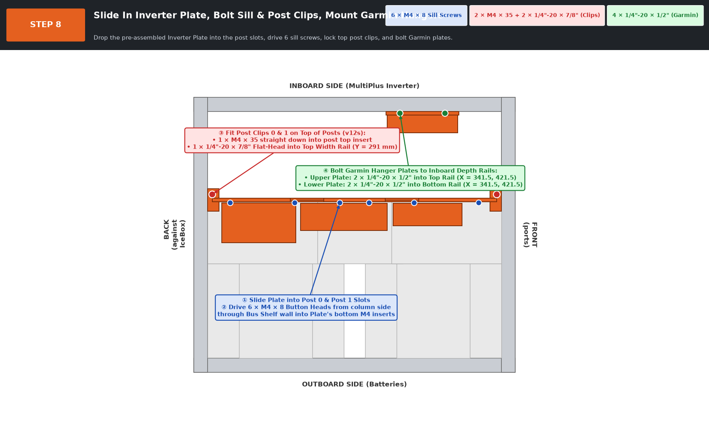

| 3D Isometric View | 3D Top-Down View |
| :---: | :---: |
| 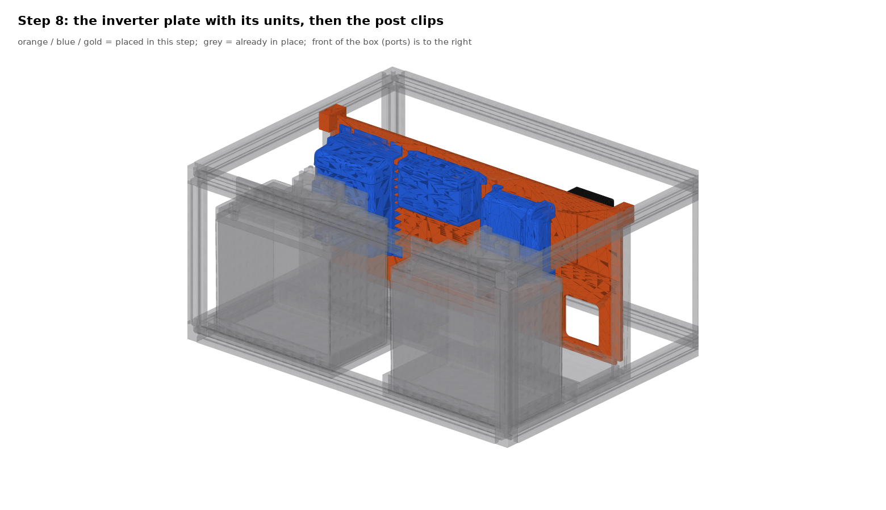 | 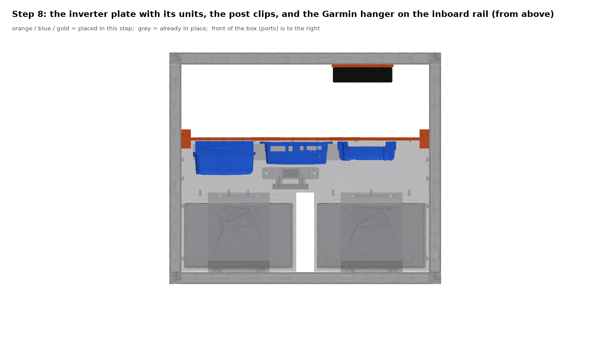 |

* **① Slide the Assembled Inverter Plate Down** into the vertical slots of Post 0 and Post 1 (MPPT, Cerbo GX, and Orion XS facing the center column; 4 proud `M5` keyhole screws facing the inboard lane).
* **② Drive `6 × M4 × 8` Sill Screws:** From the center column, drive **`6 × M4 × 8` button heads** through the bus shelf's `4 mm` inboard wall into the short `M4` inserts along the bottom of the plate (`z = 28 mm`).
* **③ Lock Post Clips 0 & 1 on Top of the Posts (`v12s`):** Set `print_post_clip_0` and `_1` on top of the posts; drive **`1 × M4 × 35` button head** straight down into each post's top insert and **`1 × 1/4"-20 × 7/8 in` flat-head screw** horizontally into the top width rail T-nut at `Y = 291 mm`.
* **④ Bolt the Upper & Lower Garmin Hanger Plates (`4 × 1/4"-20 × 1/2 in`):** In the inboard lane (`X = 341.5` and `421.5 mm`), bolt `print_garmin_hanger` (with Garmin attached) to the **top inboard rail** (`2 × 1/4"-20 × 1/2 in` flat-head) and `print_garmin_hanger_lower` directly below it to the **bottom inboard rail** (`2 × 1/4"-20 × 1/2 in` flat-head).

---

### Step 9: Hang MultiPlus Inverter on Keyholes

> **🔧 `3 mm` Hex Key  |  🔩 `4 × M5 × 10` Keyhole Screws (Pre-installed in Bench 3)**

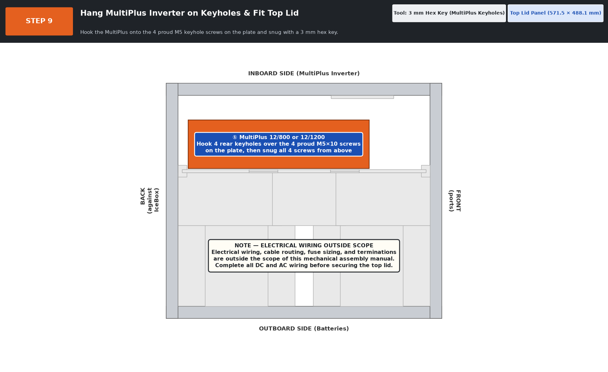

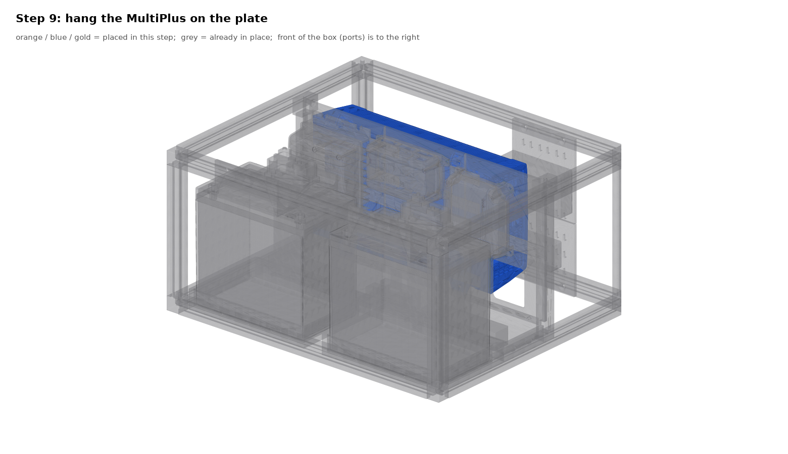

* **① Hang & Snug the MultiPlus:** Lower the **MultiPlus** into the inboard lane (cable end toward the front panel), hook its 4 rear keyholes over the 4 proud `M5 × 10` screws on the plate, and snug all 4 screws with a `3 mm` hex key.
* **⚡ Note — Electrical Wiring Outside Scope:** Electrical wiring, cable routing, fuse sizing, and terminations are outside the scope of the mechanical assembly diagrams. Complete all DC and AC wiring before securing the top lid.

---

### Step 10: Install Panel Ports, GX Touch 50, Branch Wiring & Lid

> **🔧 Phillips / Hex Driver + Zip Ties  |  🔩 `4 × #6 × 1/2 in` Wood Screws (Bezel) + Lid Screws**

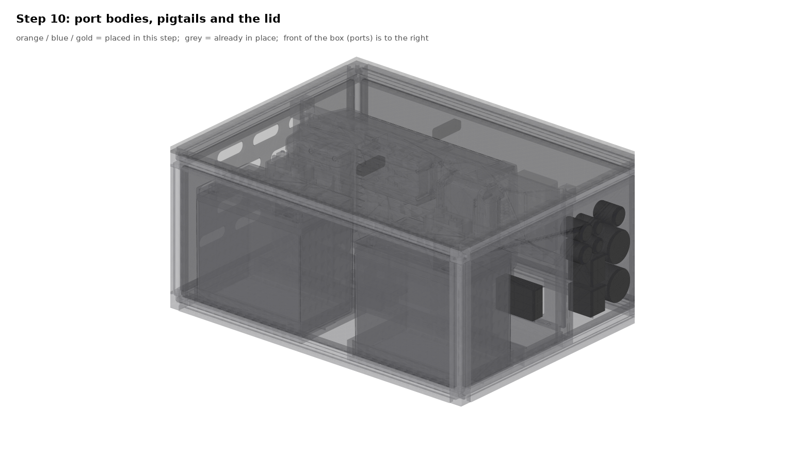

* **① Mount the GX Touch 50 (Back Panel):** Pass the cable through the rear cutout, seat the display with **`print_touch_bezel.stl`** (`4 × #6 × 1/2 in` screws), and plug the HDMI + USB cable into the Cerbo GX.
* **② Mount the 10 Front-Panel Ports & Zip-Tie Harnesses:** Install the two `L14-30`, two `SB50`, `SB175`, three `12V`, and two `USB` sockets into the front panel, complete the branch connections below, and zip-tie harnesses to the 5 rows of slots on the Garmin hanger wall.
* **③ Install the Lid:** Secure the top lid panel (`571.5 × 488 × 6 mm` on top of the rails in `v12s`, or slid into the `z = 266.2..272.2 mm` top-rail slots in `v13`).

### Wiring Schedule

| Circuit / Run | Wire Gauge | Overcurrent Protection | Routing Notes |
|---|---|---|---|
| **Battery `+` → Bussmann 285 → `+` bus bar** (×2) | `4 AWG` | Eaton Bussmann 285 (`285150F` 150 A in hand / `285060F` 60 A same body) | Short vertical lead to drop shelf, then over shelf lip to bus column |
| **Battery `−` → SmartShunt → `−` bus bar** (×2) | `4 AWG` | — | Along tray wall into center column |
| **Bus bars → MultiPlus DC input** | `4 AWG` (`< 1 m`) | Protected by battery breakers | Through `70 × 70 mm` low window in front plate tile |
| **Bus bars → Orion XS output** | `6 AWG` | `60 A` fuse | Up column face of plate to Orion terminals |
| **Alternator (`SB50` inlet) → Orion XS input** | `6 AWG` | `60 A` fuse at starter battery | From front panel through plate window to Orion |
| **Bus bars → SmartSolar MPPT 100/30 battery side** | `10 AWG` | `40 A` fuse | Up column face of plate to MPPT terminals |
| **Solar (`SB50` inlet) → MPPT PV input** | `10 AWG` | Per PV string | From front panel to MPPT PV terminals |
| **Bus `+` → Garmin PowerSwitch** | `10 AWG` | `60 A` fuse | Through plate window to Garmin on inboard hanger |
| **Garmin outputs → 12 V & USB sockets** | `10 AWG` | Garmin per-channel (`30 A` max) | `20–130 mm` run along inboard hanger to front panel |
| **Bus bars → Cerbo GX power** | `16 AWG` | `3 A` inline fuse | Column face of plate |
| **`pack2` umbilical (`SB175` inlet → bus bars)** | `2 AWG` | `150 A` breaker inside `pack2` | Straight back from front-panel `SB175` onto bus bars |
| **Shore AC in / Inverter AC out (`L14-30` × 2)** | `12 AWG` (3-wire) | MultiPlus internal AC breaker | Front panel inboard column straight into MultiPlus AC gland |

---

## 4. The Printed Parts

| | |
|---|---|
| 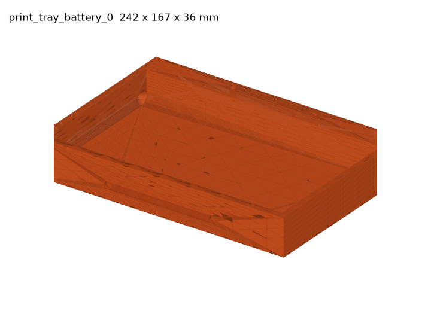 | 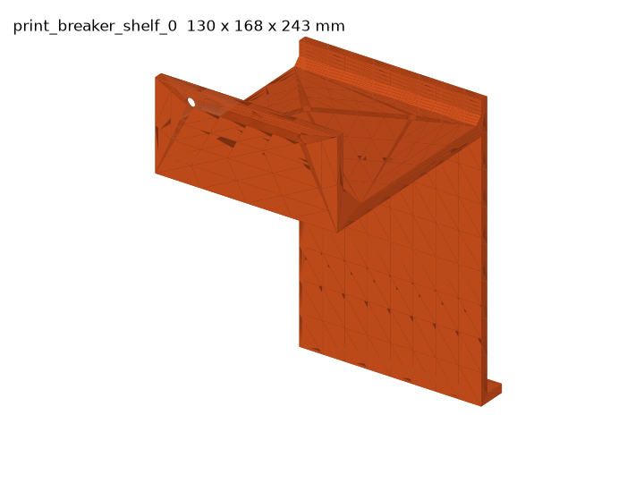 |
| 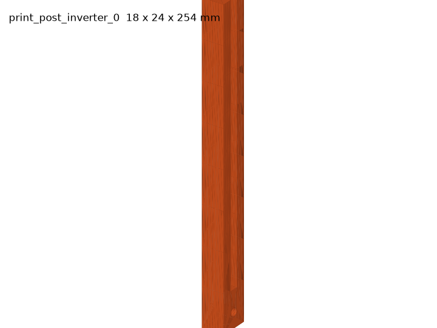 | 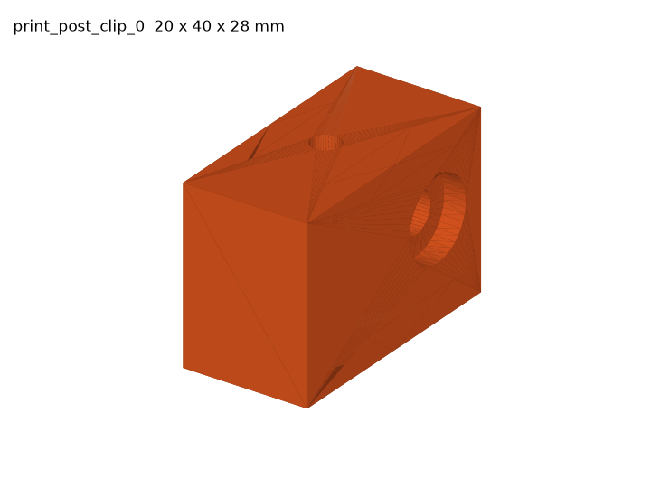 |
| 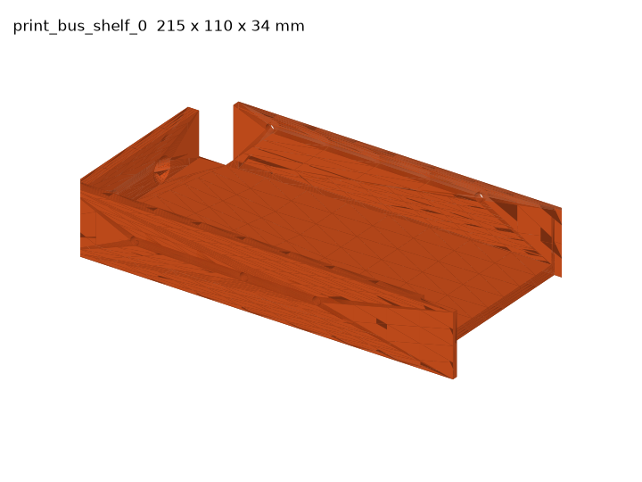 | 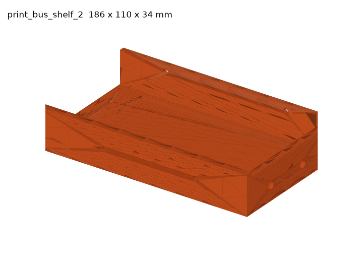 |
| 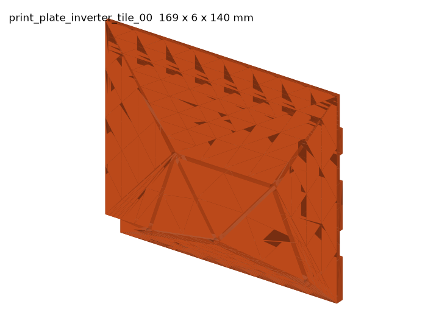 | 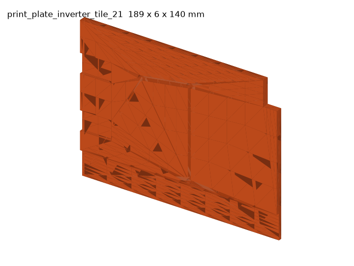 |
| 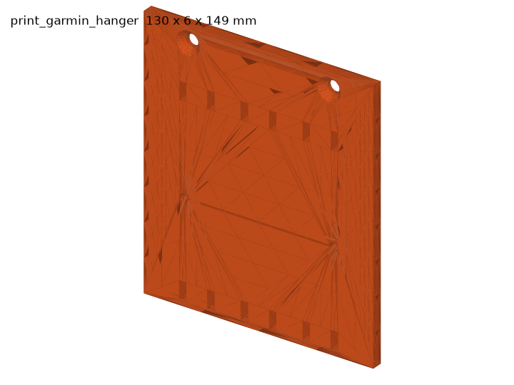 |  |

---

## 5. The Add-On Battery Pack (`pack2`)

Four additional SuperPack 60Ah batteries (`240 Ah`, `120 A` continuous) in a stacked `325 × 314 × 572 mm` all-printed cage connected via the front-panel `SB175` umbilical. Its printable files are in [`stl/pack2/`](stl/pack2/) and its layer breakdown and assembly sequence are in [`README.md` §2](README.md#2-the-add-on-battery-pack-pack2).

---

*To regenerate all step diagrams and placement drawings after any CAD change in [`cad/cage.py`](cad/cage.py), run:*
```bash
cd cad && .venv/bin/python placement.py v12s && .venv/bin/python simple_steps.py v12s && .venv/bin/python manual.py v12s
```
