# 4Runner Electronics Box: Build Manual (v12s)

Step-by-step assembly of the v12s box: the frame of a 25 in Goose Gear IceBox 1.3 cut down to 282 mm tall, holding a MultiPlus 12/1200-class inverter and two Victron SuperPack 60Ah, with the charge gear on a printed plate and one Bussmann 285 breaker over each battery. Every diagram is rendered from the CAD model (`cad/cage.py`, variant `v12s`), so what you see is what the STLs produce. Parts placed in a step are shown in colour; parts already in place are grey. The front of the box, with the ports, is on the right in every picture.

Outer size: **635 × 487 × 282 mm (25.0 × 19.2 × 11.1 in)**. Loaded weight about 42 kg: frame 15, batteries 15, inverter 8, prints and gear 4.

**Before you start, read these two rules.** They are why every fastener in this manual is reachable.

- The IceBox panels sit in the rails' centre slots, so a rail's top and bottom slots are taken. Every tie to the frame is a horizontal 1/4-20 into a rail's **inner-face slot** through a **drop-in T-nut**, which can be added after the frame is closed.
- There is no loose nut inside the assembled box. Printed parts carry heat-set inserts; the only nuts are the T-nuts in the rails and the lap-joint nuts on parts that are bolted together on the bench first.

---

## 1. What you need

### 1.1 From the second IceBox 1.3 (25 in model)

| Part | Use | Cut |
|---|---|---|
| 8 corner cubes | the box's corners | none |
| 4 width rails, 436.6 mm | front and back, top and bottom | none |
| 4 depth rails, 584.2 mm | sides, top and bottom | none |
| 4 height rails, 508 mm | corners | **cut to 231.2 mm**, one end, re-tap 1/4-20 |

The cut length already allows for the corner cubes: the box is 282 mm (11.1 in) tall outside, a cube is 25.4 mm, and the rail runs between two cubes, so 282 − 2 × 25.4 = **231.2 mm (9.10 in)**. Check: the stock 558.8 mm (22 in) box uses the same cubes and its height rails are 558.8 − 50.8 = 508, which is what you have. Width and depth rails stay as they are.
| 2 side panels | the box's sides | cut to 237 mm tall |
| perforated rear panel | the box's back (against the main IceBox) | cut to 237 mm tall, slots and all |
| one side-panel offcut (635 × 277) | the box's **front panel** | cut to 443 × 237, then the port holes |
| top panel | the lid | none |

Measure an uncut width rail before cutting anything: it should read 436.6 mm. If it does not, the cubes are not 25.4 mm and every number below shifts by the same amount; re-run the model with the real cube size.

### 1.2 Printed parts

All files are in [`stl/v12s/`](stl/v12s/). Click a link, then **Download** on GitHub's file page, and open the file in Bambu Studio (File → Import). Or clone the repo and import the folder. Material for everything: **PETG or ASA**, never PLA (the box sits in a closed truck). 0.2 mm layers, brim on every part.

| Part | Qty | File(s) | Orientation on the bed | Walls / infill | Notes |
|---|---|---|---|---|---|
| Battery tray | 2 | [tray_0](stl/v12s/print_tray_battery_0.stl), [tray_1](stl/v12s/print_tray_battery_1.stl) | flat, floor down | 5 / 40 % (100 % floor is cheap insurance) | 255 × 167 × 36. They differ only in which end carries the bracket pads: tray 0 at the back, tray 1 at the front |
| Tray rail bracket | 4 | [00](stl/v12s/print_tray_rail_bracket_00.stl), [01](stl/v12s/print_tray_rail_bracket_01.stl), [10](stl/v12s/print_tray_rail_bracket_10.stl), [11](stl/v12s/print_tray_rail_bracket_11.stl) | as modelled, vertical leg down | 5 / 50 % | 0x fit tray 0 at the back rail, 1x fit tray 1 at the front rail |
| Breaker drop shelf | 2 | [shelf_0](stl/v12s/print_breaker_shelf_0.stl), [shelf_1](stl/v12s/print_breaker_shelf_1.stl) | **on its side**, the 130 mm edge vertical: every wall then prints upright, no supports | 4 / 40 % | 130 × 168 × 243, ~400 g each. Never flat: the leg would be 189 mm of overhang |
| Bus shelf plate | 3 | [0](stl/v12s/print_bus_shelf_0.stl), [1](stl/v12s/print_bus_shelf_1.stl), [2](stl/v12s/print_bus_shelf_2.stl) | flat | 4 / 30 % | 177 × 110 × 34. Plate 2 has the front wall and bolts into the front rail |
| Inverter plate tile | 6 | [00](stl/v12s/print_plate_inverter_tile_00.stl), [01](stl/v12s/print_plate_inverter_tile_01.stl), [10](stl/v12s/print_plate_inverter_tile_10.stl), [11](stl/v12s/print_plate_inverter_tile_11.stl), [20](stl/v12s/print_plate_inverter_tile_20.stl), [21](stl/v12s/print_plate_inverter_tile_21.stl) | flat on the face | 4 / 30 % | 179 × 140 × 6. First digit = column from the back, second = row from the bottom. Pilot holes for every unit are in them |
| Plate spline | 6 | [v1_85](stl/v12s/print_plate_inverter_spline_v1_85.stl), [v1_149](stl/v12s/print_plate_inverter_spline_v1_149.stl), [v1_213](stl/v12s/print_plate_inverter_spline_v1_213.stl), [v2_85](stl/v12s/print_plate_inverter_spline_v2_85.stl), [v2_149](stl/v12s/print_plate_inverter_spline_v2_149.stl), [v2_213](stl/v12s/print_plate_inverter_spline_v2_213.stl) | flat | 3 / 100 % | 60 × 18 × 3, all identical: print six of one. Glued; they and the units hold the tiles, there are no lap bolts |
| Inverter post | 2 | [post_0](stl/v12s/print_post_inverter_0.stl), [post_1](stl/v12s/print_post_inverter_1.stl) | **on a side** | 5 / 50 % | 254 × 24 × 18. Mirror pair: 0 at the back rail, 1 at the front |
| Post clip | 2 | [clip_0](stl/v12s/print_post_clip_0.stl), [clip_1](stl/v12s/print_post_clip_1.stl) | as modelled | 5 / 50 % | 40 × 24 × 28, mirror pair |
| **Tool:** rail-end tap guide | 1 | [tap_guide](stl/v12s/print_tool_tap_guide.stl) | pocket up | 4 / 100 % | 46 × 46 × 32 cap that fits over the 1 in rail end with a 6.5 mm bore in line with the rail's centre hole: starts the 1/4-20 tap square and centred. Print this first |

About 2.5 kg of filament, 35 hours. Pictures of each part are in [section 4](#4-the-printed-parts).

### 1.3 Hardware

| Item | Qty (buy) | Where it goes |
|---|---|---|
| Drop-in (roll-in) 1/4-20 T-nuts for 1 in 10-series slot | 18 (20) | every tie into a rail's inner slot |
| 1/4-20 × 3/4 in flat-head (countersunk) screws, stainless | 18 (20) | with the T-nuts: trays 4, brackets 4, post sills 2, clips 2, bus shelf front wall 2, drop-shelf hangers 4 |
| M4 heat-set inserts, 7.9 mm (94180A353) | 16 (50) | the thick parts: tray pads 4, tray inboard walls 6, tray wall tops 4, post tops 2 |
| M4 heat-set inserts, **short** (94180A351, under 6 mm) | 16 (25) | the 6 mm plate: bottom band 6, Cerbo 4, Orion 4, Garmin 2 |
| M4 × 10 button-head screws | 32 (40) | into those inserts |
| M5 heat-set inserts, 6.7 mm (94180A361) + M5 × 12 button heads + M5 washers | 20 (50) | MPPT 4, bus bars 4, **inverter keyholes 4** (washer under the head, left 3 mm proud), **breakers 4**, **shunt 2**. M6 inserts are too long for a 6 mm plate, so everything that was M6 is M5 with a washer |
| CA glue | | the six splines and the half-laps, which locate only |
| 3 mm closed-cell EPDM foam, adhesive-backed, 130 × 140 | 2 | glued under each drop shelf's plate: the shelf is the battery hold-down |
| 1 in cam straps, 1.5 m | 2 | optional: through the tray's floor groove under the shelf, if you want a belt as well as the braces |

Plus the electrical parts on the component list in `components.md`: MultiPlus, two SuperPack 60Ah, two Bussmann 285060F breakers, two 5-stud bus bars, SmartShunt, MPPT 100/30, Cerbo GX, Orion XS, Garmin PowerSwitch, two L14-30 panel inlets, two SB50 and one SB175 panel inlets, three 12 V and two USB sockets, and the cable in section 3.

### 1.3a McMaster-Carr order

A click-through version with a direct link per line and an Order Pad block is in [manual/mcmaster-order.md](manual/mcmaster-order.md).

One order covers every fastener, insert and tapping tool in this manual. Part numbers marked **verified** were checked against McMaster listings on 2026-10-20; the others are the right catalogue line but confirm the length or type on the product page before adding to the cart (McMaster's part numbers change with length, and a 1 in screw where 3/4 in is specified bottoms out in the rail slot).

| Item | McMaster part | Qty needed | Pack |
|---|---|---|---|
| M4 × 0.7 brass heat-set insert for plastic, 5.25 mm hole | **94180A353** (verified) | 32 | 50 |
| M5 × 0.8 brass heat-set insert, 6.7 mm long | **94180A361** (verified) | 8 | 25 |
| M4 × 0.7 brass heat-set insert, **short**, for the 6 mm plate | 94180A351 (confirm installed length under 6 mm) | 16 | 25 |
| M4 × 10 button-head hex-drive screw, 18-8 | **92095A190** (verified) | 32 | 100 |
| (M4 locknuts 93625A150 were ordered before the lap bolts were dropped; spare) | | | |
| M5 × 12 button-head screw, 18-8 | **92095A210** (verified) | 18 | 50 |
| M5 flat washer, 18-8, 10 mm OD | **93475A240** (verified) | 10 | 100 |
| (M6 × 12 button heads 92095A226 were ordered; they are spare: nothing in the box takes M6 any more) | | | |
| 1/4"-20 × 3/4 in flat-head (82°) hex-drive screw, 18-8 | 92210A540 (confirm it reads 3/4 in; 92210A542 is the 1 in, too long) | 18 | 25 or 50 |
| 1/4"-20 **drop-in** T-slot nut for 1 in (10-series) framing | McMaster "T-slotted framing drop-in fastener nut, 1 in, 1/4"-20"; 47065T142 is the **end-feed** economy nut and will not do. The 80/20 equivalent is **#3382** | 18 | 25 |
| 1/4"-20 HSS spiral-point (gun) tap, plug | "Spiral-point taps, 1/4"-20, high-speed steel" | 1 | |
| T-handle tap wrench for 1/4 in taps | "T-handle tap wrenches, 1/16 to 1/4 in" | 1 | |
| Tap guide block | "Tap guides" (the hardened block with graded holes, #0 to 5/8 in) | 1 | |
| Tapping fluid for aluminium | Tap Magic Aluminum, 4 oz | 1 | |
| #7 (0.201 in) jobber drill, HSS | only if the bore measures under 5.0 mm | 1 | |
| Cyanoacrylate, medium viscosity | for the six splines | 1 | |
| 1 in cam-buckle strap, 5 ft or longer | 2 | | |

Not from McMaster: the 285 breakers' M6 stud hardware comes fitted; the IceBox's own corner-cube screws re-use.

### 1.4 Tools

Hex keys 2.5, 3, 4 and 5 mm plus 5/32 in for the 1/4-20 flat-heads; a soldering iron with insert tips; caliper and a small square; a non-ferrous mitre blade (Diablo D1084L) or bandsaw, a disc sander or mill file; a 1/4-20 tap with its handle (the Milwaukee SAE tap-and-die set's plug tap works: back it out a quarter turn every half turn and clear the chips twice, and never use the die), cutting fluid, and the **printed rail-end tap guide** above instead of a guide block; a 6 mm and a 60 mm hole saw and a step drill for the front panel ports; crimper and heat gun for the lugs.

**Panel cuts.** The same Diablo D1084L cuts the panels: an 80-tooth triple-chip blade leaves a chip-free edge on the phenolic-faced ply panels. Rip the panels on the table saw against the fence (every panel cut is a long straight rip), good face up, masking tape over the line, a sacrificial sheet of hardboard under the cut, blade just above the panel, and a steady feed without stopping. Cut 1 mm proud and sand to the line on the front panel so its edges drop into the rail slots. Port holes: hole saw or step drill for the round sockets; the L14-30 and SB175 rectangles get their corners drilled and the sides cut with a fine jigsaw blade.

---

## 2. Bench work

Everything in this section happens before the box is assembled, where nuts, clamps and the soldering iron are easy to use.

### 2.1 Cut and tap the height rails

Follow the README's [cutting and tapping guide](README.md#rail-cutting). Four cuts, 508 → 231.2 mm, one end of each rail only. To tap: slide the printed tap guide cap over the squared rail end, oil the tap, start it through the cap's bore so it is square and centred on the rail's hole, and cut 30 mm deep, backing off every half turn to break the chip. The four 276.8 mm offcuts are your tapping practice; do all four before a real rail. Dry-fit the bare frame and check the diagonals.

### 2.2 Cut the panels

The two side panels and the perforated rear panel cut to 237 mm tall. The front panel comes from one side-panel offcut: 443 × 237. Its port holes, measured from the panel's **inboard** edge (the edge toward the main IceBox) and its bottom edge, hole centres:

| Port | From inboard edge | From bottom | Hole |
|---|---|---|---|
| L14-30 shore inlet | 39 | 50 | 60 mm |
| L14-30 inverter outlet | 39 | 120 | 60 mm |
| 12 V socket | 39 | 175 | 29 mm |
| SB50 solar inlet | 92 | 40 | 48 × 37 rectangle |
| SB50 alternator inlet | 92 | 96 | 48 × 37 rectangle |
| USB socket | 92 | 140 | 22 mm |
| USB socket | 92 | 173 | 22 mm |
| 12 V socket | 124 | 135 | 29 mm |
| 12 V socket | 124 | 175 | 29 mm |
| SB175 inlet for pack2 | 247 | 88 | 26 × 56 rectangle |

These are the model's positions, measured from the panel's inboard edge (box y 462) and its bottom tongue edge (box z 22); the two outer-column sockets clear the inverter-plate post behind them by 2.5 mm, so drill those two exactly.

### 2.3 Inserts

Set every insert with the iron before anything is assembled; the table in 1.3 says where. Pilot holes are printed; the plate tiles print all pilots at 4.6 mm, so drill those to 5.6 (M4) or 6.4 (M5) first. Use the **short** M4 inserts in the 6 mm plate and the drop shelves, the 7.9 mm ones in the thick parts; nothing in a 6 mm part takes an M6 insert.

### 2.4 Bus shelf sub-assembly

Lay the three plates out on their 20 mm floor half-laps, plate 0 at the back, plate 2 with the front wall at the front, and tack each lap with a drop of CA. There are no bolts across the laps: once in the box each plate is bolted to the trays through its lip and to the inverter plate through its wall, so the laps only locate. Mount the two bus bars on their M5 inserts in the row nearest the inverter plate and the SmartShunt on its M5 inserts (washers under the heads) in the row nearest the trays, and make up the bus-bar-to-shunt link. The result is one 530 mm piece that drops into the box in step 7.

### 2.5 Inverter plate sub-assembly

Lay the six tiles out: columns 0, 1, 2 from the back, rows 0 (bottom) and 1 (top). Each column's two tiles meet on a horizontal half-lap, tacked with CA; the columns join on vertical joints with the splines glued into their pockets on the inverter side. There are no bolts across the laps: the MPPT, Cerbo and Orion each screw into both tiles of their column, which is what holds the laps closed, and the plate's ends sit in the post slots. Set the inserts: six short M4 in the bottom band for the bus shelf wall, and on the **column face** M5 × 4 for the MPPT, short M4 × 4 for the Cerbo, × 4 for the Orion, × 2 for the Garmin; on the **inverter face** M5 × 4 for the keyholes, with M5 × 12 button heads and a 10 mm washer under each driven in and left 3 mm proud, so the keyholes drop over them. Mount the MPPT (upright, terminals down), Cerbo, Orion (terminals down) and Garmin on the column face and dress their short leads. The inverter does not go on yet.

### 2.6 Breaker shelves

Set the two M5 inserts in each shelf plate (the 285's 6.6 mm holes take M5 with a washer). The breakers go on in step 7, in the box.

---

## 3. Assembly, step by step

Work from the top with the lid off. Every fastener is reached with a hex key from above or along the open column. The batteries go in at step 6, before the drop shelves cover them.

### Where everything goes: the placement drawing

Every position below is measured from two reference faces inside the box: **depth** from the inner face of the **back** width rail (the rail against the main IceBox), and **width** from the inner face of the **outboard** depth rail (the battery side). Heights are from the underside of the frame, i.e. the surface the box stands on. Numbers come from the model (`cad/placement.py` regenerates them and the drawing).

**Where the parts sit** (mm, each as a range along the box):

| Part | Depth from the back rail face | Width from the outboard rail face | Height |
|---|---|---|---|
| Tray 0 (back) | 10 to 259 | 1 to 168 | 0 to 36 |
| Tray 1 (front) | 332 to 581 (its front pads 3 mm off the front rail) | 1 to 168 | 0 to 36 |
| Post 0 / post 1 | against the back rail / against the front rail | 269 to 293 (centre 281) | 0 to 254 |
| Brackets 00, 01 (back) | against the back rail, legs reach 21 in | 13 to 33 and 136 to 156 | 0 to 42 |
| Brackets 10, 11 (front) | against the front rail | 13 to 53 and 136 to 176 (the vertical leg is the inboard 20 mm) | 0 to 42 |
| Drop shelf 0 / 1 | 72 to 202 / 389 to 519 (centred on each battery) | 0 to 168 (hanger on the rail, foot on the tray wall) | 36 to 279 |
| Bus shelf plates 0, 1, 2 | 21 to 226, 206 to 412, 392 to 578 (laps overlap 20) | 168 to 278 | 0 to 34 |
| Inverter plate | 8 to 576 (in the post slots) | 278 to 284 | 21 to 277 |
| MultiPlus | 21 to 395 on the plate's inboard face | 286 to 387 | 22 to 271 |

**Where the T-nuts go.** Slide each drop-in nut to the position below, measured along the rail from the same reference faces, then the bolt finds it. The bottom rails' inner slot is at 12.7 mm above the floor, the top rails' at 269.

| Rail | Positions along the rail | For |
|---|---|---|
| Bottom outboard depth rail | 86, 189, 402, 505 from the back | the trays' outer-wall 1/4-20s (two per tray) |
| Top outboard depth rail | 97, 177, 414, 494 from the back | the drop-shelf hangers (two per shelf) |
| Bottom back width rail | 23, 146, 281 from the outboard side | brackets 00 and 01, post 0 sill |
| Bottom front width rail | 43, 166, 198, 238, 281 from the outboard side | brackets 10 and 11, bus shelf front wall (two), post 1 sill |
| Top back width rail | 291 from the outboard side | clip 0 |
| Top front width rail | 291 from the outboard side | clip 1 |

Eighteen nuts. If you load them from the rail ends before the cubes go on instead of dropping them in, put them in these rails in these counts and slide them to the positions once the frame is up.

### Step 1: the frame

Bolt the cubes and rails together with the IceBox's own corner-cube screws, but **before closing each face, slide its panel into the rails' centre slots** (step 2 is part of this step in practice). Drop 18 T-nuts into the inner-face slots as you go, or add them afterwards with the drop-in type: 2 in the top outboard depth rail for each drop shelf (4), 2 in the bottom outboard depth rail per tray (4), 2 in each width rail for the brackets, 2 in each bottom width rail for the post sills, 2 in each top width rail for the clips, 2 in the bottom front width rail for the bus shelf wall. Square the frame by its diagonals before the last cube screws are tightened.

### Step 2: the panels

Perforated panel at the back, side panels each side, the solid front panel with its port holes at the front, each 3 mm into the rail slots top and bottom and into the cube bars at the sides. The lid stays off.

### Step 3: the posts

In plain words: each post stands on the floor of the box, **281 mm in from the outboard rail** (the battery side), measured to the middle of the post, which leaves 156 mm to the inboard rail. Post 0 is pushed hard against the **back** rail, post 1 hard against the **front** rail. The slot in each post faces the other post. One bolt per post, **13 mm up from the floor**, through the post into the T-nut in the rail. That is all for now.

Stand post 0 against the back width rail and post 1 against the front width rail, on the inboard side, slots facing each other. One countersunk 1/4-20 through each post's sill into the bottom rail's T-nut, head on the post's inner face. That is the only fastener a post gets for now: it stands against the rail's face until the plate drops into its slot in step 9, when the clip ties its top into the top rail. The single sill bolt is all the inner slot has room for and all the post needs until then.

### Step 4: the tray brackets

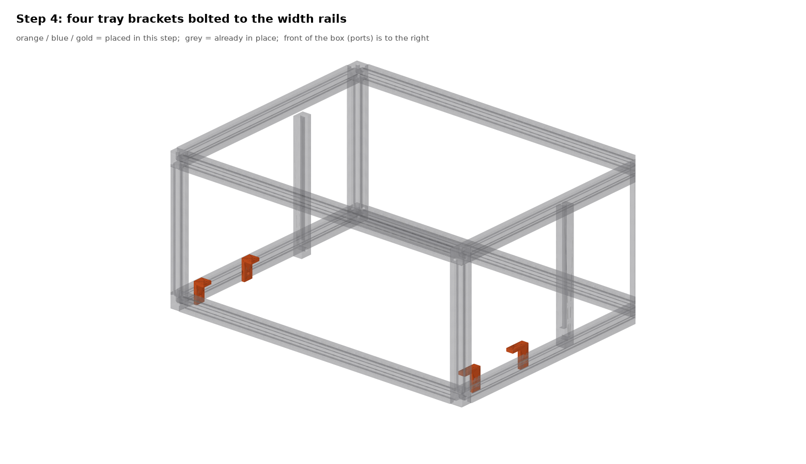
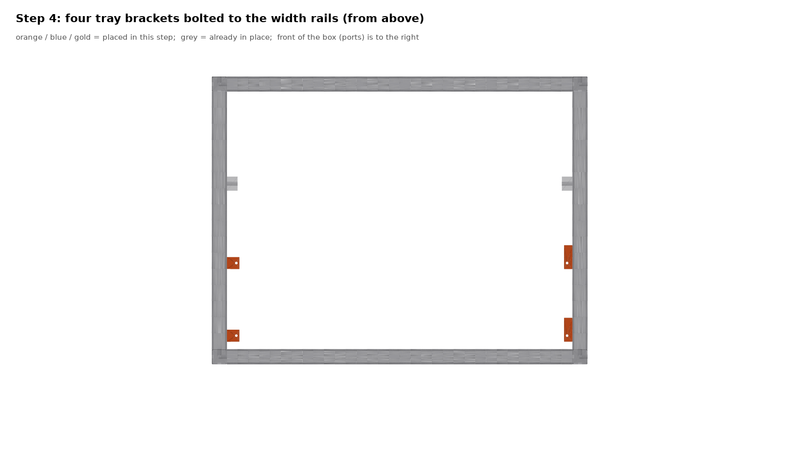

Four L brackets bolt to the width rails **before** the trays go in, because each one's rail bolt faces where the tray will be. Brackets 00 and 01 at the back rail for tray 0, 10 and 11 at the front rail for tray 1; countersunk 1/4-20 into the inner slot, horizontal leg standing 36 mm up, ready for the tray pads. The front brackets stand beside their pad, not over it, because the front pads end 3 mm off the rail.

### Step 5: the trays

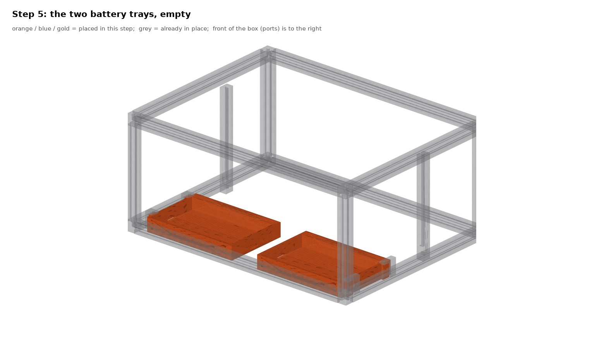
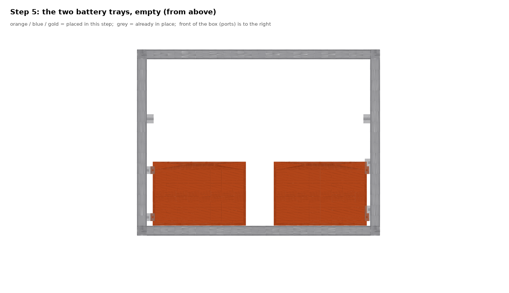

Empty trays. Drop tray 0 into the outboard zone with room to spare, slide it to the back so its pads go under the bracket legs, then two M4 × 10 down through the legs into the pad inserts. Now the two countersunk 1/4-20s through the tray's outer wall into the outboard rail's T-nuts, from inside the empty pocket. Tray 1 the same at the front. Each tray is now tied to a width rail and the outboard rail.

### Step 6: the batteries

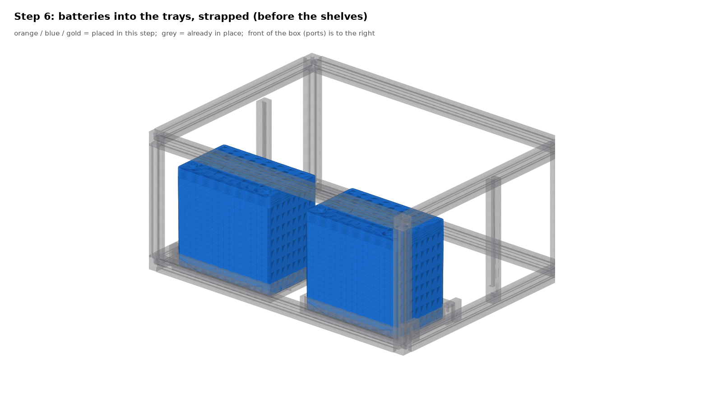

The batteries go in **before** the drop shelves: once a shelf is on, nothing 229 mm long can pass under its plate. Each SuperPack into its tray from above. The drop shelf in the next step is the hold-down, so a strap is optional; if you fit one, run it through the floor groove with the buckle at the battery's end so the middle stays flat. No lugs yet: the leads go on in step 10.

### Step 7: breaker drop shelves

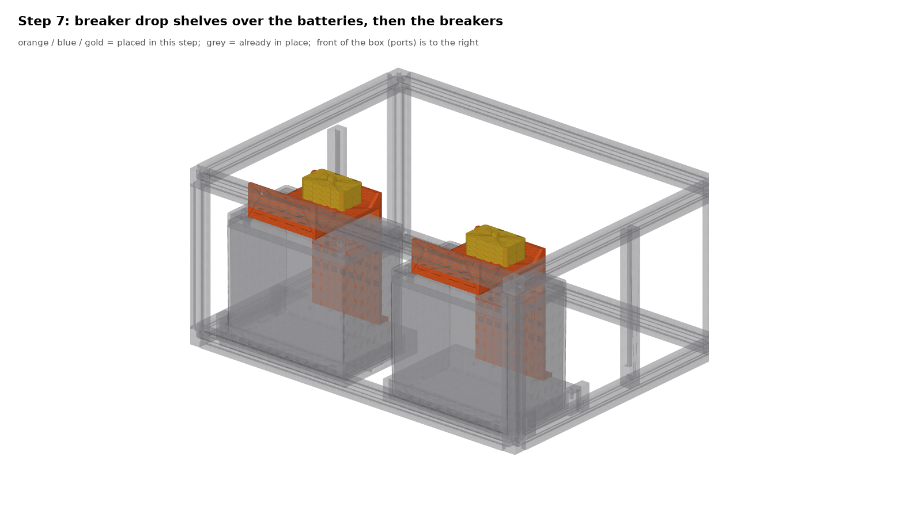
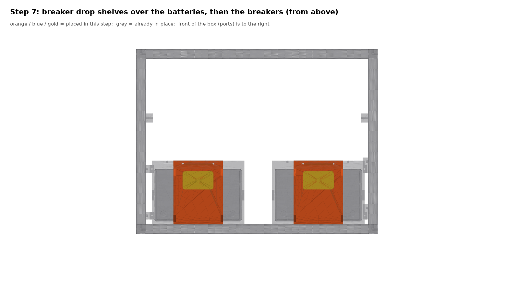

For each battery: glue the 3 mm foam pad to the underside of the shelf plate, then lower the empty shelf over the battery, hanger against the top outboard rail's inner face, foot on the tray's inboard wall beyond the battery. The pad lands on the battery's top and compresses about a millimetre as the four screws go in, so **the shelf is the battery's hold-down**: the battery cannot lift, and the tray walls stop it sliding. The hanger key path at 269 mm clears the lugs' height. Start all four screws by hand: two M4 × 10 down through the foot into the wall-top inserts, two countersunk 1/4-20 through the hanger into the rail's T-nuts. Tighten the foot screws first, then the hanger screws with the key coming along the open box over the empty plate. Then the Bussmann 285 down onto the plate's M5 inserts with washers, studs toward the column.

### Step 8: the bus shelf

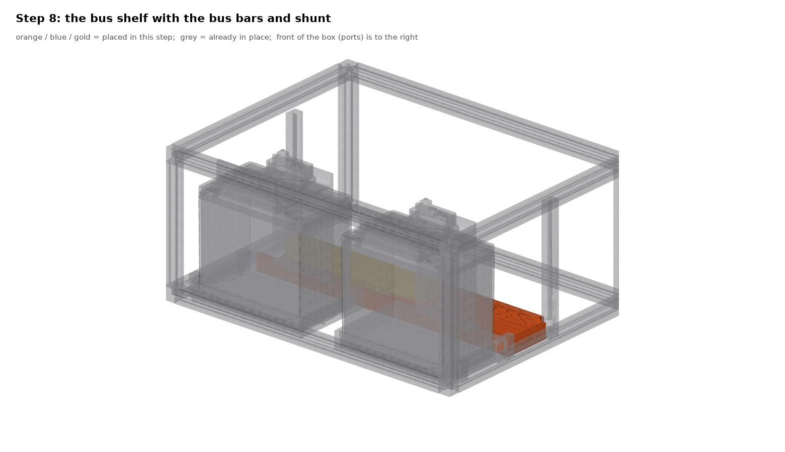
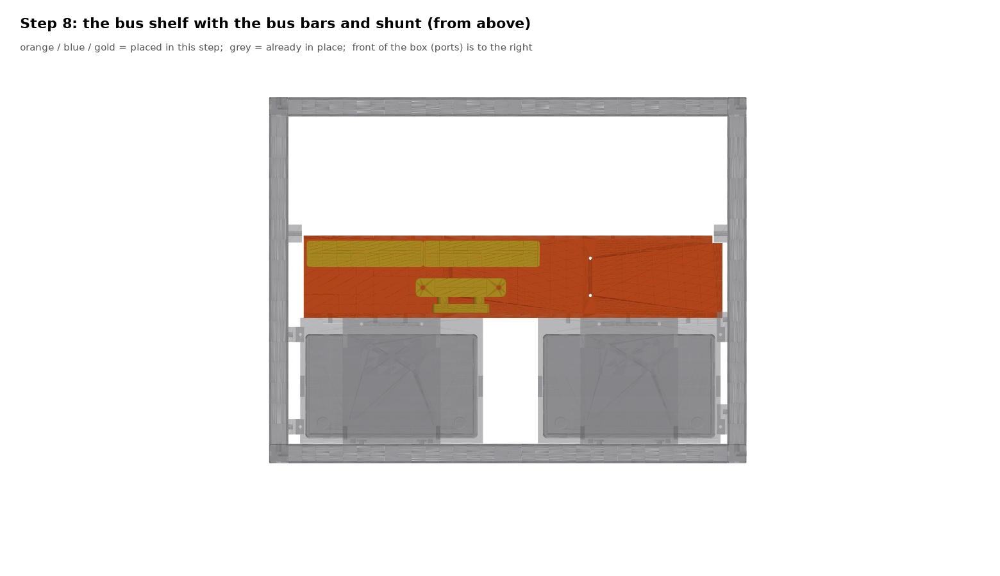

Lower the sub-assembly into the column, lip against the trays' inboard walls. Three M4 × 10 per tray through the lip into the tray wall inserts, driven from the column side (heads in the column). Two countersunk 1/4-20 through the front wall into the front rail's T-nuts, from inside the column.

### Step 9: the inverter plate and clips

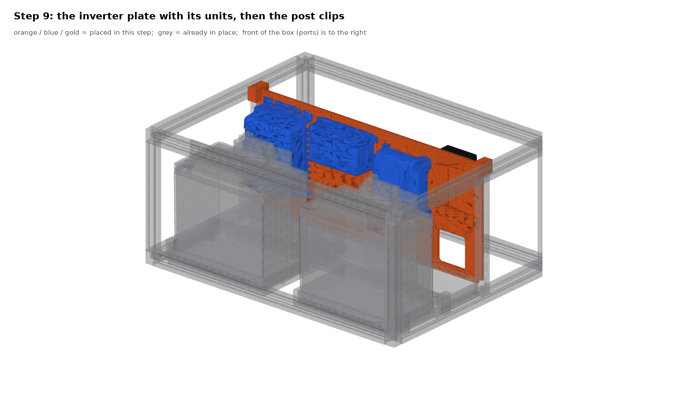
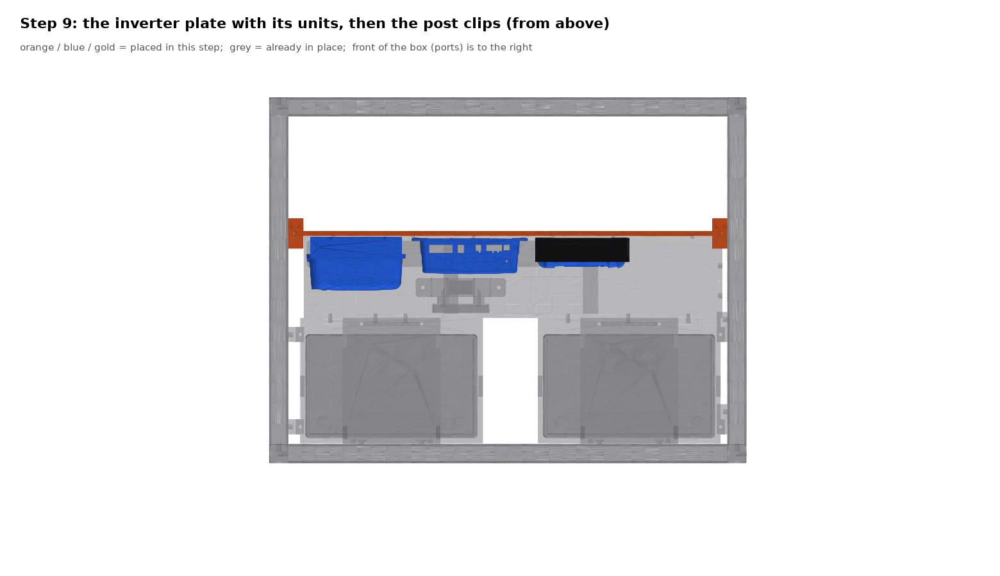

Lower the plate with its units into the two post slots, column face toward the batteries. Its units clear everything on the shelf. The bottom band lands against the bus shelf's inboard wall: six M4 × 10 through that wall into the plate's inserts, from the column side, under the MPPT. Then the two clips: one M4 × 10 down into each post top, one countersunk 1/4-20 into the top width rail's T-nut; the clip's rail bolt sits 10 mm off the plate line so the key passes the plate's edge.

### Step 10: the inverter and the DC leads

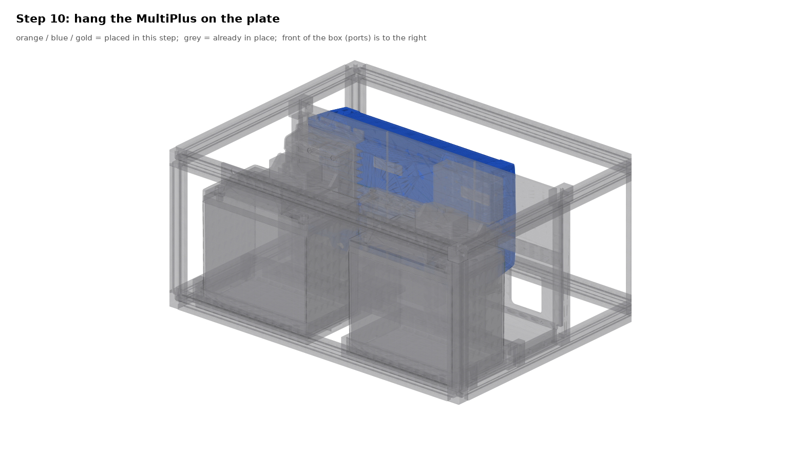

Hang the MultiPlus on its four keyholes over the proud M5 heads and washers, cable end toward the front, and snug the heads. Now the lugs: each battery's positive straight up to its breaker's battery-side stud, 4 AWG from the breaker's other stud over the shelf lip to the positive bus bar; negatives to the shunt's battery side; the MultiPlus DC leads through the plate's low window to the bus bars; AC in and out to the L14-30s beside it. Fit the breaker stud covers.

### Step 11: ports, pigtails and the lid

Port bodies into the front panel from inside, SB50 pigtails to the MPPT and Orion, Garmin outputs through the plate window to the sockets, the SB175 to the bus bars. The IceBox top panel goes on as the lid; with 17 mm between the lid and the truck roof, use flush pulls, not standing handles.

### Wiring

| Run | Cable | Protection |
|---|---|---|
| Battery + → its Bussmann 285 → + bus bar | 4 AWG, short | the 60 A breaker |
| Battery − → shunt → − bus bar | 4 AWG | |
| Bus bars → MultiPlus | 4 AWG, under 1 m | the breakers, 60 A each side |
| Bus → Orion output | 6 AWG | 60 A |
| Alternator → Orion input (SB50) | 6 AWG | 60 A at the start battery |
| Bus → MPPT battery side | 10 AWG | 40 A |
| Solar → MPPT (SB50) | 10 AWG | per string |
| Bus → Garmin PowerSwitch | 10 AWG | 60 A |
| Garmin outputs → sockets | 10 AWG per circuit | Garmin per-channel |
| Bus → Cerbo | 16 AWG | 3 A |
| pack2 umbilical (SB175) | 2 AWG | breaker in the pack |
| Shore in / inverter out | 12 AWG | the MultiPlus AC breaker |

---

## 4. The printed parts

| | |
|---|---|
|  | 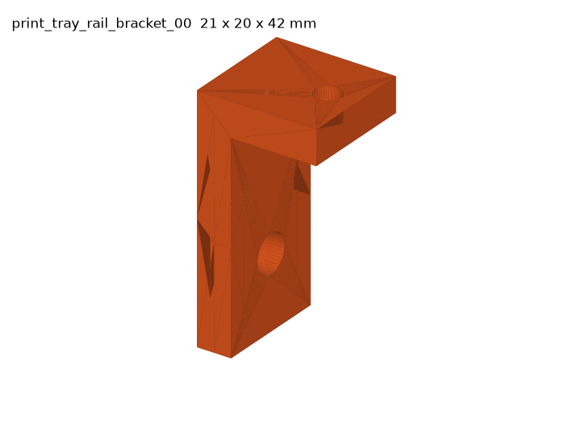 |
| 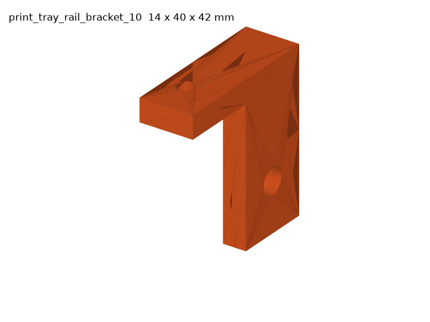 |  |
|  |  |
|  |  |
|  |  |
| 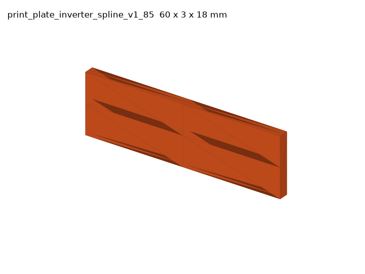 | |

---

## 5. The add-on pack (pack2)

Four more SuperPacks in a stacked all-printed cage on an SB175 umbilical. Its files are in [`stl/pack2/`](stl/pack2/) and its description and assembly order are in the README under pack2. Build the box first; the pack is a separate project with its own parts list.

---

Regenerate the diagrams after any model change with `cd cad && .venv/bin/python manual.py v12s`.
