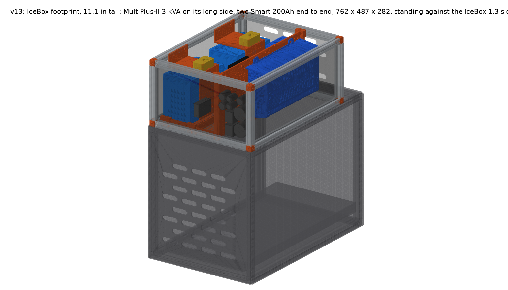
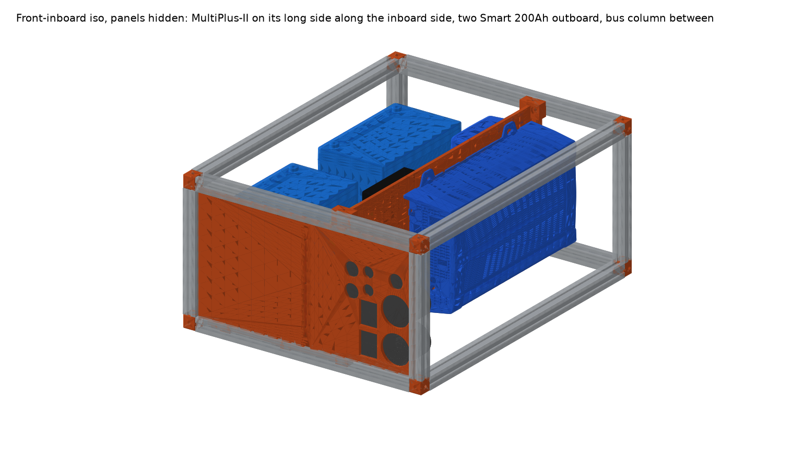
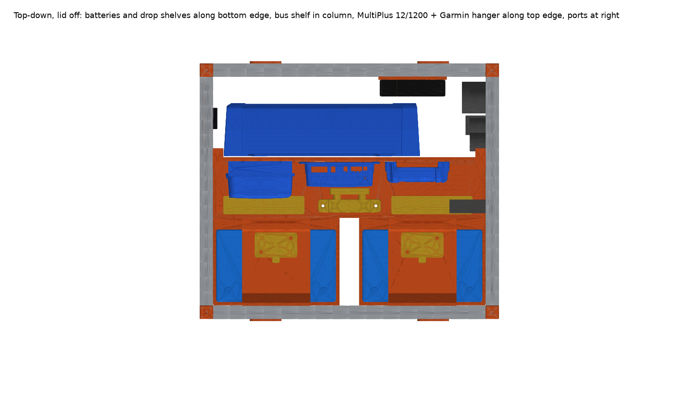
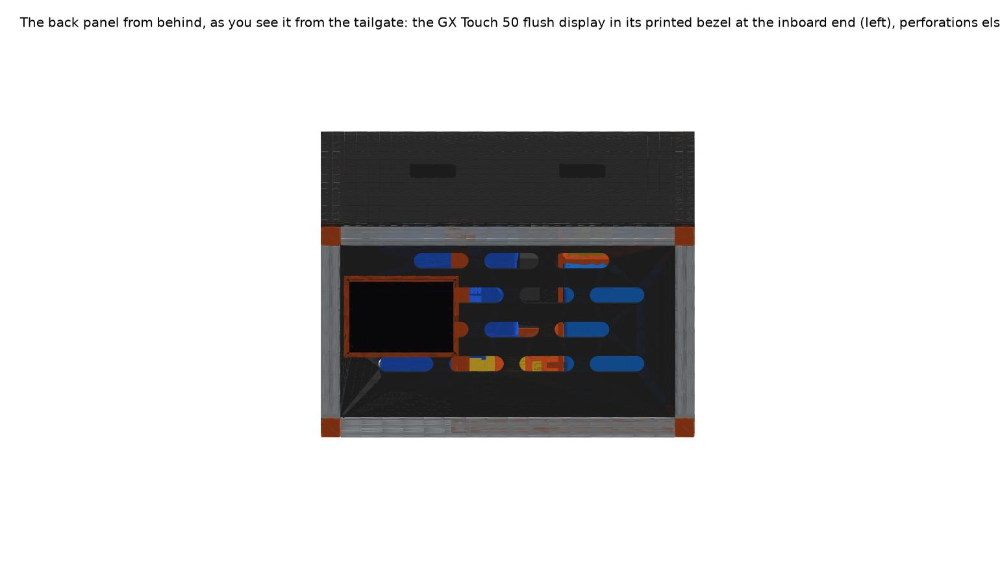

# 4Runner Electronics Box (`v12s` + `pack2`)

**Vehicle:** Toyota 4Runner, Goose Gear plate system  
**Replaces:** the plywood battery box on the plate against the IceBox 1.3 slotted back panel  
**Active Build:** **`v12s`** (main electronics & 2-battery enclosure) + **`pack2`** (4-battery external add-on pack on an SB175 umbilical)

| Resource | Description |
|---|---|
| **[IKEA Visual Guide (`IKEA-MANUAL.md`)](IKEA-MANUAL.md)** | **Picture-first IKEA assembly booklet** (`Steps 0–12` with `H1`–`H11` hardware badges, `P1`–`P10` part codes, and `OK / NO` visual checks) |
| **[Build Manual (`MANUAL.md`)](MANUAL.md)** | **Full step-by-step assembly manual**: donor cut list, rail tapping, print list & settings, heat-set insert map, T-nut placement, port cutouts, and wiring |
| **[Fastener BOM (`manual/mcmaster-order.md`)](manual/mcmaster-order.md)** | Complete McMaster-Carr fastener/insert BOM, direct product links, Order Pad block, and purchase log |
| **[Component Specs (`components.md`)](components.md)** | Dimensions, weights, mounting patterns, and 3D STEP model sources for all Victron, Eaton, Garmin, and Goose Gear parts |
| **[As-Built Audit (`manual/audit-2026-10-30.md`)](manual/audit-2026-10-30.md)** | Metric 25-series frame measurements, rail slot ledger, and pre-assembly verification checks |
| **[Interactive 3D Viewer](https://claude.ai/artifact/6eBbQY1pbboG68gWnnFshe)** | Switch between **v12s**, **pack2**, and **v12s + pack2**; toggle materials and sub-assemblies (local: `cd viewer && python3 -m http.server`, open `http://localhost:8000`) |
| **[Printable STLs (`stl/v12s/`)](stl/v12s/)** | Pre-oriented `print_*.stl` parts and multi-part `plate_*.stl` beds for `v12s` (and [`stl/pack2/`](stl/pack2/)) |
| **[Design History (`HISTORY.md`)](HISTORY.md)** | Chronological build log and earlier reference designs (`v2` through `v13`, `cube`, `bookshelf`) |

---

## 1. The Main Box: `v12s`

Built from the frame, corner cubes, and panels of a donor **25 in Goose Gear IceBox 1.3**, cut down in height and depth to **571.5 × 488.1 × 281.7 mm (22.5 × 19.2 × 11.1 in)** (`25.0 mm` metric 25-series rails, `25.75 mm` corner cubes, height rails cut to `230.2 mm`, depth rails cut to `520.0 mm`, width rails `436.6 mm` uncut, plus one Goose Gear Extrusion Frame Modification Kit x.31 bar for the missing front-bottom width rail). Loaded weight is ~42 kg (frame 15 kg, batteries 15 kg, inverter 8 kg, prints and charge gear 4 kg).

| | |
|---|---|
|  |  |
|  |  |

### Architecture & Zones

| Zone | What Is There |
|---|---|
| **Inboard side, full depth** | **MultiPlus 12/800** (modelled to the larger **12/1200** envelope: `375 × 249 × 101 mm` body) on its long side, hanging by its four keyholes on a 6-tile splined/half-lapped printed plate (`505.5 × 256 × 6 mm`) held in two slotted posts (`print_post_inverter_0..1`) against the width rails and bolted to the bus shelf's inboard wall; cable end faces the front |
| **Outboard side** | **Two Victron SuperPack 60Ah** batteries in single-print trays (`print_tray_battery_0..1`), one at each end of the zone, bolted directly to the bottom outboard rail and their adjacent width rail (`1/4-20` countersunk screws in shear) and to the bus shelf lip (`3 × M4`). Over the middle of each battery sits a printed **breaker drop shelf** (`print_breaker_shelf_0..1`) with a closed-cell foam pad pressed onto the battery top—serving as both the **battery hold-down** and the mount for that battery's **Eaton Bussmann 285 breaker** |
| **Center column (`110 mm` wide)** | **Bus shelf** in three wall-half-lapped plates (`print_bus_shelf_0..2`) running rail-to-rail (`521.5 mm`): carries the two 5-stud bus bars and the **SmartShunt 500A**, leaving full overhead room for 4 AWG lugs |
| **Plate's column face** | **SmartSolar MPPT 100/30** (upright, terminals down), **Cerbo GX**, and **Orion XS 12/12-50A** (terminals down) in one high row along the top, plus a `70 × 70 mm` filleted cable window low in the front tile level with the bus bars |
| **Inboard wiring lane (`76 mm` wide)** | **Garmin PowerSwitch** mounted on a two-piece full-height printed tie-down panel (`print_garmin_hanger` on the top inboard rail + `print_garmin_hanger_lower` on the bottom inboard rail, each with cable-tie slots) 20 mm behind the front-panel port bodies |
| **Front panel** | Cut from a **solid offcut of an IceBox side panel** (`444 × 237 mm`) with ports cut directly through it: two **L14-30** (shore in, inverter out), two **SB50** inlets (solar, alternator), three **12 V** and two **USB** sockets on the inboard half, and the **SB175** umbilical inlet for `pack2` in front of the bus column |
| **On the IceBox** | Stands **rail on rail** on the `30 in` IceBox, port face flush with its back panel, held by four printed `4 mm` **stack straps** (`print_stack_strap_*`, two per side) across the seam on the bottom depth rails' outer faces: `1/4-20` button heads into drop-in T-nuts in the box rail's and the IceBox rail's outer slots |
| **Back, sides, lid** | Donor IceBox **perforated rear panel** cut down (`237 mm` tall) with a flush-mounted **GX Touch 50** display in a printed bezel (`print_touch_bezel`) at its inboard end; donor **side panels** cut to `527.5 × 237 mm`; flat `571.5 × 488 × 6 mm` **lid** on top of the top rails held by drop-in T-nuts |

### Core Design Rules

1. **Inner-face rail slots only**: The IceBox's panels sit in the rails' centreline slots, occupying the top and bottom slots of the perimeter rails. Every structural tie to the frame is therefore a horizontal `1/4-20` screw into a rail's **inner-face slot** using a **drop-in (roll-in) T-nut** (`24` total).
2. **Zero loose nuts inside the box**: Every internal fastener threads into a brass **heat-set insert** in a printed part or a T-nut in a rail slot. All fastener heads are reachable from above or along the open center column with a hex key.
3. **Self-contained frame load path**: The box has no structural floor panel; the trays hang directly from the bottom rails in shear (`4 × 1/4-20` per tray plus `5 × M4` into the bus shelf and drop shelf) so the entire loaded box lifts by its bottom rails as one unit.
4. **Support-free, layer-aligned prints**: Every `print_*.stl` and `plate_*.stl` is exported pre-oriented on the print bed (`256 × 256 × 256 mm` Bambu P1P/P1S limit checked automatically) so bolt loads act along layer lines and no part requires supports.

### Electrical Summary

- **In-box bank (`2 × SuperPack 60Ah`)**: `120 Ah` / `1,536 Wh`, **`60 A` continuous** (`160 A` for 10 s), supporting ~700 W continuous AC output. Each battery's positive terminal runs straight up to its own Eaton Bussmann 285 breaker on the drop shelf above it, then via 4 AWG over the shelf lip to the positive bus bar.
- **With `pack2` connected (`6 × SuperPack 60Ah` total)**: `360 Ah` / `4,608 Wh`, **`180 A` continuous**, easily supporting full continuous output from a MultiPlus 12/800 (`~70 A`) or 12/1200 (`~105 A`).

---

## 2. The Add-On Battery Pack: `pack2`

An external, all-printed stacked cage holding **four more SuperPack 60Ah (`2 × 2`)** on a 2 AWG **SB175** umbilical (`python cage.py pack2`; viewer option `pack2` or `v12s + pack2`).
- **Outer dimensions**: **325 × 314 × 572 mm (12.8 × 12.4 × 22.5 in)** — `269 mm` lower than the `841 mm` IceBox + `v12s` stack height.
- **Loaded weight**: ~36 kg (batteries 30 kg, printed cage ~6 kg).
- **Printable files**: [`stl/pack2/`](stl/pack2/) (all parts segmented under `256 mm`).

| Level | Height (`z`) | What Is There |
|---|---|---|
| **Floor** | `0–247 mm` | Two SuperPack 60Ah side-by-side in printed trays (`print_pack_tray_00..01`); four `30 × 30 mm` corner posts stand on foot tabs bolted (`M4`) into the trays' corner pads |
| **Mid-deck** | `247 mm` | Two `253 × 151 × 6 mm` deck plates (`print_pack_deck_0..1`) resting on gusseted post ledges (`M4` inserts) and `20 mm` panel ribs; upper trays (`print_pack_tray_10..11`) bolt down into deck inserts from inside the empty trays |
| **Upper bay** | `253–500 mm` | Upper pair of SuperPack 60Ah with `30 mm` lug clearance above both layers |
| **Top shelf** | `500 mm` | Two shelf plates (`print_pack_shelf_0..1`) carrying the positive/negative bus bars and a 150 A surface-mount breaker; **SB175 umbilical inlet** mounted in the back panel at shelf level |
| **Skins & Lid** | `0–572 mm` | Optional 6 mm half-lapped/splined side and end panels (`print_pack_panel_*`) outside the posts; 4-tile lid (`print_pack_lid_00..11`) + handle at `z = 566 mm` |

**`pack2` Assembly Order**: Lower trays → corner posts (3 half-lapped segments of ~209 mm per post with 2 × M4 pins per lap, foot tabs onto tray pads) → back/front panels with ribs → mid-deck plates → upper trays → top shelf plates → bus bars, breaker, and SB175 inlet → side panels → batteries, lugs, and lid.

---

## 3. Working with the CAD Model (`cad/`)

All geometry, clash checks, countersink/pilot probes, print-bed layouts, step diagrams, and 3D viewer models are generated from Python (`cad/`):

```bash
cd battery-box/cad
python3 -m venv .venv && .venv/bin/pip install -r requirements.txt

# Build model, run clash + countersink + pilot + 256 mm bed checks, export STLs & viewer glTF JSON:
.venv/bin/python cage.py v12s --clash
.venv/bin/python cage.py pack2 --clash
.venv/bin/python cage.py v12s_pack

# Rebuild multi-part print plates (stl/v12s/plate_*.stl) and shop tools (print_tool_tap_guide.stl):
.venv/bin/python plates.py v12s
.venv/bin/python tools.py v12s

# Regenerate manual placement drawing/JSON, step-by-step diagrams, and orthographic renders:
.venv/bin/python placement.py v12s
.venv/bin/python simple_steps.py v12s
.venv/bin/python manual.py v12s
.venv/bin/python render.py v12s
```

| Script | Purpose |
|---|---|
| [`cad/cage.py`](cad/cage.py) | Parametric CadQuery model for all variants (`v12s`, `pack2`, `v12s_pack`, and legacy variants), `--clash` verification suite, STL export, and glTF export to `viewer/cage-<variant>.json` |
| [`cad/plates.py`](cad/plates.py) | Auto-orients exported `print_*.stl` files onto their print faces and packs multi-part print beds (`plate_*.stl`) with 2D raster overlap checks |
| [`cad/tools.py`](cad/tools.py) | Generates `stl/v12s/print_tool_tap_guide.stl` (rail-end 1/4-20 tapping guide cap for the 25 mm metric rail) |
| [`cad/placement.py`](cad/placement.py) | Computes part bounding boxes and T-nut coordinates from the live assembly and writes `manual/img/placement-plan.png` and `manual/img/placement.json` |
| [`cad/manual.py`](cad/manual.py) | Renders the 10 colour-coded step-by-step assembly diagrams (`manual/img/01-frame.png` .. `10-ports-lid.png`) and individual part renders (`manual/img/part-*.png`) |
| [`cad/simple_steps.py`](cad/simple_steps.py) | Generates simplified dimensioned shop drawings (`manual/img/03-posts-simple.png`) |
| [`cad/render.py`](cad/render.py) | Generates shaded orthographic and isometric views in `renders/<variant>/` |
