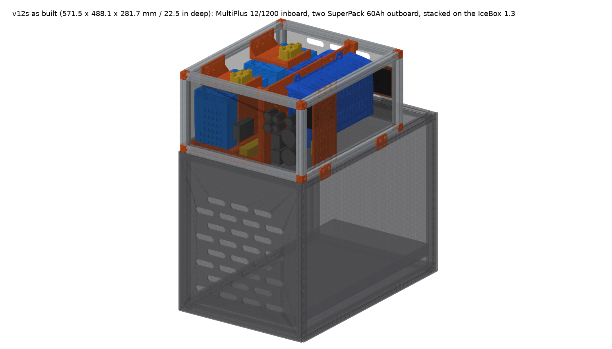
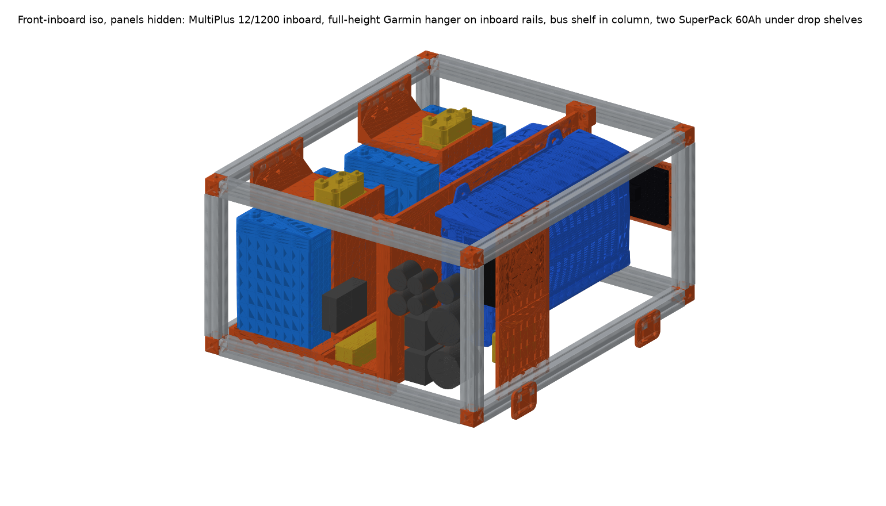
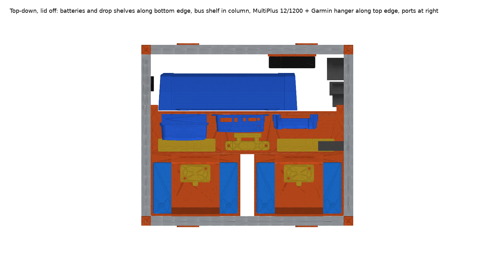
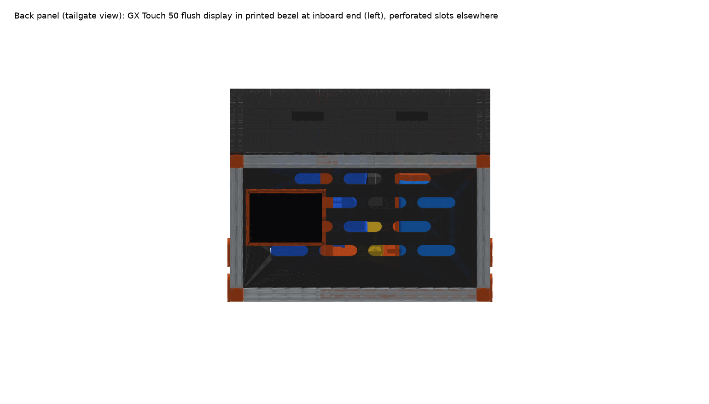

# 4Runner Electronics Box (`v12s` + `pack2`)

**Vehicle:** Toyota 4Runner, Goose Gear plate system  
**Replaces:** the plywood battery box on the plate against the IceBox 1.3 slotted back panel  
**Active Build:** **`v12s`** (main electronics & 2-battery enclosure) + **`pack2`** (4-battery external add-on pack on an SB175 umbilical)

| Resource | Description |
|---|---|
| **[IKEA Visual Guide (`IKEA-MANUAL.md`)](IKEA-MANUAL.md)** | **Picture-first IKEA assembly booklet** (`Steps 0–12` with `H1`–`H11` hardware badges, `P1`–`P10` part codes, and `OK / NO` visual checks) |
| **[Build Manual (`MANUAL.md`)](MANUAL.md)** | **Full step-by-step assembly manual**: donor cut list, rail tapping, print list & settings, heat-set insert map, T-nut placement, port cutouts, and wiring |
| **[Fastener BOM (`manual/mcmaster-order.md`)](manual/mcmaster-order.md)** | Complete McMaster-Carr fastener/insert BOM, direct product links, Order Pad block, and purchase log |
| **[Component Specs (`components.md`)](components.md)** | Dimensions, weights, mounting patterns, and 3D STEP model sources for all Victron, Eaton, Garmin, and Goose Gear parts |
| **[As-Built Audit (`manual/audit-2026-10-30.md`)](manual/audit-2026-10-30.md)** | Metric 25-series frame measurements, rail slot ledger, and pre-assembly verification checks |
| **[Interactive 3D Viewer](https://claude.ai/artifact/6eBbQY1pbboG68gWnnFshe)** | Switch between **v12s**, **pack2**, and **v12s + pack2**; toggle materials and sub-assemblies (local: `cd viewer && python3 -m http.server`, open `http://localhost:8000`) |
| **[Printable STLs (`stl/v12s/`)](stl/v12s/)** | Pre-oriented `print_*.stl` parts and multi-part `plate_*.stl` beds for `v12s` (and [`stl/pack2/`](stl/pack2/)) |
| **[Design History (`HISTORY.md`)](HISTORY.md)** | Chronological build log and earlier reference designs (`v2` through `v13`, `cube`, `bookshelf`) |

---

## 1. The Main Box: `v12s`

Built from the frame, corner cubes, and panels of a donor **25 in Goose Gear IceBox 1.3**, cut down in height and depth to **571.5 × 488.1 × 281.7 mm (22.5 × 19.2 × 11.1 in)** (`25.0 mm` metric 25-series rails, `25.75 mm` corner cubes, height rails cut to `230.2 mm`, depth rails cut to `520.0 mm`, width rails `436.6 mm` uncut, plus one Goose Gear Extrusion Frame Modification Kit x.31 bar for the missing front-bottom width rail). Loaded weight is ~42 kg (frame 15 kg, batteries 15 kg, inverter 8 kg, prints and charge gear 4 kg).

| | |
|---|---|
|  |  |
|  |  |

### Architecture & Zones

| Zone | What Is There |
|---|---|
| **Inboard side, full depth** | **MultiPlus 12/800** (modelled to the larger **12/1200** envelope: `375 × 249 × 101 mm` body) on its long side, hanging by its four keyholes on a 6-tile splined/half-lapped printed plate (`505.5 × 256 × 6 mm`) held in two slotted posts (`print_post_inverter_0..1`) against the width rails and bolted to the bus shelf's inboard wall; cable end faces the front |
| **Outboard side** | **Two Victron SuperPack 60Ah** batteries in single-print trays (`print_tray_battery_0..1`), one at each end of the zone, bolted directly to the bottom outboard rail and their adjacent width rail (`1/4-20` countersunk screws in shear) and to the bus shelf lip (`3 × M4`). Over the middle of each battery sits a printed **breaker drop shelf** (`print_breaker_shelf_0..1`) with a closed-cell foam pad pressed onto the battery top—serving as both the **battery hold-down** and the mount for that battery's **Eaton Bussmann 285 breaker** |
| **Center column (`110 mm` wide)** | **Bus shelf** in three wall-half-lapped plates (`print_bus_shelf_0..2`) running rail-to-rail (`521.5 mm`): carries the two 5-stud bus bars and the **SmartShunt 500A** in one row along the tray side (one stud line `23 mm` from the tray edge), leaving full overhead room for 4 AWG lugs and the inboard band under the plate's cable window clear for the MultiPlus, Orion and Garmin leads |
| **Plate's column face** | **SmartSolar MPPT 100/30** (upright, terminals down), **Cerbo GX**, and **Orion XS 12/12-50A** (terminals down) in one high row along the top, plus a `70 × 70 mm` filleted cable window low in the front tile, opening onto the bus shelf's clear inboard band |
| **Inboard wiring lane (`76 mm` wide)** | **Garmin PowerSwitch** and **Blue Sea 2701** ground bus mounted on a single-piece full-height printed tie-down panel (`print_garmin_hanger`, `130 × 276.7 × 6 mm`, bolted across both top and bottom inboard rails with 4 rows of cable-tie slots) 20 mm behind the front-panel port bodies |
| **Front panel** | 2-piece half-lapped `6.25 mm` dual-nozzle Black/White PETG printed H2D front panel (`print_panel_front_outboard_multicolor.3mf` `281.0 mm` + `print_panel_front_inboard_ports_multicolor.3mf` `189.1 mm`, `450.1 × 245.5 mm` assembled with `6.0 mm` rail tongues, Textured PEI side out): flush `0.60 mm` white outlines & labels (`AUX BATT` & `DC IN` stacked by the lap on outboard; `AC IN`, `AC OUT`, `4 × DC OUT` on inboard), plus a trimmed exterior 32-slot MIL-STD **MOLLE panel** (`print_panel_front_outboard_molle`, `208.5 × 278.7 mm`, `6 × 82°` beveled `1/4"-20` flat-head holes) clearing both SB50 ports |
| **On the IceBox** | Stands **rail on rail** on the `30 in` IceBox, port face flush with its back panel, held by four printed `4 mm` **stack straps** (`print_stack_strap_*`, two per side) across the seam on the bottom depth rails' outer faces: `1/4-20` button heads into drop-in T-nuts in the box rail's and the IceBox rail's outer slots |
| **Back, sides, roof** | 2-piece half-lapped `6.25 mm` printed H2D **rear panel** (`print_panel_back_outboard` perforated + `print_panel_back_inboard_gx` carrying the flush **GX Touch 50**); two 2-piece half-lapped `6.25 mm` printed H2D **3-color topographic side panel pairs** (`print_panel_side_outboard_{back,front}_multicolor.3mf` & `print_panel_side_inboard_{back,front}_multicolor.3mf`, `537.8 × 245.5 mm` assembled, Textured PEI side out: Black body Ex1, White elevation labels Ex2, Green contour lines Ex3, continuous across the `X = 295.75 mm` lap seam); **4-piece (`2 × 2`) half-lapped `6.25 mm` printed H2D roof** (`print_panel_lid_{back,front}_{outboard,inboard}`, `295.8 × 254.1 mm` per tile -> `571.5 × 488.1 mm` assembled on top of the upper rails, `16 × 82°` beveled `1/4"-20` flat-head screws into drop-in T-nuts) |

### Core Design Rules

1. **Inner-face rail slots only**: The IceBox's panels sit in the rails' centreline slots, occupying the top and bottom slots of the perimeter rails. Every structural tie to the frame is therefore a horizontal `1/4-20` screw into a rail's **inner-face slot** using a **drop-in (roll-in) T-nut** (`24` total).
2. **Zero loose nuts inside the box**: Every internal fastener threads into a brass **heat-set insert** in a printed part or a T-nut in a rail slot. All fastener heads are reachable from above or along the open center column with a hex key.
3. **Self-contained frame load path**: The box has no structural floor panel; the trays hang directly from the bottom rails in shear (`4 × 1/4-20` per tray plus `5 × M4` into the bus shelf and drop shelf) so the entire loaded box lifts by its bottom rails as one unit.
4. **Support-free, layer-aligned prints**: Every `print_*.stl` and `plate_*.stl` is exported pre-oriented on the print bed (`256 × 256 × 256 mm` Bambu P1P/P1S limit checked automatically) so bolt loads act along layer lines and no part requires supports.

### Electrical Summary

- **In-box bank (`2 × SuperPack 60Ah`)**: `120 Ah` / `1,536 Wh`, **`60 A` continuous** (`160 A` for 10 s), supporting ~700 W continuous AC output. Each battery's positive terminal runs straight up to its own Eaton Bussmann 285 breaker on the drop shelf above it, then via 4 AWG over the shelf lip to the positive bus bar.
- **With `pack2` connected (`6 × SuperPack 60Ah` total)**: `360 Ah` / `4,608 Wh`, **`180 A` continuous**, easily supporting full continuous output from a MultiPlus 12/800 (`~70 A`) or 12/1200 (`~105 A`).

---

## 2. The Add-On Battery Pack: `pack2`

An external, all-printed stacked cage holding **four more SuperPack 60Ah (`2 × 2`)** on a 2 AWG **SB175** umbilical (`python cage.py pack2`; viewer option `pack2` or `v12s + pack2`).
- **Outer dimensions**: **325 × 314 × 572 mm (12.8 × 12.4 × 22.5 in)** — `269 mm` lower than the `841 mm` IceBox + `v12s` stack height.
- **Loaded weight**: ~36 kg (batteries 30 kg, printed cage ~6 kg).
- **Printable files**: [`stl/pack2/`](stl/pack2/) (all parts segmented under `256 mm`).

| Level | Height (`z`) | What Is There |
|---|---|---|
| **Floor** | `0–247 mm` | Two SuperPack 60Ah side-by-side in printed trays (`print_pack_tray_00..01`); four `30 × 30 mm` corner posts stand on foot tabs bolted (`M4`) into the trays' corner pads |
| **Mid-deck** | `247 mm` | Two `253 × 151 × 6 mm` deck plates (`print_pack_deck_0..1`) resting on gusseted post ledges (`M4` inserts) and `20 mm` panel ribs; upper trays (`print_pack_tray_10..11`) bolt down into deck inserts from inside the empty trays |
| **Upper bay** | `253–500 mm` | Upper pair of SuperPack 60Ah with `30 mm` lug clearance above both layers |
| **Top shelf** | `500 mm` | Two shelf plates (`print_pack_shelf_0..1`) carrying the positive/negative bus bars and a 150 A surface-mount breaker; **SB175 umbilical inlet** mounted in the back panel at shelf level |
| **Skins & Lid** | `0–572 mm` | Optional 6 mm half-lapped/splined side and end panels (`print_pack_panel_*`) outside the posts; 4-tile lid (`print_pack_lid_00..11`) + handle at `z = 566 mm` |

**`pack2` Assembly Order**: Lower trays → corner posts (3 half-lapped segments of ~209 mm per post with 2 × M4 pins per lap, foot tabs onto tray pads) → back/front panels with ribs → mid-deck plates → upper trays → top shelf plates → bus bars, breaker, and SB175 inlet → side panels → batteries, lugs, and lid.

---

## 3. Working with the CAD Model (`cad/`)

All geometry, clash checks, countersink/pilot probes, print-bed layouts, step diagrams, and 3D viewer models are generated from Python (`cad/`):

```bash
cd battery-box/cad
python3 -m venv .venv && .venv/bin/pip install -r requirements.txt

# Build model, run clash + countersink + pilot + 256 mm bed checks, export STLs & viewer glTF JSON:
.venv/bin/python cage.py v12s --clash
.venv/bin/python cage.py pack2 --clash
.venv/bin/python cage.py v12s_pack
.venv/bin/python cage.py v12s_h2d        # the same box with the inverter plate split for the H2D's 350 x 320 bed (2 tiles): stl/v12s_h2d/

# Rebuild multi-part print plates (stl/v12s/plate_*.stl) and shop tools (print_tool_tap_guide.stl):
.venv/bin/python plates.py v12s
.venv/bin/python tools.py v12s

# Regenerate manual placement drawing/JSON, step-by-step diagrams, and orthographic renders:
.venv/bin/python placement.py v12s
.venv/bin/python simple_steps.py v12s
.venv/bin/python manual.py v12s
.venv/bin/python render.py v12s
```

| Script | Purpose |
|---|---|
| [`cad/cage.py`](cad/cage.py) | Parametric CadQuery model for all variants (`v12s`, `pack2`, `v12s_pack`, and legacy variants), `--clash` verification suite, STL export, and glTF export to `viewer/cage-<variant>.json` |
| [`cad/plates.py`](cad/plates.py) | Auto-orients exported `print_*.stl` files onto their print faces and packs multi-part print beds (`plate_*.stl`) with 2D raster overlap checks |
| [`cad/tools.py`](cad/tools.py) | Generates `stl/v12s/print_tool_tap_guide.stl` (rail-end 1/4-20 tapping guide cap for the 25 mm metric rail) |
| [`cad/placement.py`](cad/placement.py) | Computes part bounding boxes and T-nut coordinates from the live assembly and writes `manual/img/placement-plan.png` and `manual/img/placement.json` |
| [`cad/manual.py`](cad/manual.py) | Renders the 10 colour-coded step-by-step assembly diagrams (`manual/img/01-frame.png` .. `10-ports-lid.png`) and individual part renders (`manual/img/part-*.png`) |
| [`cad/simple_steps.py`](cad/simple_steps.py) | Generates simplified dimensioned shop drawings (`manual/img/03-posts-simple.png`) |
| [`cad/render.py`](cad/render.py) | Generates shaded orthographic and isometric views in `renders/<variant>/` |

---

## 4. Final Production Print Settings (Bambu H2D — Bambu ABS-GF Black)

While **PETG Basic** is used for test-fitting and prototyping, the final production parts are printed in **Bambu ABS-GF (Glass-Fiber ABS, Black)** (`4 × 1 kg` spools total; the full `master` box uses `~2.5–2.7 kg` at ABS-GF's `1.08 g/cm³` density, leaving over a spool of spare margin).

### Why Bambu ABS-GF Black?
- **Heat Resistance (`HDT ~99–108°C`):** Handles hot vehicle cabin temperatures (`60–70°C`) plus local heat from the MultiPlus 12/1200, Orion-Tr DC-DC, MPPT, and high-current bus bars without softening or bolt creep.
- **100% Electrically Insulating:** Glass-fiber reinforcement (`-GF`) is completely non-conductive (unlike carbon-fiber `-CF` filaments, which can be slightly conductive/ESD-dissipative near bare `12 V` studs), making it safe for `print_busbar_spacer_0..1`, `print_bus_shelf_0..2`, and `print_breaker_shelf_0..1`.
- **1:1 Dimensional Match with PETG Basic:** The glass fibers lock the polymer matrix during cooling (`~0.15–0.2%` shrinkage, identical to PETG Basic), so all `Ø5.6 mm` (`M4`) and `Ø7.5 mm` (`M5`) heat-set insert bores and the `2.5 mm` frame-span adjustments fit identically without rescaling in Bambu Studio.

### Bambu Studio H2D Slicer & Prep Checklist
1. **Filament Drying (Mandatory before printing):**
   - Dry **Bambu ABS-GF** spools at **`80°C` for 6–8 hours** before printing and print from a dry AMS / drybox.
   - **Nozzle:** `0.4 mm` (or `0.6 mm`) **hardened steel nozzle** (standard on H2D).
2. **Chamber & Bed Adhesion (especially for `print_plate_inverter_tile_00..10` and `print_tray_battery_0..1`):**
   - **Build Plate:** Textured PEI Plate with a thin coat of Bambu Liquid Glue (prevents corner lift on the `255 × 256 mm` tiles and aids release).
   - **Active Chamber Heater:** Set to **`60°C`** and let the chamber pre-warm before starting large flat plates.
   - **Cool-Down Rule:** Let the build plate cool below **`45°C`** before flexing or removing large flat tiles (`tile_00`, `tile_10`, `panel_*`) so they cool dead-flat inside the chamber.
3. **Wall Loops, Shells & Infill by Part Group:**
   - **Standard Structural Parts** (`print_tray_battery_0..1`, `print_bus_shelf_0..2`, `print_breaker_shelf_0..1`, `print_plate_inverter_tile_00..10`, `print_garmin_hanger`, `print_panel_*`):
     - **Layer height:** `0.20 mm` Standard @BBL H2D
     - **Wall loops:** **`4 walls`**
     - **Top / Bottom shells:** **`5 layers`** (`1.0 mm`)
     - **Sparse infill:** **`25%` Gyroid or Cubic**
   - **High-Clamp / Compression Parts** (`print_post_inverter_0..1`, `plate_busbar_spacers.stl` / `print_busbar_spacer_0..1`, `plate_stack_straps.stl` / `print_stack_strap_*`):
     - **Wall loops:** **`5 walls`** (reinforces `1/4"-20` countersinks and `M5` bus bar compression sleeves)
     - **Top / Bottom shells:** **`5 layers`** (`1.0 mm`)
     - **Sparse infill:** **`35–40%` Gyroid or Cubic** (prevents compression crush under bolt torque)
4. **Heat-Set Insert Installation (`M4` & `M5` in ABS-GF):**
   - Set soldering iron tip temperature to **`260–270°C`** (`25–30°C` hotter than PETG).
   - Press straight down with steady, light pressure until the flange is flush, hold a flat metal block against the face for `3–4 seconds` as it cools, and let cool completely before torquing bolts.

### PETG Matte End-Panel & Half-Lap Support Baseline (Bambu H2D)
1. **PETG Matte Flat Panel Baseline (`print_panel_*`, `6.25 mm` panel thickness):**
   - **Drying & Prep:** Dry PETG Matte overnight in AMS 2 Pro (`~10%` RH). Wash Textured PEI plate with Dawn + warm water, apply a thin coat of **Bambu Liquid Glue** as a release barrier, and let the plate cool below **`35–40°C`** before flexing off to prevent stress-whitening swirls.
   - **Process (`0.20mm Standard @BBL H2D`):** `4` wall loops, `6–7` top shell layers (`1.2–1.4 mm`), `5` bottom shell layers, `25%` **Gyroid** (or **Cross Hatch**) sparse infill, **Precise Z height** enabled.
2. **Half-Lap Overhang Support Baseline (`print_panel_back_outboard`, `print_panel_front_inboard_ports`, `print_panel_side_outboard_front`, `print_panel_side_inboard_front`, and `print_panel_lid_{back_inboard,front_outboard,front_inboard}`):**
   - **CAD Lap Geometry:** All 12 enclosure & roof tiles print with their outer Textured PEI face on `Z = 0`. Support-free base-flap tiles (`back_inboard_gx`, `front_outboard`, `side_outboard_back`, `side_inboard_back`, `lid_back_outboard`) print **support-free** (`Z = 0.000..3.125 mm` flap); the mating overhang tiles print with an overhanging flap at **`Z = 3.200..6.100 mm`** (`16 × 0.20 mm` exact layer boundary for `+0.075 mm` glue/interface allowance over the `3.125 mm` mating flap, plus `-0.15 mm` inner relief capping total joint thickness at `6.10 mm` inside the rail slot).
   - **Bambu Studio `Support` Tab Baseline:**
     - **Enable support:** `Checked` *(for the `Z = 3.20..6.10 mm` lap overhang tiles only; keep unchecked on the `Z = 0..3.125 mm` base tiles and MOLLE panel)*
     - **Type:** `normal(auto)` · **Style:** `Snug` · **Threshold angle:** `30°`
     - **On build plate only:** `Checked` · **Remove small overhangs:** `Checked`
     - **Support/raft base & interface:** `Default` *(same PETG Matte; optional H2D dual-nozzle alternative: `PLA` interface with `0 mm` Top Z distance & `0 mm` Top interface spacing)*
     - **Initial layer density:** `90%` · **Initial layer expansion:** `-1 mm`
     - **Top Z distance:** `0.2 mm` · **Bottom Z distance:** `0.2 mm`
     - **Base pattern:** `Default` · **Base pattern spacing:** `2.5 mm` · **Pattern angle:** `0°`
     - **Top interface layers:** `3 layers` · **Bottom interface layers:** `2 layers`
     - **Interface pattern:** `Default` · **Top interface spacing:** `0.25 mm`
     - **Normal Support expansion:** `0 mm`
     - **Support/object xy distance:** `0.6 mm` *(keeps supports clear of the vertical `3.20 mm` mating lap wall)*
     - **Support/object first layer gap:** `0.6 mm` *(keeps Layer 1 support clear of the visible `Z = 0` Textured PEI seam edge)*
     - **Independent support layer height:** `Checked`
