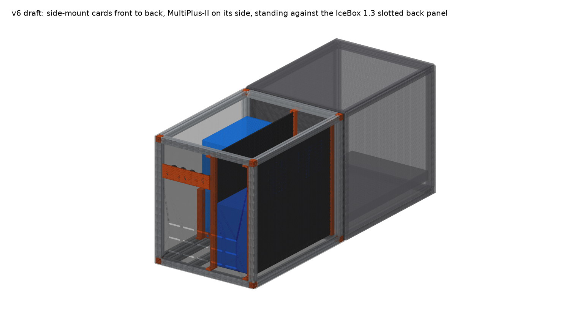
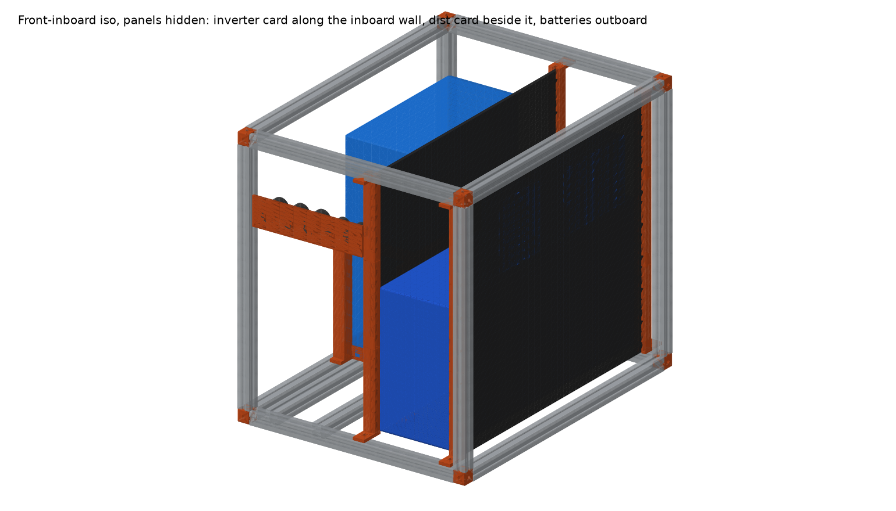
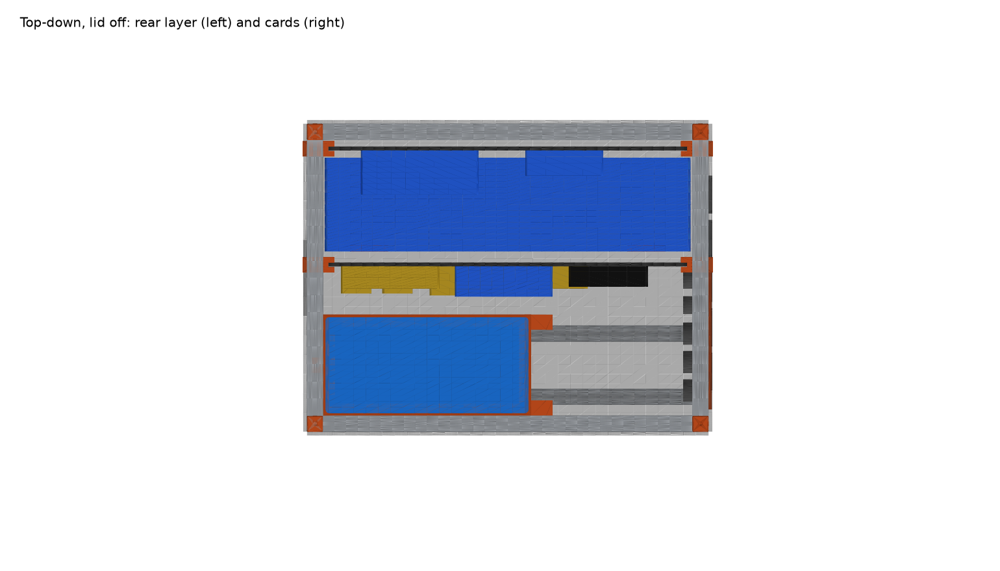
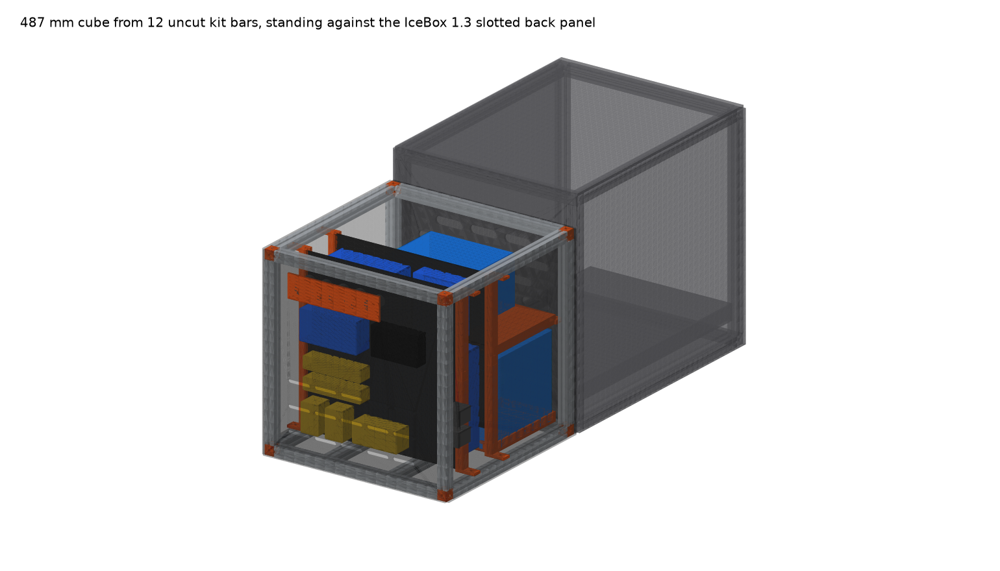
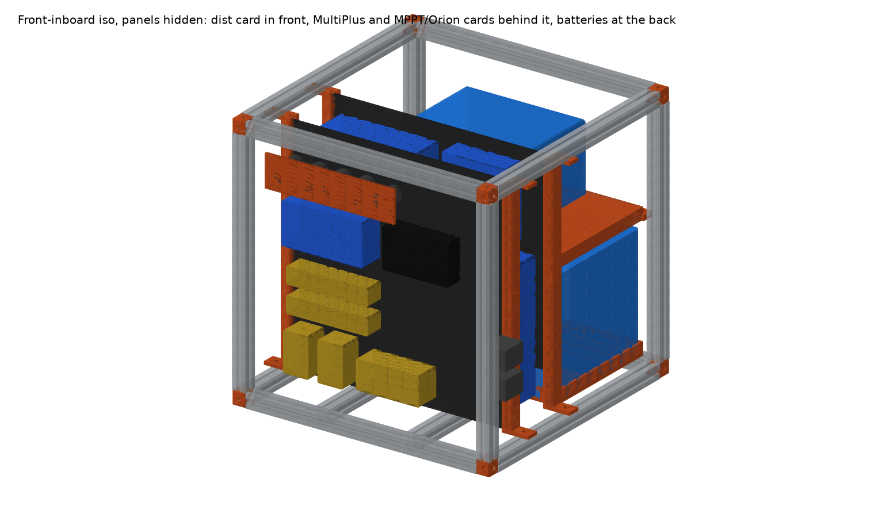
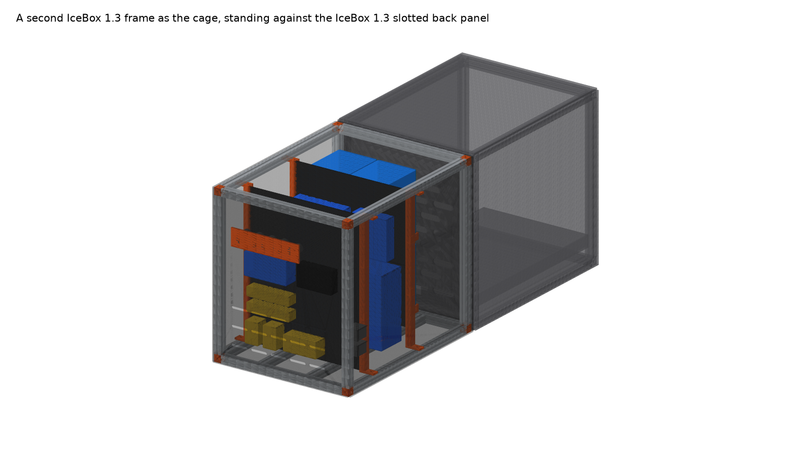
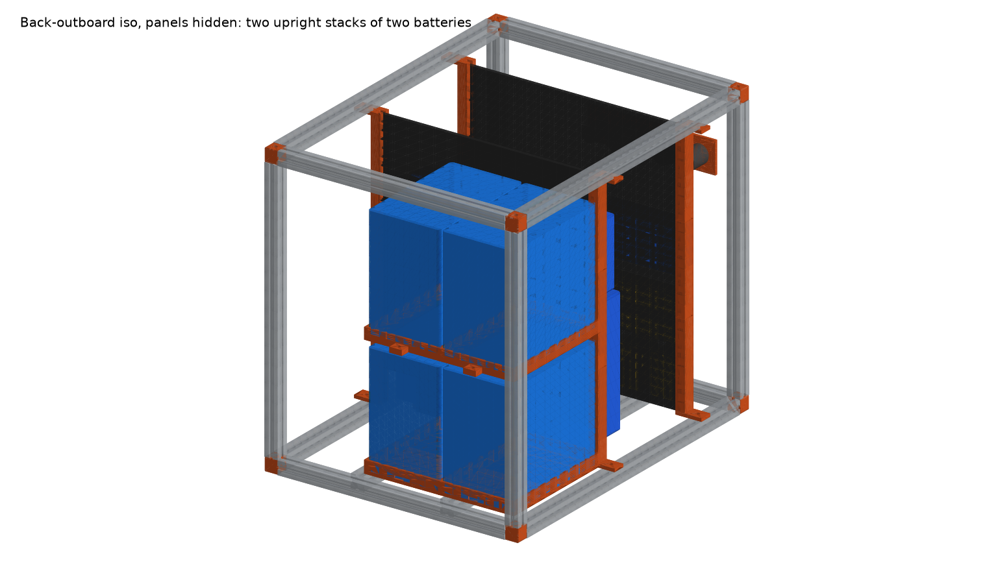
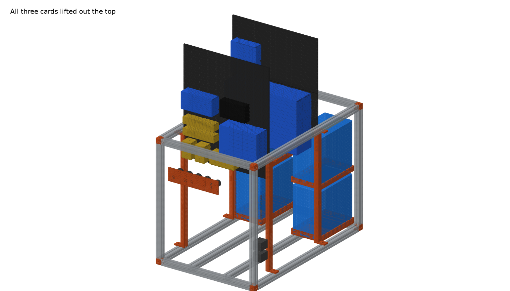
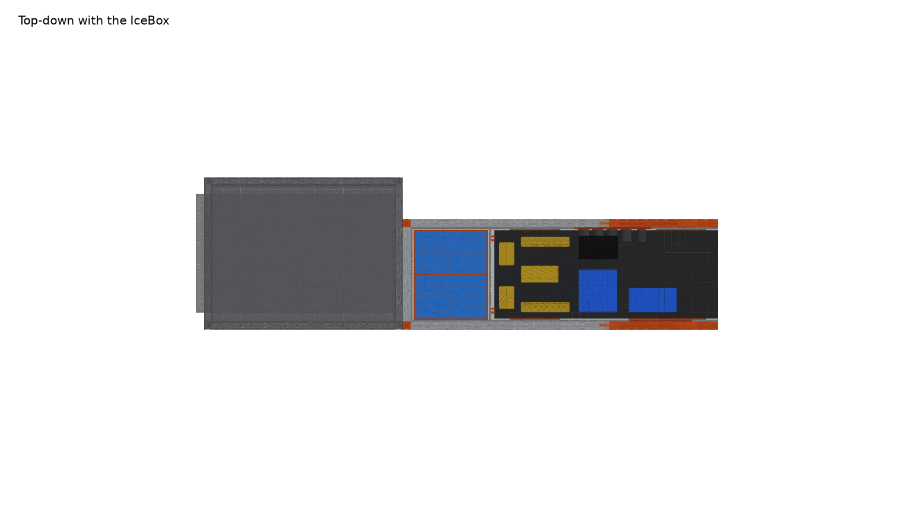

# 4Runner Electronics Card Cage

**Vehicle:** Toyota 4Runner, Goose Gear plate system
**Replaces:** the plywood battery box that sits on the plate against the IceBox 1.3 slotted back panel
**Status:** v7 is the current direction (narrow, your SuperPack 60Ah, lengthwise cards); v4 (`cage-v4-cube`), v5 and v6 are kept as versions. 8 mod kits ordered; cargo-ceiling height still to measure (2026-10-04)

**Goal:** a cube built from **12 uncut Goose Gear mod-kit bars**. Each bar is the IceBox 1.3 width rail (~437 mm), so the frame is 487.4 mm in every direction: the IceBox's exact width, 71 mm shorter than the IceBox, standing against its slotted back panel. It holds **four SuperPacks** (three upright, one on its long side above them), and everything else is on cards that drop in from the top, with the distribution card right behind the front panel so the output runs are short. Same look (1" extrusion frame, black corner cubes, black panels), 3D-printed interior, **no off-the-shelf extrusion and no saw cuts**.

| | |
|---|---|
| Interactive 3D | [Published viewer](https://claude.ai/artifact/6eBbQY1pbboG68gWnnFshe) with a version switch, or `viewer/index.html` (serve it: `cd battery-box/viewer && python3 -m http.server`, then open http://localhost:8000) |
| CAD source | `cad/cage.py` (CadQuery, every dimension is a parameter; `python cage.py cube` or `python cage.py icebox`) |
| Printable parts | `stl/cube/`, `stl/icebox/` (regenerated by `cage.py`) |
| Renders | `renders/cube/`, `renders/icebox/` |
| Photos of the current box | `photos/` |

## Versions

**v9 (current): v8 plus a fixed bus deck, so every card unplugs and lifts out alone** (`python cage.py v9`)

The problem with v8: the battery leads run under card 3, through card 2, up to the bus bars on card 1, so no card comes out without its neighbours. v9 moves everything that is wired to more than one card off the cards:

- **Bus deck.** A printed 6 mm plate bolted to the tops of the battery rack legs, at 468 mm, 91 mm under the lid. It carries both bus bars, the two battery breakers, the SmartShunt, and the mating halves of every card's connector along its front edge: an **SB175** for the inverter and three **SB50s** for the MPPT, the Orion and the Garmin/Cerbo feed. A hand window in the plate reaches the battery lugs below it.
- **Two cards, one plug each side.** The inverter card carries the MultiPlus 12/1200 and a single SB175 receptacle at the top of its rear face. The charge card carries the MPPT (at the top), the Orion and the Cerbo on its front face and five SB50 receptacles at the top of its rear face (MPPT, Orion, Cerbo, solar in, alternator in). The deck has **no fixed connector halves**: every pigtail is lugged to a bus bar or breaker on the deck and plugs into the card at its far end. The five charge-card pigtails run forward in the 18 mm chase between the outboard rail and the guide posts, so the inverter card lifts out without touching them.
- **Service:** lid off, unplug that card at the deck, lift it. Batteries: unplug both cards, unbolt the deck, lift it, lift the batteries. Nothing on any card is wired to another card.
- **Front panel:** shore-power inlet and inverter outlet (L14-30), the Anderson inlets for the alternator feed and the solar array, and the 12 V sockets in the lower band. All of those are plugs too, so the front panel comes off clean.
- Depth: **20 mm between the deck's front edge and the inverter card** (just the card's SB175 housing plus 4 mm; the 4 AWG pigtail rises out of its flying half and bends back over the deck inside the 60 mm lid room), **22 mm behind the charge card** for its rear-face SB50s, **4 mm** behind the charge card's parts and **10 mm between the MPPT and the front panel**. The MPPT, the deepest unit at 70 mm, sits at the **top** of the charge card; the Orion and the Cerbo (turned 90°) fill the middle band; the bottom band of the card is empty, and that is where every panel-mounted connector lives: the five 12 V / USB sockets, the L14-30 shore inlet and inverter outlet, and the two SB50 inlets for solar and alternator, all with 90 mm of depth behind them. The Garmin PowerSwitch lies on the **deck**, where the SB50 row used to be, fed by a 150 mm lead from the positive bus bar; its four outputs leave through a PP45 block at the deck's front edge and the socket harness runs down the outboard chase to the front panel. **568 × 353 × 559 mm (22.4 in deep), 7.6 in shorter and 5.3 in narrower than the IceBox**, same height. ~58 kg.

**Connectors.** The v9 cards are **cut down 50 mm (444 tall)** so the connector stack at the top of each card leaves **60 mm under the lid** for the pigtail cables, which leave the mated halves upward. Every card carries its **own fixed Anderson halves at the top of its rear face, standing with the mating face up**: one SB175 on the inverter card; five SB50s in a row on the charge card for the MPPT, the Orion, the Garmin/Cerbo feed, and the solar and alternator inlets. Everything below the connectors is free for the wire bends up to them. The bus deck is extended 40 mm forward over the wiring gap and carries the other fixed halves, **pointing at the cards** with proper spacing. Short pigtails with a flying half at each end join deck to card. To pull a card: lift the pigtail halves straight up off the card's connectors (25 mm for the SB175, 15 mm for an SB50), then lift the card. The deck ends come off forward on the extension if a pigtail ever needs replacing. All of it is reached from above with the lid off; the housings are Anderson's own STEP models.

**Garmin outputs.** The PowerSwitch's four socket circuits leave the charge card through an **Anderson Powerpole PP45 block** (8 poles, 10 AWG contacts, 30 A per Garmin channel) at the top of the card's front face, mating face up like the rest. The harness from the front-panel sockets ends in the mating block; unclip it before the card comes out.

**Battery rack: how every part connects.** The rack is a closed load path from the frame back to the frame, so the box lifts as one unit and nothing relies on the Goose Gear plate:

```
frame bottom rails ──T-nuts──▶ tray L tabs ──▶ trays ──M4 insert──▶ leg foot tabs ──▶ lower legs
                                 │                                         │ half-lap + shelf M4
                                 ▼                                         ▼
                      lower batteries (strap)                  shelves ──▶ upper batteries (strap)
                                                                           │
                                                   upper legs ──M4──▶ bus deck ──M4──▶ deck ties ──T-nut──▶ frame corner bars
```

| Joint | How | What it carries |
|---|---|---|
| Tray → frame | 2 integral L tabs per tray: a flange grown from the top of the outer side wall lies on the bottom depth rail, 1/4-20 T-nut. 2 printed L brackets per tray: 2 × M5 into inserts in 6 mm pads on the back wall, flange on the back width rail, T-nut. The tray floor stays flat on the plate; the 4 × M6 into the plate are optional | the whole stack when the box is lifted by the frame (15 kg per tray on 4 bolts); sideways loads under braking |
| Lower battery → tray | sits in the 229 × 138 pocket inside 6 mm walls and a 30 mm lip; one 25 mm cam strap runs lengthwise through a 2 mm channel under the battery, out through slots in both end walls, over the top; buckle in the wiring gap in front | vertical hold-down; the lip takes sideways |
| Leg → tray | the lower leg segment stands on the plate in the 15 mm end gap and has a 6 mm foot tab lying on the tray's wall top, M4 down into a heat-set insert in a corner pad (6 mm pad + 6 mm wall = 12 mm of plastic) | lifts the leg with the tray; locates it |
| Lower leg → upper leg | 37 mm half-lap (z 215–252) | bending at the joint; both segments print under 256 |
| Shelf → legs | one M4 through each shelf end wall at z 240, through **both** lap halves: the same screw clamps the shelf to the leg and pins the lap | the upper battery (7.5 kg) hangs on these 4 screws; the shelf is a 21 mm wide ring 10 mm thick with a 15 mm lip |
| Upper battery → shelf | lip pocket + one lengthwise cam strap in the shelf's channel, buckle in front, over the top under the deck | hold-down and sideways |
| Deck → legs | each upper leg ends in a 14 mm boss with a 16 mm tab reaching under the deck; the deck's M4 goes into an insert in the tab, 9 mm inside the deck edge (the deck spans 245 mm between the leg centrelines) | the deck's 3 kg plus the connector pulls |
| Deck → frame | two printed ties at the deck's back corners: a plate on the corner bar's inward face (T-nut), a bridge over the leg boss, a pad on the deck with 2 × M4 | stops the deck, and with it the legs, lifting out of the foot tabs under a bump; takes the pigtail pull when a card is unplugged |

Under 1 g braking each stack puts about 15 kg sideways into the tray lip and tabs, and the upper battery 7.5 kg into the shelf lip and its four screws. The legs are 12 mm square and only ever see the deck's weight in compression, the shelf's screws in shear and the strap and battery friction.

Print the rack in ASA rather than PETG: a closed box in a parked truck exceeds PETG's softening range in summer.

**How it prints and goes together (Bambu P1P/P1S, 256 × 256 × 256 bed).** Every part in `stl/v9/` fits; the script checks each one:

| Part | Qty | Size (mm) | Print | Joins to |
|---|---|---|---|---|
| Card tiles | 4 (2 per card) | 249 × 234 × 6 solid | flat, rabbet up (lower tile back face down, upper tile front face down), no supports, 4 walls, 30 % gyroid, ASA | one 24 mm half-lap across the middle of the card, glued (CA or plastic cement) and through-bolted with 3 × M4 countersunk + nyloc; units via heat-set inserts in the pilot holes |
| Guide posts | 4 posts × 2 segments | 193 / 167 tall, 24 × 18, feet 61 long | standing or flat | 20 mm tenon between segments; posts stand 18 mm in from the rails so the cards are 249 wide (two tiles); the bottom foot reaches back over the floor panel, steps down onto the depth rail and takes a 1/4-20 T-nut on the slot centreline; the top foot bolts up into the top rail |
| Battery trays | 2 | 253 × 176 × 34 (incl. side tabs, back pads, corner pads) | flat | side tabs T-nut into the depth rail; corner pads take the leg foot tabs (M4 inserts); 4 × M6 into the plate optional |
| Tray back brackets | 4 | 40 × 34 × 32 | flat | 2 × M5 into the tray's back pads; T-nut into the back width rail |
| Mid-shelves | 2 | 241 × 150 × 25 | flat | ring shelf 14 mm above the lower battery (lug room); M4 through each end wall into the leg lap |
| Rack legs | 8 × 2 segments | lower 252 (with foot tab), upper 253 (with deck tab), 12 mm square | flat (strongest across the lap) | half-lap; foot tab M4 into the tray pad; shelf M4 through the lap; M4 insert in the deck tab |
| Deck ties | 2 | 58 × 32 × 21 | any | T-nut into the corner bar; 2 × M4 through the deck |
| Bus deck | 2 halves + 3 splines | 245 × 147 × 6 | flat | 8 × M4 into the leg boss tabs; halves splined at the centre; bus bars, breakers, shunt, the Garmin PowerSwitch and its PP45 block screw to it with inserts |
| MultiPlus feet, cubes, socket insert | 2, 8, 1 | ≤ 60 mm | any | see "How the units attach"; the MultiPlus bolts get M6 × 30 mm fender washers on the back, not printed plates |

**Assembly, in order**

1. **Frame.** IceBox height and depth rails (depth rails cut to 606), kit-bar width rails cut to 294, printed corner cubes with 1/4-20 end-tap screws. Floor panel over the card zone only. Side, back and front panels screwed to the outside of the bars with T-nuts; the front panel gets the socket insert, the two SB50 inlets and the L14-30 inlet and outlet before it goes on.
2. **Battery rack.** Press the inserts: 4 × M4 in each tray's corner pads, 4 × M5 in its back pads, 1 × M4 in each upper leg's deck tab. Trays in, side tabs bolted down into the depth rails, back brackets to the tray pads and the back rail (T-nuts slid in before the corner cubes go on); the 4 × M6 into the plate only if you want them. Lower legs: stand each in its corner, foot tab onto the wall top, M4 into the pad. Lay each lower strap in its tray channel, battery in, strap over the top, buckle at the front. Shelves on: upper legs onto the laps, then one M4 through each shelf end wall into the lap. Strap in the shelf channel, upper battery in, strap over, buckle at the front. Battery leads (6 AWG, M6 lugs) left loose on top.
3. **Bus deck.** Both halves splined together on the bench; bus bars, breakers, shunt, the Garmin PowerSwitch and its PP45 block screwed on with inserts; the six pigtails (SB175 for the inverter; SB50s for MPPT, Orion and Cerbo; PP45 socket harness) lugged to the bus bars and breakers, flying halves at their free ends. Deck onto the leg boss tabs, 8 × M4. Deck ties: T-nut into each back corner bar, 2 × M4 down through the deck. Battery leads up through the hand windows to the breakers and bus bars.
4. **Guide posts.** Four posts, two segments each; the bottom foot sits on the depth rail beside the floor panel and bolts into its T-slot, the top foot bolts up into the top rail.
5. **Each card on the bench.** Lap the two tiles (lower tile's rabbet to the front, upper's to the back), glue, and bolt the lap with 3 × M4 countersunk from the front. Press in the inserts: inverter card M6 for the SB175; charge card M4/M5/M6 per unit plus the SB50 row and the PP45. Mount the units: MultiPlus on its feet with the four M6 through-bolts, fender washers and nyloc nuts on the back; MPPT, Orion, Cerbo, Garmin on their inserts. Wire every unit to the card's own connectors at the top with the sizes in the table above, and label each lead. Test the card's internal wiring before it goes in.
6. **Install.** Drop the inverter card into its posts, then the charge card. Plug each pigtail's flying half down onto the card's receptacles: the SB175 straight off the deck for the inverter card; the charge-card SB50s via the outboard chase. Connect the front-panel harnesses: inlet pigtails to the charge card's two inlet SB50s, the socket harness to the PP45, AC cords to the MultiPlus. Lid on.
7. **Pull a card later:** lid off, lift that card's pigtail halves and harness block straight up, lift the card. Nothing else moves.


Cable sizes are Victron's where they publish them; your 6 AWG is right for the Orion and the batteries, and the inverter run is 4 AWG because 2 AWG would not fit its terminals:

| Run | Size (Victron manual) | Fuse / breaker | Connector |
|---|---|---|---|
| Battery stack → bus deck, per stack of two 60Ah | 6 AWG (30 A per battery, M6 terminals) | one breaker per stack, on the deck | lugs on the deck bus bars |
| Bus deck → MultiPlus 12/1200 | **4 AWG / 21 mm² as built** (Victron lists 35 mm²; 2 AWG would not fit the 12/1200's terminals). Keep this run under 1 m: 4 AWG at 105 A continuous is at the top of its rating | **150 A** at the deck | Anderson SB175 with 4 AWG contacts |
| Bus deck → Orion XS 12/12-50 output | 6 AWG / 16 mm² (50 A, under 5 m) | 60–70 A | Anderson SB50, 6 AWG contacts |
| Alternator → Orion XS input | 6 AWG; fuse at the starter battery | 60–70 A | Anderson SB50 inlet, front panel |
| Bus deck → MPPT 100/30 battery side | 10 AWG / 6 mm² (30 A) | 40 A | Anderson SB50, 10 AWG contacts |
| Solar array → MPPT PV side | 10 AWG | per string if more than one | Anderson SB50 inlet, front panel |
| Bus deck → Garmin PowerSwitch | 10 AWG (PowerSwitch is 50 A max) | 60 A | Anderson SB50, 10 AWG contacts |
| Bus deck → Cerbo GX | 16 AWG | 3 A | Anderson Powerpole 15 |
| Shore AC in, inverter AC out | 12 AWG | the MultiPlus's own AC breaker | L14-30 inlet and outlet, front panel |

**v8: v7's battery bay, three cards across the box** (`python cage.py v8`) (`python cage.py v8`)

Same frame width and battery bay as v7, but the cards face across the box like v4, so each one only costs its own thickness in depth. More cards across is *less* depth, not more, because the inverter's 100 mm goes along the depth instead of its 250 mm. The box is **598 deep × 345 wide × 559 tall: 6.5 in shorter in depth and 5.6 in narrower than the IceBox**, same height.

| Depth chain, IceBox end to front | mm |
|---|---|
| battery bay (two touching stacks of two SuperPack 60Ah, on the plate) | 261 |
| gap | 10 |
| **inverter card**: MultiPlus 12/1200 upright on 10 mm standoffs, SmartShunt above it | 6 + 10 + 100 + 8 |
| **charge card**: MPPT, Orion, Cerbo, Garmin | 6 + 70 + 8 |
| **distribution card**: bus bars, breakers (parts start at 140 mm up) | 6 + 46 + 8 |
| front margin; sockets in the front panel's lower band, 50–110 mm up | 8 |

- Cards are 277 × 494 mm, printed as 2 × 2 solid tiles of 138 × 247 (see "Printed cards" below), in printed posts bolted to the top and bottom depth rails (the v4 post design). No cross-members: the posts don't need them and the trays and straps hold the batteries.
- Frame: 4 width rails from kit bars cut to 294; the IceBox's 4 height rails uncut and its 4 depth rails cut to 547.
- Service: lid off, lift any card straight up (277 wide, 494 tall; needs ~1050 mm plate-to-ceiling, or tilt forward into the gap); batteries lift out of the bay.
- ~60 kg.

**v10: two batteries, 454 mm deep (17.9 in)** (`python cage.py v10`, viewer "v10")

The 18 in question answered: drop to two SuperPacks in **one stack** and the depth falls to **454 × 353 × 559 mm**, 12.1 in shorter than the IceBox and 4.5 in shorter than v9, at the same width and height.

| | v9 (4 batteries) | v10 (2 batteries) |
|---|---|---|
| Outer | 568 × 353 × 559 | **454 × 353 × 559** |
| Bank | 240 Ah, 120 A continuous | 120 Ah, **60 A continuous / 80 A for 10 s** |
| MultiPlus 12/1200 | full 1200 W | **~700 W continuous**, ~1000 W bursts (105 A at full output) |
| Charging | MPPT 30 A + Orion 50 A | same, within the 60 A charge limit |
| Weight | ~58 kg | ~43 kg |

How it is laid out:

- **Battery rack:** the v9 rack with one stack (tray, shelf, four legs, the deck over it, 245 × 151). The deck carries the two bus bars along the depth, the two breakers and the hand window. Tray tabs to the outboard and back rails as before.
- **Charge card in the freed column.** The 150 mm column beside the stack takes the charge card turned **lengthwise along the inboard wall** (250 × 444, two tiles on the half-lap), units facing the stack: MPPT at the top, Orion and Garmin in the middle, Cerbo and the SmartShunt (on end) at the bottom. Its five SB50s and the Garmin's PP45 stand on the **rear face** in the 21 mm behind the card, mating upward, so it unplugs and lifts exactly like a v9 card. Its two guide posts stand on the plate 12 mm off the inboard rail, with feet onto the bottom and top inboard depth rails and three half-lapped segments pinned by M4s.
- **Inverter card** 10 mm in front of the bay, unchanged: MultiPlus upright, SB175 at the top of its rear face. The SB175 sits beside the deck, not in front of it, so the deck needs no clearance.
- **Ports above the MultiPlus.** The front panel's port band moves up to z 435..530, above the inverter's 428 mm top, where there is 119 mm of depth behind the panel: socket row at the top, the two L14-30s and the two SB50 inlets below it. The card's lower band behind the panel is the MultiPlus itself.

Depth chain: bay 268 | gap 10 | inverter card 6 + 10 + 101 | front 8 = 403 inner, 454 outer.

**Add-on pack (modelled, shown 80 mm in front of the box in the v10 view).** The two displaced SuperPacks live in their own cage, **329 × 353 × 359 mm** (13.0 × 13.9 × 14.1 in), the same width as the main box so it uses the same trays, tabs, legs and deck halves, one battery high. On its deck: the two bus bars along the depth between the hand windows and a breaker per battery. One SB175 panel inlet on its back panel at 300 mm, facing the main box, and a matching SB175 inlet beside the socket row on the main box's front panel; two 4 AWG jumpers between them put the bank back to 240 Ah and 120 A whenever the pack is plugged in. It sits on the vehicle floor like the main box, no floor panel.

The bar budget is the point of the size: the main box's depth rails are the second IceBox's 711 mm rails cut to 403, and the four **308 mm offcuts become the pack's height rails uncut**. Its four width rails (302) and four depth rails (278) come from 8 kit bars, i.e. **4 Extrusion Frame Modification Kits** (2 bars each). The main box itself needs no kit bars at all once its width rails are cut from the IceBox's 437 mm ones, so the whole plan is one IceBox 1.3 frame plus 4 kits, with nothing spare. (The owner returned 4 kits on 2026-10-05; if none are left, the pack is 8 rails short and needs 4 kits.)

**v7: 345 mm wide, 642 deep, your four SuperPack 60Ah, lengthwise cards** (`python cage.py v7`)

The 200Ah Smarts and the MultiPlus-II are shelved. v7 is built around what you own and the pedal clearance:

| | mm |
|---|---|
| Outer | **642 deep (25.3 in) × 345 wide (13.6 in) × 559 tall**: 5.6 in narrower and 4.7 in shorter in depth than the IceBox, same height, flush with its right face (`depth="fit"`, `card_len=280`) |
| Battery bay (IceBox end, on the plate) | two stacks of two SuperPack 60Ah, trays touching: 294 of 294 wide, 261 deep, 468 tall (91 mm under the lid). Printed trays, mid-shelves and 9 mm legs (each carries under 2 kg); no vent gaps are required for SuperPacks |
| Cross-members | two spare kit bars cut to 294 at the bay's front edge, top and bottom, in printed corner brackets. They stop the batteries and carry the rear card posts |
| Cards | both **lengthwise** in front of the bay, 281 × 494 mm, printed, posts on the cross-bars and the front width rail. Inverter card: the **MultiPlus 12/1200 upright, terminals down**, alone. Distribution card: breakers, bus bars, MPPT and Garmin in one column; shunt, Orion and the Cerbo (turned 90°) in the other |
| Across the front zone, from the inboard wall | 17 post/plate · 110 inverter + standoff · 4 · 52 distribution · **96 mm of cable and Anderson space** against the outboard wall |
| Bank | 240 Ah, 3.1 kWh, 120 A continuous against the 12/1200's ~105 A; SuperPacks have their own BMS, so no VE.Bus BMS |
| Frame cuts | 4 width rails + 2 cross-members from kit bars (6 of 16); the IceBox's 4 height rails uncut, its 4 depth rails cut from 711 to 592 |
| Mass | ~61 kg |

Service: lid off, everything is reached from the top; the batteries lift straight out of the bay behind the top cross-bar. The cards are full height and come out with the box out of the truck.

**How the units attach to the printed cards.** Every Victron unit has a published hole pattern (`HOLES` in `cage.py`, from the dimension drawings), and the tile generator puts a **22 mm solid boss with a 4.6 mm pilot** at each hole, so no hole ever lands in a lattice opening. Light units screw into **heat-set brass inserts** in those bosses: Cerbo and Orion M4, MPPT and bus bars M5 (the MPPT hangs on its keyholes first), SmartShunt and breakers M6, the Garmin through its own bracket. The MultiPlus 12/1200 is 8.2 kg, so it gets **four M6 through-bolts with 30 mm fender washers and nyloc nuts** on the back of the card, and its weight sits on the two printed feet; the bolts only keep it on the card. The card is **solid under the whole inverter footprint** (plus 10 mm), so the bolt holes can be moved or re-drilled if the real unit lands a few millimetres off. Its keyholes are 220.6 × 243.8 mm with the upper pair 62.8 mm below the top of the 374.6 mm body; the datasheet's 406 mm height includes the mounting bracket. The script lists the hardware per card (`== Attachment ==` in the v8 report): 10 × M4, 8 × M5 and 6 × M6 inserts plus the four M6 bolts. Bus bar, breaker and Garmin hole positions are measured from photos and marked verify; the Victron ones are from the drawings.

**Printed cards (v7 and v8).** Each card is a **2 × 2 grid of solid 6 mm tiles, about 140 × 247 mm**, with a 4.6 mm pilot hole at every unit's mounting position for a heat-set insert (M4/M5/M6 by unit) and M6 through-holes with printed backing plates for the MultiPlus. Solid tiles mean any unit can be shifted and re-drilled, and nothing threads through the card, so every card still lifts straight out. The four tiles join with 3 mm printed splines glued into pockets in the back face (flush). About 820 g of PETG and 9 h of printing per card; print tiles flat, 4 walls, 30 % gyroid, PETG or ASA. (`card_style="lattice"` in `cage.py` brings back the ribbed version at half the weight.) Every other part in `stl/v7/` and `stl/v8/` also fits the bed: trays 237 × 146, shelves 255 × 146, posts in two segments, legs, brackets, cubes, socket insert.

| | v4 cube (`cage-v4-cube`) | v5 second IceBox |
|---|---|---|
| Frame | 12 uncut kit bars, 487 × 487 × 487 mm | a stock 30" IceBox 1.3 frame, fridge slide removed: 762 × 487 × 559 mm |
| vs the IceBox | same width, 71 mm lower, 275 mm shallower | identical; decks flush |
| Inside | 437 × 437 × 431 | 711 × 437 × 502 |
| Batteries (4) | 3 upright + 1 on its long side on a shelf | 2 upright stacks of 2, one at each side wall, 145 mm channel between; a third stack fits in the channel (6) |
| Cards | lower (MultiPlus), upper (Orion, 171 tall), dist (423 tall, with MPPT + Cerbo + Garmin) tight behind the MultiPlus | same three; upper 242 tall; dist 494 tall pushed forward to the sockets, ~240 mm of free air behind it for a future card |
| Lift out, plate to ceiling | 658 / 741 mm; dist 910 or tilt | 801 / 813 mm; dist 1053 or tilt |
| Mass | ~49 kg | ~63 kg (frame + panels ~19) |
| Kit bars | 12 + 2 joists, 2 spare | not needed; return them, or keep 2 as joists |
| Cost | 8 kits ≈ $1,112 + panels + prints | one IceBox 1.3 $1,345, matching panels included |

**v6: side-mount cards (current direction)**

Started as the way to fit a MultiPlus-II; kept because it leaves the whole battery column free and puts every Victron unit on one of two full-length cards. The inverter is now **your MultiPlus 12/1200/50** (406 × 250 × 100, 8.2 kg, ~105 A at full output). Your IceBox is the **30" (762 mm) model**, 711 mm inside. Both cards run **front to back along the inboard wall**, sliding down between posts on the back and front width rails:

| From the inboard wall | mm |
|---|---|
| post + inverter/charger card plate | 17 |
| MultiPlus 12/1200 on its side, on 10 mm standoffs, terminals toward the front | 100 + 10 |
| gap | 4 |
| distribution card plate + parts facing the batteries (≤ 46 deep) | 52 |
| gap | 4 |
| **battery column** against the outboard wall | **193** (tray 160 + Victron's 20 mm vent each side; no spare, by design) |
| **frame width** | **440 mm (17.3 in)**: 48 mm (1.9 in) narrower than the IceBox, to leave room for bike pedals beside the box. The cage sits flush with the IceBox's right face (`align`), so the free strip is on the left. The four width rails are kit bars cut to 389 mm. `pedal_gap` in `cage.py` adds width back if you want slack. |

**Getting closer to 5 in of pedal room.** The width is the sum of what's across the box, and only one layer is optional: the distribution card. Moving its parts (bus bars, shunt, breakers, BMS, Garmin) up onto the inverter/charger card, above the 12/1200 where there is 240 × 694 mm of free card, removes 56 mm and takes the frame to **384 mm (15.1 in), 4.1 in narrower than the IceBox**. Everything else is fixed: the 12/1200 is 100 mm deep in any orientation, the 200Ah Smarts are 152 mm wide plus Victron's 20 mm vents, and the bars are 25 mm each. The cost is one crowded card instead of two and all the DC distribution sharing a card with the inverter. Say the word and the model gets a `single_card` option.

- The inverter/charger card is 694 × 494 mm; the MultiPlus 12/1200 uses 406 of it and sits on 10 mm standoffs so its case clears the post bodies. Above it there are 240 mm for the **MPPT, Orion and Cerbo** on the same card. (A MultiPlus-II 12/3000 still fits this card on its side if that ever comes back; `--inverter=multiplus_ii`.)
- The distribution card carries bus bars, shunt, breakers, the **VE.Bus BMS V2** and the Garmin at the front end near the sockets. Nothing on it is deeper than 46 mm, which is what buys the battery column its vent gaps.
- The battery column is 240 mm wide and 711 mm deep, standing on the Goose Gear plate. The build is **four Lithium Smart 12.8V/200Ah, two end to end and two high** (152 wide, 321 long, 237 tall each) in a printed rack: 698 of 711 mm deep with 15 mm end gaps, 516 of 559 mm tall with 43 mm over the top lugs. **800 Ah, 10.2 kWh, 800 A recommended, 80 kg**, with the VE.Bus BMS V2 on the distribution card. The 12/1200 draws ~105 A at full output, so this bank runs it for most of a day; its 50 A charger needs ~16 h from empty, which is why solar and the Orion matter. The two-battery alternative (`bookshelf2`) is 400 Ah with no rack. With 240 mm of column, the Lithium Smart 330Ah (206 wide) would also fit if a single bigger pair is ever preferred.

### Your SuperPack 60Ah in the same trays (`python cage.py bookshelf60`)

They fit: the 200Ah tray pocket is 321 × 152 and a SuperPack 60Ah is 229 × 138, so 92 mm of slack in length and 14 mm in width. The four of them make a 2 × 2 that is 468 mm tall (91 mm under the lid) and only 514 mm deep. The slack needs printed spacer blocks in each pocket so a battery can't shuttle under braking; the straps do the rest. As a bank it is 240 Ah with 120 A of continuous discharge, which still clears the 12/1200's ~105 A draw with little margin. Good as a "use what I have" first fill of the box; the trays, rack and cards don't change when the 200Ah Smarts arrive.

### Dimensions in the viewer

The **Dimensions** checkbox draws the overall depth, width and height, the Y stack across the box (battery tray, gap to the distribution parts, dist parts, gap, inverter), the battery column, the rack depth, the stack height and the card length, each labelled in mm. They come from `dims_bookshelf()` in `cage.py`, so they move with the parameters.

### Four 200Ah as a 2 × 2 vs two end to end (`bookshelf` vs `bookshelf2`)

With the batteries on the plate the 2 × 2 fits with real margin on height; depth and mass are the trade:

| | 2 × 200Ah end to end | 4 × 200Ah, 2 × 2 |
|---|---|---|
| Bank | 400 Ah, 5.1 kWh | 800 Ah, 10.2 kWh |
| Height (trays on the plate, no floor under them) | 255 of 559 mm to the lid | 516 of 559: **43 mm above the top lugs**, workable for flag lugs |
| Depth | 702 of 711 with 20 mm gaps | 698 of 711 only by dropping the end gaps to 15 mm and the tray walls to 3 mm |
| Support | two printed trays | a printed rack: two trays, two mid-shelves, six 14 mm legs in three rows bolted through the floor into the joist bars |
| Mass | ~75 kg total | **~115 kg total**, 80 of it batteries, half of that at 250–500 mm up |
| Recharge from empty on the 12/1200's 50 A charger | 8 h | 16 h; add solar and the Orion's 50 A and it halves |

You chose the 2 × 2. Its rack: two printed trays, two mid-shelves with lips that locate the upper batteries, and six 14 mm legs in three rows (back, shared middle, front) that stand on the plate inside the vent gaps and bolt down into it. The upper batteries also get a strap over the top to the frame.
- **No floor under the batteries.** The floor panel is cut away under the column and the trays bolt straight to the Goose Gear plate, so the batteries sit 31 mm lower (bottom rail + floor panel) and 80 kg of battery loads the plate directly instead of a 6 mm ply floor. The column's ceiling is then the lid itself, 559 mm up.
- Both cards are full height (494 mm), so they only come out with the box out of the vehicle. In the vehicle, everything is reached from the top with the lid off; the MultiPlus-II's terminals face the front panel.
- Sockets and the Anderson inlets go in the front panel over the battery column.
- About 86 kg with the two 200Ah batteries.





**v4 cube**




**v5 second IceBox**





---

## 1. What goes in it (owner's list, 2026-10-04)

Dimensions are manufacturer figures **as mounted in this design** (X along the box, Y across, Z up). Sources in [components.md](components.md).

| # | Component | As-mounted W×D×H (mm) | Weight | Where it goes |
|---|---|---|---|---|
| 1 | **Victron Lithium SuperPack 12.8V/60Ah** ×4 (M6 top terminals, internal BMS; **30 A continuous / 80 A 10 s discharge, 30 A charge**) | 229 deep × 138 wide × 213 tall upright | 7.5 kg each | v4: **three upright in a row** and the **fourth on its long side** on a shelf (Victron permits upright or long side). v5: **two upright stacks of two** on printed mid-shelves, one against each side wall with a 145 mm cable channel between them. |
| 2 | **Victron MultiPlus 12/800/35-16 120V** (800 W inverter/charger) | 100 deep × 360 wide × 240 tall, on its side | 6.4 kg | **Lower card**, on two printed feet, keyholes bolted through the card |
| 3 | **Victron SmartSolar MPPT 100/30** | 70 × 186 × 130, upright, terminals down | 1.3 kg | **Dist card** (front), next to the shunt; the Andersons are in the same layer |
| 4 | **Victron Orion XS 12/12-50A** DC-DC charger | 40 × 123 × 137, upright, terminals down | 0.33 kg | **Upper card**, alone (room for a second one) |
| 5 | **Garmin PowerSwitch** (USB, cigarette-lighter and other 12 V loads) | 32 × 125 × 75 | 0.28 kg | **Dist card**, next to the Cerbo, a few inches from the sockets |
| 6 | **Victron Cerbo GX** | 48 × 154 × 78 | ~0.5 kg | **Dist card**, top row, between the shunt and the MPPT it talks to |
| 7 | **Victron SmartShunt 500A** | 46 × 120 × 54 | ~0.3 kg | **Dist card**, between breakers and bus bars |
| 8 | Covered 5-stud bus bars ×2 (Blue Sea 2300-class) | 35 × 155 × 32 each | — | **Dist card** |
| 9 | Battery circuit breakers ×2 (surface-mount, 285-style) | 43 × 48 × 74 each | — | **Dist card**, bottom, 150 mm from the battery terminals |
| 10 | Panel-mount 12 V / USB sockets ×4 + 1 smaller | 29 mm and 22 mm holes | — | Printed insert in the **front panel**, above the MultiPlus band, facing the cabin |
| 11 | **Anderson SB50** panel mounts ×2, solar ingress | 48 × 36 mm cutouts (verify) | — | Inboard side panel, front layer, beside the dist card |
| 12 | 6 AWG wiring throughout | — | — | Battery runs pass the main cards through 60 × 60 notches in the lower card's bottom corners, then up the dist card. 6 AWG is good to ~100 A short runs; fine for the 12/800, not for anything bigger (see below) |

### Orientation notes
- **Orion XS and MPPT 100/30:** both upright on the upper card with terminals down, exactly as Victron asks (the vertical layout is what made this possible).
- **MultiPlus 12/800:** on its side (360 wide × 240 tall) on the lower card. The family manual only requires "a dry, well-ventilated and heatproof area" with free space around its vents; it doesn't mandate upright. The front panel has three rows of vent slots over the MultiPlus band, and its 5 mm gap to the panel keeps the vents open.
- **SuperPacks:** three upright with 14 mm of lug clearance under the shelf; the fourth lies on its long side on a shelf that supports the whole face, which is what Victron asks for. The stack is 379 mm of 431. The top battery comes out first and exposes the lugs of the batteries under it.

### Inverter sizing against four SuperPack 60Ah

| | DC draw at full output | Bank limit (4 × SuperPack 60Ah) | Verdict |
|---|---|---|---|
| MultiPlus 12/800/35 (today) | ~70 A | 120 A continuous | fine, with 40 % headroom |
| MultiPlus 12/1200/50 | ~105 A | 120 A | ok, little headroom |
| MultiPlus-II 12/3000/120-50 | ~220 A (2400 W ÷ 12.8 V ÷ 0.93) | 120 A continuous, 320 A for 10 s | **no**: the BMSs cut out above ~1.4 kW of AC load. Its 120 A charger is exactly the bank's 30 A × 4 limit. |
| MultiPlus-II 12/4k/160-50 | ~310 A | same | **no**, and its 160 A charger must be capped at 120 A |

The number that matters is 30 A per battery continuous (Victron datasheet). Four in parallel is 120 A, which is about 1.5 kW. To actually run a 3 kVA inverter you need 220 A: eight 60Ah SuperPacks, or three 100Ah SuperPacks (100 A each), or a different battery. Wiring and bus bars would also move from 6 AWG / 150 A to 2/0 or 4/0 and a 300–400 A class T fuse.

**Physically** the MultiPlus-II does not fit a 437 mm card either way: 578 mm (12/3000) or 631 mm (12/4k) on the long axis, against 437 inside and 502 tall (`python cage.py icebox --inverter=multiplus_ii` prints the fit failure). The model keeps the 12/800.

---

## 2. Layout (v4 cube; v5 differs only where the Versions table says)

Names, front to back: the **distribution card** (nearest the front panel), the **inverter/charger card** with the small **upper card** riding on it, and the **battery bay** at the IceBox end.

Inside the cube the clear space is 437 × 437 wide and deep and 431 tall above the floor panel. Panels are screwed to the **outside** of the bars with T-nuts, the way Goose Gear does it, so the frame size is what matches the IceBox.

```
 side view (looking inboard)                   top view, lid off
 ┌──────────────────────────────────┐  487     ┌──────────────┬──┬────────┬──┬───┐
 │  lid                             │          │ batt 1       │  │        │  │   │ inboard
 │ ┌──────────┐ ┌──┐ ┌────┐ ┌─┐     │          ├──────────────┤  │ Multi  │  │   │  Andersons
 │ │ batt 4   │ │up│ │    │ │d│     │          │ batt 2       │  │ Plus   │  │   │
 │ │ on side  │ │  │ │    │ │i│     │          ├──────────────┤  │        │  │   │  sockets
 │ ├──────────┤ ├──┤ │    │ │s│     │          │ batt 3       │  │        │  │   │  (top band)
 │ │ b1 b2 b3 │ │lo│ │ MP │ │t│     │          │ (4 on top)   │  │        │  │   │
 └─┴──────────┴─┴──┴─┴────┴─┴─┴─────┘  0       └──────────────┴──┴────────┴──┴───┘ outboard
   IceBox◄ 240 ►│6│◄100►│6│6│◄48►│front        IceBox ◄───────── 487 ──────────► front
```

| Layer | Depth | What |
|---|---|---|
| **Rear** (against the IceBox) | 240 mm | Three SuperPacks upright in a row (430 of 437 mm wide, one printed tray each) with the fourth on its long side on a two-piece printed shelf. Two spare kit bars run under the floor panel as joists. |
| **Main cards** | 6 mm | **Lower card** (419 × 254): the MultiPlus on its side on two printed feet, with 60 mm notches at both bottom corners for the battery cables. **Upper card** (419 × 171): the Orion upright, terminals down, with room for a second. Same two guide posts; the upper sits on the lower's top edge. |
| **Front** | 191 mm | 100 mm of MultiPlus, a 6 mm gap, then the **dist card** (419 × 423) facing the front panel: breakers and shunt low, bus bars, the **MPPT** upright beside the shunt, then Cerbo and Garmin on the top row, all below 350 mm so the socket bodies in the panel's top band clear them. Anderson SB50s in the inboard side panel, right beside the MPPT. |

Service order: lid off, dist card out (423 mm tall: 910 mm straight up, or lift clear and tilt forward), upper card (658 mm), lower card (741 mm). Batteries: the top one lifts off its shelf with the cards in place; the three below come out after the shelf halves.

Mass is about 57 kg, mostly at the back. Tie it down: T-nuts in the bottom rails to the plate, and a printed hook plate on the IceBox-side panel into the slotted panel.

### Printed parts (all in `stl/`)

| Part | Qty | Size (mm) | Notes |
|---|---|---|---|
| Corner cube | 8 | 25.4³ | Visual twin of the Goose Gear black corner; three 6.8 mm bores for 1/4-20 end-tap screws. Black ASA. |
| Rail splice | 4 | 60 × 22 × 22 | Cross key sliding into the four slots on both sides of the height-rail joint. |
| Guide post | 4 posts × 2 segments | 24 × 18 × ~215 (+20 mm tenon) | The cards' guides are free-standing printed posts, not wall channels: each has a 7.2 mm card slot down one face, a foot at the bottom that sits on the floor panel and bolts **through it into the bottom rail's T-slot**, and a foot at the top that bolts up into the top rail's slot. Segments stack on 20 mm tenons. Two pairs on the depth rails: one for the main cards, one for the dist card. |
| Battery tray | 3 | 146 × 237 × 24 | One per upright battery, butted side by side; 20 mm lips, strap slot. |
| Top shelf | 2 halves | 255 × 219 × 22 | Carries the fourth battery on its long side; flat bearing face, 12 mm lip, a tab into each back corner bar's slot. |
| MultiPlus feet | 2 | 50 × 40 × 10 | Take the 6.4 kg on the lower card; the keyholes only locate. |
| Socket insert | 1 | 245 × 60 × 5 | Fills the cutout in the front panel; 4 × 29 mm + 1 × 22 mm. |

PETG or ASA, not PLA (hot vehicle). Cubes, feet and splices at 100 %; guides and rails 4 walls / 40 %.

### Frame: 12 uncut kit bars

Each Extrusion Frame Modification Kit x.31 bar is an IceBox width rail: 19-3/16" minus two 1" corner cubes, so **~437 mm** (verify on arrival). Eight kits give 16 bars; the cube uses **12 as they come, no cuts, no splices**, two more go under the floor panel as joists beneath 38 kg of batteries, and 2 are spare. The MaxLite die can't be copied on a printer, so this is the only all-aluminium frame that needs no saw.

The script's allocator confirms it: 12 rails at 437, 12 bars touched, 0 printed segments, 0 splices.

| Panel (6 mm, screwed to the outside of the bars with T-nuts; floor rests on the bottom rails) | Qty | Size |
|---|---|---|
| Floor (inside, on the rails) | 1 | 487 × 487 |
| Lid (on top of the top rails) | 1 | 487 × 487 |
| Sides | 2 | 487 × 487 (inboard gets two 48 × 36 Anderson cutouts) |
| Back (IceBox side) | 1 | 487 × 487, one 120 × 30 cable slot low down, lined up with the IceBox slots |
| Front (removable) | 1 | 487 × 487, 3 rows of vent slots + socket-insert cutout |

### How it sits against the IceBox 1.3



Same 487.4 mm width, so the vertical bars line up and the outboard faces are flush; the cube's deck sits 71 mm below the IceBox deck. Between the frames sit the two back panels (12 mm, `icebox_gap`). The cage's back panel has a cable slot at 40 mm up that lands on the IceBox's bottom row of slots, which is where the fridge cable and a printed hook plate go.

## 3. Phase 2 envelope check: four SuperPacks + MultiPlus-II 12/3000/120-50

| Item | Size (mm) |
|---|---|
| MultiPlus-II 12/3000/120-50 120V | 506 × 275 × 147 (h × w × d), ~19 kg (verify) |
| 4 × SuperPack 60Ah | 4 × (138 × 229 × 213) |

- **MultiPlus-II:** 506 mm in its long axis in any orientation, against 437 mm clear inside the cube. It does not fit. The MultiPlus 12/1600/70 (420 × 282 × 100) would, on its side on the lower card.
- **Four batteries:** done in v4 (three upright plus one on its long side) and v5 (two stacks). v5 has 149 mm free beside the stacks for a third stack, so six batteries fit a second IceBox.

## 4. Open questions (answers change the model)

1. **Cargo ceiling height above the plate** where the box sits: the main cards need 658 and 741 mm to lift out in the vehicle; the dist card 910 mm or a tilt.
7. **Floor:** 6 mm ply over two bar joists carries 38 kg of batteries; if the plate under it is not flat, go to 9 mm.
2. **Mod kit contents:** confirm 2 bars per kit and ~437 mm each when they arrive.
3. **Does the SuperPack's 213 mm include the terminal posts?** Less critical now (200 mm above the lugs), but it sets the tray lip height.
4. **Cables entering the box:** alternator feed to the Orion and chassis ground. Solar is on the inboard Andersons, the fridge goes through the back-panel slot. Tell me where the alternator feed arrives and I'll add a gland.
5. **MaxLite slot width:** measure one slot on the IceBox so the T-nut choice is right (1/4-20 roll-in T-nuts are consistent with Goose Gear's anchor kit, but it is not published).

---

## 5. Working with the model

```bash
cd battery-box/cad
python3 -m venv .venv && .venv/bin/pip install -r requirements.txt
.venv/bin/python cage.py      # prints fit report + cut list, writes stl/ and viewer/cage.json
.venv/bin/python render.py    # writes renders/*.png
```

Change a number in `P`, `COMPONENTS`, `FLOOR_LAYOUT` or `CARD_LAYOUT`, re-run, and the fit report tells you what no longer fits.

## Build log

| Date | Notes |
|---|---|
| 2026-10-04 | Project started. Identified components from photos, pulled datasheet dims, built parametric CadQuery model with drop-in card, printed-part STLs, renders and web viewer. Four Goose Gear mod kits on order. |
| 2026-10-04 | Owner confirmed the list: 2 × SuperPack 60Ah, MultiPlus 12/800/35, MPPT 100/30 with Anderson solar ingress, Cerbo, Orion XS 12/12-50, SmartShunt, Garmin PowerSwitch, battery breakers, 6 AWG. Dropped the unidentified parts. Added the IceBox 1.3 to the model and switched the frame to kit bars + printed rails. |
| 2026-10-05 | **v10:** two batteries in one stack, charge card lengthwise in the freed column along the inboard wall (rear-face SB50s, rail-footed half-lapped posts), ports above the MultiPlus: **454 deep (17.9 in)**. Tradeoff documented: 120 Ah and the inverter limited to ~700 W continuous by the two SuperPacks' 60 A. Add-on pack modelled in the v10 scene: 329 × 353 × 359, height rails = the IceBox depth-rail offcuts uncut, SB175 jumper to a new inlet on the main box's front panel. |
| 2026-10-05 | Deck connector row removed: pigtails lugged at the bus bars, SB175 on the inverter card is the only inverter-side plug; Garmin moved onto the deck with a PP45 at its front edge; inverter card closed up to 20 mm from the deck; charge-card pigtails routed in the 18 mm outboard chase. **568 deep (22.4 in).** |
| 2026-10-05 | MPPT moved to the top of the charge card and the panel connectors (sockets, L14-30 in/out, SB50 inlets, now modelled) gathered in the bottom band behind the card's empty zone, so the front grace drops from 45 to 10 mm: **618 deep (24.3 in)**. Garmin to the inverter card's rear face with its own SB50 feed + PP45. v10 full-length-deck study built, reviewed and removed. |
| 2026-10-05 | Cards reworked for printing: guide posts stood 18 mm in from the rails, so each card is 249 wide and prints as **two** 249 × 234 tiles with a 24 mm half-lap (glued + 3 × M4) instead of four spline-joined tiles. Every tile prints flat with its rabbet up, no supports. Inverter card is exactly the MultiPlus width; Garmin PowerSwitch turned 90° beside the Orion; SB50 row re-pitched to 47 mm. |
| 2026-10-05 | Card backs made flush: splines recessed into 3 mm pockets, MultiPlus backing plates replaced by fender washers (the "bumps" on the card backs). Back bracket pads moved off the strap slot. |
| 2026-10-05 | Rack connections reworked after "how do the supports connect?": leg feet (which collided with the rails and each other, and bolted to the plate) replaced by foot tabs screwed to tray corner pads; tenon joints replaced by a half-lap that the shelf screw pins (the old shelf screw landed in the tenon pocket); deck holes moved into leg boss tabs (they were 1 mm from the deck edge); deck tied to the corner bars; crosswise strap slots (blocked by the touching trays) turned lengthwise with the buckle in front. `cage.py v9 --clash` reports solid overlaps between parts. |
| 2026-10-05 | Trays get L tabs onto the bottom rails (side tabs integral, back brackets printed) so the box lifts as one unit with the batteries in; guide-post feet fixed to sit on the rails instead of 6 mm above them (the floor panel stops at the rail). Dimensions corrected to 661 × 353 after the 6 mm tray walls. |
| 2026-10-05 | Garmin outputs get a PP45 block on the charge card's front face; rack beefed up (6 mm tray walls, 30 mm lips, M6 to the plate, shelves screwed to the legs, cam straps); full assembly procedure written. |
| 2026-10-05 | v9 cards cut down 50 mm (444 tall) so the upward-facing connector stacks leave 60 mm of cable room under the lid. |
| 2026-10-05 | Card connectors moved to the top of each card's rear face (wire-bend room below); the charge card's inlet SB50s join the rear row. |
| 2026-10-05 | Each card gets its own fixed Andersons on its rear face, mating face up (pigtails lift off before the card); deck extended 40 mm forward with its halves pointing at the cards; 657 mm deep. |
| 2026-10-05 | Real Anderson SB175/SB50 housings (Anderson STEP files) on the deck, mating axis across the box so the flying halves unplug sideways from above. Rack legs split in two with an M4 boss for the deck; deck in two halves; shelves trimmed: every v9 part now fits the P1S bed. Printing and assembly table added. |
| 2026-10-05 | v9 depth opened up for wiring: 70 mm deck-to-inverter-card, 45 mm card-to-ports; 636 mm (25 in) deep. Inverter run is 4 AWG as built. |
| 2026-10-05 | **v9:** fixed bus deck on the battery rack with Anderson receptacles; two cards that unplug and lift out alone; 539 deep. Cable sizes from the Victron manuals: 2 AWG + 150 A for the 12/1200, 6 AWG for the Orion, 10 AWG for the MPPT. |
| 2026-10-05 | All cards printed as solid 6 mm tiles (same as under the inverter) so units can be shifted and re-drilled; cables route under the cards, not through them. |
| 2026-10-05 | MultiPlus hole pattern corrected to the 374.6 mm body (the 406 figure includes the bracket); card solid under the inverter footprint for micro-adjustment. |
| 2026-10-04 | Mounting detail: bosses + heat-set inserts at every unit's hole pattern on the printed cards, M6 through-bolts with backing plates for the MultiPlus; fastener list in the report. |
| 2026-10-04 | **v8:** cards turned across the box (three: inverter, charge, distribution). 598 deep, 6.5 in shorter than the IceBox; v7 kept. |
| 2026-10-04 | v7: port wall brought in to the gear (642 deep, 4.7 in shorter), height kept at 559; cards are printed 2 × 2 ribbed tiles; 12/1200 upright alone on its card, Orion + Cerbo on the distribution card. |
| 2026-10-04 | **v7:** 200Ah Smarts and MultiPlus-II shelved. Four SuperPack 60Ah in two touching stacks at the IceBox end, kit-bar cross-members, both cards lengthwise in front with the 12/1200 upright. 345 mm wide (5.6 in narrower). |
| 2026-10-04 | Cage right-justified against the IceBox (`align="right"`); noted that a single-card layout would reach 384 mm. |
| 2026-10-04 | Frame narrowed to 440 mm (sized from the Y stack, for bike pedals beside the box). `bookshelf60` checks the owner's SuperPack 60Ah in the 200Ah trays: fits with spacers. Dimension lines added to the viewer. |
| 2026-10-04 | Inverter back to the owner's MultiPlus 12/1200/50 (Victron STEP added); v6 column widens to 240 mm; 2 × 2 of 200Ah is now the main v6, two end to end is `bookshelf2`. MPPT STEP flipped terminals-down. |
| 2026-10-04 | Battery column now stands on the Goose Gear plate (floor cut away under it): +31 mm of height, 43 mm over the top lugs in the 2 × 2. Viewer fetches are cache-busted per publish. Victron STEP geometry replaces the grey boxes where Victron publishes a file. |
| 2026-10-04 | Asked about 4 × 200Ah: added the `bookshelf4` 2 × 2 variant with a six-leg printed rack; it fits with 15 mm end gaps and 11 mm over the top lugs, recommendation stays at 2 × 200Ah. Column widened to 192 mm for Victron's 20 mm vents by moving the Cerbo to the inverter card. |
| 2026-10-04 | Owner's IceBox 1.3 is the 30" (762 mm) model, not 25": v5 and v6 re-sized. v6 battery column becomes two Lithium Smart 200Ah end to end (400 Ah), no stack. `--column` / `--arrange` options added to compare batteries. |
| 2026-10-04 | **v6 draft:** cards turned 90° to run front to back along the inboard wall so a MultiPlus-II 12/3000 fits on its side; one column of two Lithium Smart 100Ah outboard with frame-mounted supports. `python cage.py bookshelf`. |
| 2026-10-04 | Named the parts: distribution card, inverter/charger card, battery bay. Battery supports noted as needing to be frame-mounted, not card-adjacent; left for the battery decision. |
| 2026-10-04 | MPPT and Cerbo on the dist card with the Garmin; upper card keeps only the Orion. v5 battery stacks justified to the side walls with a 145 mm channel. Checked the MultiPlus-II 12/3000 and 12/4k: neither fits (578 / 631 mm long) and four SuperPack 60Ah can only supply 120 A continuous, so the 12/800 stays. SuperPack weight corrected to 7.5 kg. |
| 2026-10-04 | **v5:** second variant in the same script: a stock IceBox 1.3 frame (635 × 487 × 559) with two upright battery stacks and the dist card at the front panel. Viewer gets a version switch. v4 tagged `cage-v4-cube`. |
| 2026-10-04 | **v4:** four batteries (three upright + one on its long side on a printed shelf), dist card moved to the front layer facing the sockets with the Garmin on it, lower card notched for battery cables, two spare bars as floor joists. |
| 2026-10-04 | **v3:** cube from 12 uncut bars (487.4 mm each way, 71 mm under the IceBox). Batteries end to end in depth instead of stacked; Garmin joins the upper card turned 90°. Lift clearances drop to 658 / 741 mm. |
| 2026-10-04 | Card guides were floating: replaced with printed posts bolted into the top and bottom rail T-slots. Panels moved to the outside of the bars (Goose Gear style), which also gains 12 mm of inside width and 6 mm of height. |
| 2026-10-04 | Ordered 4 more mod kits (8 total, 16 bars). Frame is now all kit aluminium with a cut plan; no printed rail. |
| 2026-10-04 | **v2:** re-laid out as a half-depth twin of the IceBox (317.5 × 487.4 × 558.8). Batteries stacked, MultiPlus on its side on a lower card, MPPT/Orion/Garmin on an upper card, distribution on a third card beside the batteries. v1 long-box layout kept in git history (`cad/cage.py` before this commit). |
