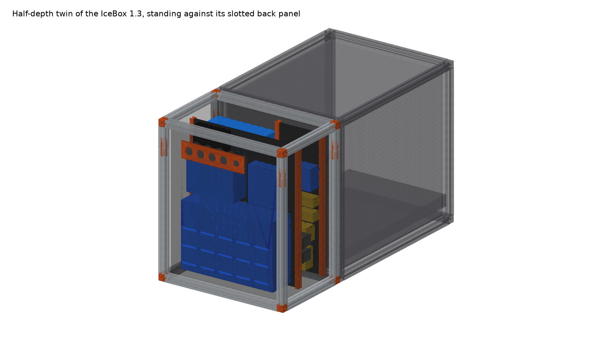
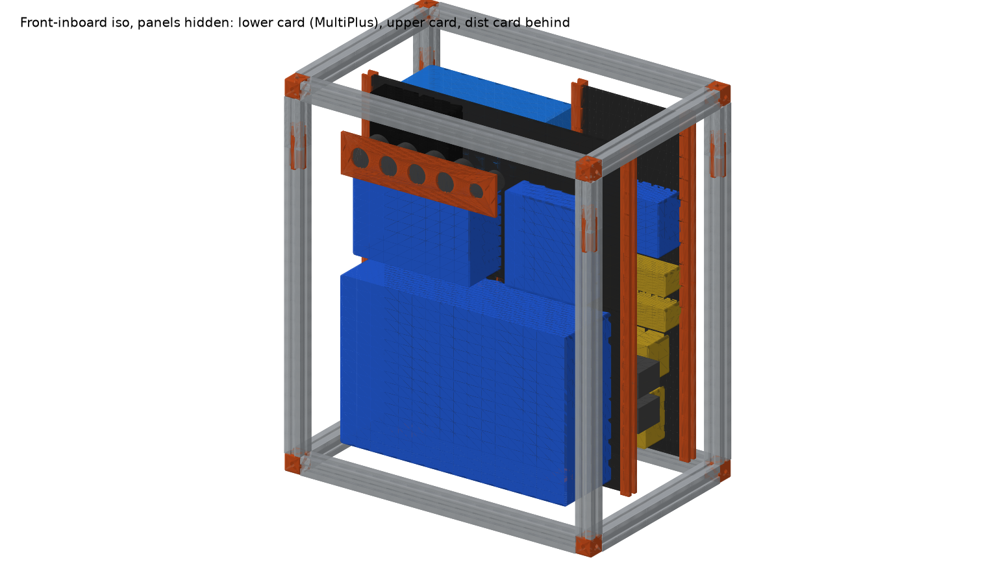
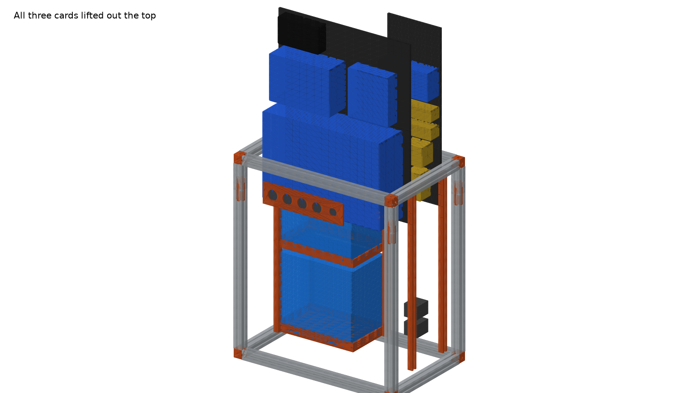

# 4Runner Electronics Card Cage

**Vehicle:** Toyota 4Runner, Goose Gear plate system
**Replaces:** the plywood battery box that sits on the plate against the IceBox 1.3 slotted back panel
**Status:** Concept v2 "half IceBox" — parametric CAD done; 8 mod kits ordered; cargo-ceiling height still to measure (2026-10-04)

**Goal:** take another IceBox 1.3, cut its depth in half, and lay everything out on cards that drop in from the top. The box is **exactly the IceBox's width and height (19-3/16" × 22") and half its depth (12-1/2")**, standing against the IceBox's slotted back panel so the two read as one unit. Same look (1" extrusion frame, black corner cubes, black panels), 3D-printed interior, and **no off-the-shelf extrusion**: every rail is cut from Goose Gear mod-kit bars (8 kits, 16 bars), everything else is printed.

| | |
|---|---|
| Interactive 3D | [Published viewer](https://claude.ai/artifact/6eBbQY1pbboG68gWnnFshe) or `viewer/index.html` (serve it: `cd battery-box/viewer && python3 -m http.server`, then open http://localhost:8000) |
| CAD source | `cad/cage.py` (CadQuery, every dimension is a parameter) |
| Printable parts | `stl/*.stl` (regenerated by `cage.py`) |
| Renders | `renders/*.png` |
| Photos of the current box | `photos/` |





---

## 1. What goes in it (owner's list, 2026-10-04)

Dimensions are manufacturer figures **as mounted in this design** (X along the box, Y across, Z up). Sources in [components.md](components.md).

| # | Component | As-mounted W×D×H (mm) | Weight | Where it goes |
|---|---|---|---|---|
| 1 | **Victron Lithium SuperPack 12.8V/60Ah** ×2 (M6 top terminals, internal BMS) | 138 deep × 229 wide × 213 tall each | 9.5 kg each | Rear layer, outboard column, **stacked** in a printed tray + printed mid-shelf |
| 2 | **Victron MultiPlus 12/800/35-16 120V** (800 W inverter/charger) | 100 deep × 360 wide × 240 tall, on its side | 6.4 kg | **Lower card**, on two printed feet, keyholes bolted through the card |
| 3 | **Victron SmartSolar MPPT 100/30** | 70 × 186 × 130, upright, terminals down | 1.3 kg | **Upper card**, bottom row |
| 4 | **Victron Orion XS 12/12-50A** DC-DC charger | 40 × 123 × 137, upright, terminals down | 0.33 kg | **Upper card**, bottom row, next to the MPPT |
| 5 | **Garmin PowerSwitch** (USB, cigarette-lighter and other 12 V loads) | 32 × 125 × 75 | 0.28 kg | **Upper card**, top row |
| 6 | **Victron Cerbo GX** | 48 × 154 × 78 | ~0.5 kg | **Dist card**, top |
| 7 | **Victron SmartShunt 500A** | 46 × 120 × 54 | ~0.3 kg | **Dist card**, between breakers and bus bars |
| 8 | Covered 5-stud bus bars ×2 (Blue Sea 2300-class) | 35 × 155 × 32 each | — | **Dist card** |
| 9 | Battery circuit breakers ×2 (surface-mount, 285-style) | 43 × 48 × 74 each | — | **Dist card**, bottom, 150 mm from the battery terminals |
| 10 | Panel-mount 12 V / USB sockets ×4 + 1 smaller | 29 mm and 22 mm holes | — | Printed insert in the **front panel**, above the MultiPlus band, facing the cabin |
| 11 | **Anderson SB50** panel mounts ×2, solar ingress | 48 × 36 mm cutouts (verify) | — | Inboard side panel, rear layer, right by the dist card |
| 12 | 6 AWG wiring throughout | — | — | Battery → breakers → shunt/bus is all inside the 144 mm rear layer; bus → MultiPlus crosses the card gap at the bottom |

### Orientation notes
- **Orion XS and MPPT 100/30:** both upright on the upper card with terminals down, exactly as Victron asks (the vertical layout is what made this possible).
- **MultiPlus 12/800:** on its side (360 wide × 240 tall) on the lower card. The family manual only requires "a dry, well-ventilated and heatproof area" with free space around its vents; it doesn't mandate upright. The front panel has three rows of vent slots over the MultiPlus band, and its 5 mm gap to the panel keeps the vents open.
- **SuperPacks stacked:** 2 × 213 + lug clearance + tray + shelf = 468 mm of 496 available. This assumes the 213 mm height already includes the terminal posts (verify on the battery). If it doesn't, the stack still fits but the lid is close; the alternative is to lay the upper battery on its side, which Victron's SuperPack manual allows for LiFePO4.

---

## 2. Layout

Three layers in depth, inside a 255 mm inner cavity (outer 317.5 mm, half an IceBox):

```
 side view (looking inboard)            top view, lid off
 ┌───────────────────────┐  559         ┌─────────┬──┬────────────┐
 │  lid                  │              │ dist    │  │ upper/lower│  inboard
 │ ┌─────┐ ┌───────────┐ │              │ card ◄──┼──┼─ cards ────┼──► sockets
 │ │batt │ │ upper card│ │              ├─────────┤  │  MultiPlus │  on the
 │ │upper│ │ MPPT Orion│ │              │ battery │  │  (front    │  front
 │ ├─────┤ ├───────────┤ │              │ stack   │  │   layer)   │  panel
 │ │batt │ │ lower card│ │              │ (rear   │  │            │
 │ │lower│ │ MultiPlus │ │              │  layer) │  │            │  outboard
 └─┴─────┴─┴───────────┴─┘  0           └─────────┴──┴────────────┘
   IceBox◄ 144 │6│ 105 ►front            IceBox ◄───── 317.5 ─────► front
```

| Layer | Depth | What |
|---|---|---|
| **Rear** (against the IceBox) | 144 mm | Outboard: the two SuperPacks stacked in a printed tray with a printed mid-shelf. Inboard: the **dist card** (162 × 488) with breakers, SmartShunt, both bus bars and the Cerbo, in its own pair of guides. Anderson SB50 solar inlets in the inboard side wall. |
| **Cards** | 6 mm | **Lower card** (401 × 254): the MultiPlus on its side on two printed feet. **Upper card** (401 × 236): MPPT and Orion upright on the bottom row, Garmin PowerSwitch above. Both ride in the same two side-wall guides; the upper sits on the lower's top edge. |
| **Front** | 105 mm | Nothing but the components standing off the cards. The removable front panel carries vent slots over the MultiPlus and the printed socket insert at 430 mm. |

Service: lid off, lift the upper card (3 kg, needs **795 mm** plate-to-ceiling), then the lower card (8 kg, 813 mm). The dist card is 488 mm tall and needs 1047 mm straight up, so in the vehicle it comes out by lifting it clear of its guides and tilting forward into the empty front layer. The batteries drop into their tray from the top with the cards out. **Measure the cargo-area ceiling above the plate**: a 5th-gen 4Runner is about 905 mm floor to headliner, so the upper and lower cards should clear, but that is the number that decides whether the cards lift out in place or only with the box out.

Mass is about 36 kg in a box only 318 mm deep, so it must be tied down: T-nuts in the bottom rails to the plate, and a printed hook plate on the IceBox-side panel into the slotted panel.

### Printed parts (all in `stl/`)

| Part | Qty | Size (mm) | Notes |
|---|---|---|---|
| Corner cube | 8 | 25.4³ | Visual twin of the Goose Gear black corner; three 6.8 mm bores for 1/4-20 end-tap screws. Black ASA. |
| Rail splice | 4 | 60 × 22 × 22 | Cross key sliding into the four slots on both sides of the height-rail joint. |
| Card guide segment | 8 | 250 / 244 × 18 × 14 | U-channel, 7.2 mm slot, flared top; two per side wall for the main cards, two per side for the dist card (one on the wall, one on a printed post next to the batteries). |
| Battery tray | 1 | 237 × 146 × 24 | 20 mm lips, two strap slots. Fits the bed. |
| Battery mid-shelf | 1 | 237 × 146 × 22 | Sits on the lower battery, 12 mm lip locates the upper; bolt to the side rail. |
| MultiPlus feet | 2 | 50 × 40 × 10 | Take the 6.4 kg on the lower card; the keyholes only locate. |
| Socket insert | 1 | 245 × 60 × 5 | Fills the cutout in the front panel; 4 × 29 mm + 1 × 22 mm. |

PETG or ASA, not PLA (hot vehicle). Cubes, feet and splices at 100 %; guides and rails 4 walls / 40 %.

### Frame: 16 kit bars, nothing off the shelf, nothing printed

Each Extrusion Frame Modification Kit x.31 bar is an IceBox width rail: 19-3/16" minus two 1" corner cubes, so **~437 mm** (verify on arrival). Eight kits give 16 bars. The MaxLite die can't be copied on a printer, so every rail is aluminium; the script produces this cut plan:

| Rail | Need | From |
|---|---|---|
| Height ×4 | 508 mm | one full bar (437) + a 71 mm piece, joined with a printed splice; all four 71 mm pieces come out of **bar 2** (151 mm left over) |
| Width ×4 | 437 mm | one full bar each, no cut |
| Depth ×4 | 267 mm | one bar each cut to length (170 mm offcut each) |

13 bars touched, 3 untouched, 4 splices, 4 × 170 mm + 1 × 151 mm offcuts (handy for a lid stiffener or the hook plate). The printed splice is a cross key that slides into the four slots on both sides of the joint, with a 1/4-20 bolt into each bar's end tap. The splice sits 71 mm from the top of each height rail, right under the top corner cube, where the panel screws on both sides of the joint carry the load.

| Panel (6 mm) | Qty | Size |
|---|---|---|
| Floor + lid | 2 | 267 × 437 |
| Sides | 2 | 267 × 508 (inboard gets two 48 × 36 Anderson cutouts) |
| Back (IceBox side) | 1 | 425 × 508, one 120 × 30 cable slot low down, lined up with the IceBox slots |
| Front (removable) | 1 | 425 × 508, 3 rows of vent slots + socket-insert cutout |

### How it sits against the IceBox 1.3


Same 487.4 × 558.8 mm face, so the frames line up corner to corner and the two decks are flush. The model has them touching (`icebox_gap = 0`). The cage's back panel has a cable slot at 40 mm up that lands on the IceBox's bottom row of slots, which is where the fridge cable and a printed hook plate go.

## 3. Phase 2 envelope check: four SuperPacks + MultiPlus-II 12/3000/120-50

| Item | Size (mm) |
|---|---|
| MultiPlus-II 12/3000/120-50 120V | 506 × 275 × 147 (h × w × d), ~19 kg (verify) |
| 4 × SuperPack 60Ah | 4 × (138 × 229 × 213) |

- **Height is the hard limit** (559 outer): the MultiPlus-II is 506 tall upright, which does not fit inside 496. On its side it is 275 tall × 506 wide, and 506 is wider than the 425 inner width. So the MultiPlus-II does not fit this footprint in any orientation. Phase 2 with that unit means either a wider box than the IceBox or a different inverter (the MultiPlus 12/1600/70 is 420 × 282 × 100 upright: fits width-wise only on its side at 282 tall, which works).
- **Four batteries:** a second stacked column needs another 237 mm of width, which the 425 inner doesn't have next to the cards. The honest answer is a second, deeper box or a 1.5-depth version (476 mm) with two battery columns in depth.

Phase 1 is built for exactly what you have today. The parameters that would grow it are `rear_depth` and `icebox_W`.

## 4. Open questions (answers change the model)

1. **Cargo ceiling height above the plate** where the box sits: decides whether the cards lift out in the vehicle (needs ~800 mm) or only with the box out.
2. **Mod kit contents:** confirm 2 bars per kit and ~437 mm each when they arrive.
3. **Does the SuperPack's 213 mm include the terminal posts?** Decides the stack height margin.
4. **Cables entering the box:** alternator feed to the Orion and chassis ground. Solar is on the inboard Andersons, the fridge goes through the back-panel slot. Tell me where the alternator feed arrives and I'll add a gland.
5. **MaxLite slot width:** measure one slot on the IceBox so the T-nut choice is right (1/4-20 roll-in T-nuts are consistent with Goose Gear's anchor kit, but it is not published).

---

## 5. Working with the model

```bash
cd battery-box/cad
python3 -m venv .venv && .venv/bin/pip install -r requirements.txt
.venv/bin/python cage.py      # prints fit report + cut list, writes stl/ and viewer/cage.json
.venv/bin/python render.py    # writes renders/*.png
```

Change a number in `P`, `COMPONENTS`, `FLOOR_LAYOUT` or `CARD_LAYOUT`, re-run, and the fit report tells you what no longer fits.

## Build log

| Date | Notes |
|---|---|
| 2026-10-04 | Project started. Identified components from photos, pulled datasheet dims, built parametric CadQuery model with drop-in card, printed-part STLs, renders and web viewer. Four Goose Gear mod kits on order. |
| 2026-10-04 | Owner confirmed the list: 2 × SuperPack 60Ah, MultiPlus 12/800/35, MPPT 100/30 with Anderson solar ingress, Cerbo, Orion XS 12/12-50, SmartShunt, Garmin PowerSwitch, battery breakers, 6 AWG. Dropped the unidentified parts. Added the IceBox 1.3 to the model and switched the frame to kit bars + printed rails. |
| 2026-10-04 | Ordered 4 more mod kits (8 total, 16 bars). Frame is now all kit aluminium with a cut plan; no printed rail. |
| 2026-10-04 | **v2:** re-laid out as a half-depth twin of the IceBox (317.5 × 487.4 × 558.8). Batteries stacked, MultiPlus on its side on a lower card, MPPT/Orion/Garmin on an upper card, distribution on a third card beside the batteries. v1 long-box layout kept in git history (`cad/cage.py` before this commit). |
