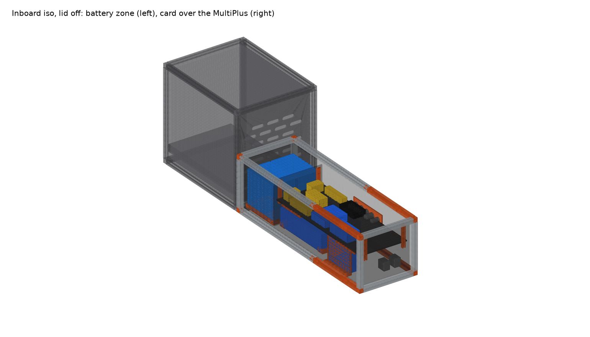
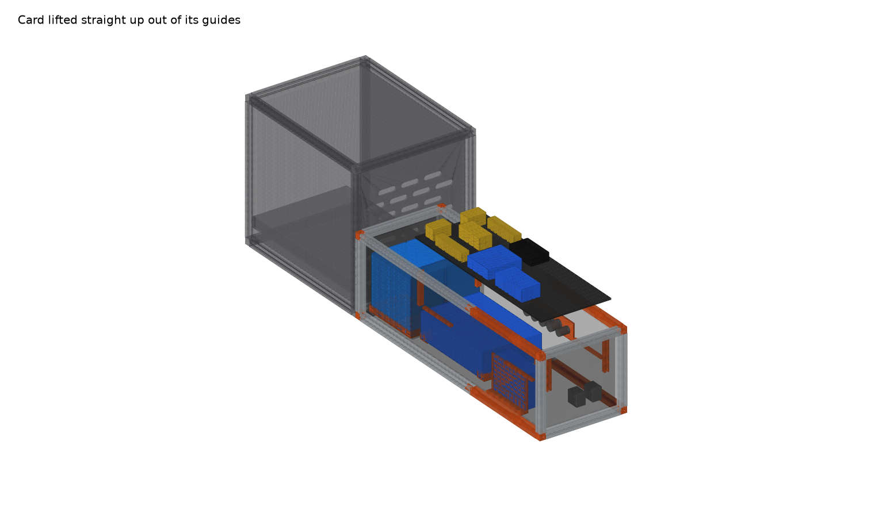

# 4Runner Electronics Card Cage

**Vehicle:** Toyota 4Runner, Goose Gear plate system
**Replaces:** the plywood battery box that sits on the plate with one end against the IceBox 1.3 slotted back panel
**Status:** Concept v1 — parametric CAD done, dimensions awaiting field measurement (2026-10-04)

**Goal:** a box that looks like the Goose Gear IceBox (1" extrusion frame, black corner cubes, black panels) with a 3D-printed interior: batteries and the MultiPlus live on the floor, and *all the small electronics live on one removable card* that drops straight down into printed guides and lifts straight out for service. **No off-the-shelf extrusion:** the aluminium comes from the four Goose Gear mod kits, everything else is printed.

| | |
|---|---|
| Interactive 3D | [Published viewer](https://claude.ai/artifact/6eBbQY1pbboG68gWnnFshe) or `viewer/index.html` (serve it: `cd battery-box/viewer && python3 -m http.server`, then open http://localhost:8000) |
| CAD source | `cad/cage.py` (CadQuery, every dimension is a parameter) |
| Printable parts | `stl/*.stl` (regenerated by `cage.py`) |
| Renders | `renders/*.png` |
| Photos of the current box | `photos/` |





---

## 1. What goes in it (owner's list, 2026-10-04)

Dimensions are manufacturer figures **as mounted in this design** (X along the box, Y across, Z up). Sources in [components.md](components.md).

| # | Component | As-mounted W×D×H (mm) | Weight | Where it goes |
|---|---|---|---|---|
| 1 | **Victron Lithium SuperPack 12.8V/60Ah** ×2 (M6 terminals, internal BMS) | 229 × 138 × 213 each | 9.5 kg each | Floor, IceBox end, side by side in a printed 2-bay tray |
| 2 | **Victron MultiPlus 12/800/35-16 120V** (800 W inverter/charger) | 360 × 240 × 100 lying flat | 6.4 kg | Floor, under the card, in 4 printed corner cradles |
| 3 | **Victron SmartSolar MPPT 100/30** | 186 × 70 × 130 standing, terminals down | 1.3 kg | Floor, far end, under the card, printed stand with the 176 × 71.5 mm keyhole pattern |
| 4 | **Victron Cerbo GX** | 154 × 78 × 48 | ~0.5 kg | Card, top |
| 5 | **Victron Orion XS 12/12-50A** DC-DC charger | 123 × 137 × 40 (flat, as today) | 0.33 kg | Card, top (see orientation note) |
| 6 | **Victron SmartShunt 500A** | 120 × 54 × 46 | ~0.3 kg | Card, top, between the bus bars |
| 7 | **Garmin PowerSwitch** (USB, cigarette-lighter and other 12 V loads) | 125 × 75 × 32 | 0.28 kg | Card, top |
| 8 | Covered 5-stud bus bars ×2 (Blue Sea 2300-class) | 155 × 32 × 35 each | — | Card, top |
| 9 | Battery circuit breakers ×2 (surface-mount, 285-style) | 48 × 74 × 43 each | — | Card, top, nearest the batteries |
| 10 | Panel-mount 12 V / USB sockets ×4 + 1 smaller | 29 mm and 22 mm holes | — | Printed insert in the inboard side panel, above the card |
| 11 | **Anderson SB50** panel mounts ×2, solar ingress | 48 × 36 mm cutouts (verify) | — | Far end panel, lower level, right beside the MPPT |
| 12 | 6 AWG wiring throughout | — | — | Bend radius ~60 mm; the 150 mm card height leaves room under the card for the battery-to-bus runs |

### Orientation notes
- **Orion XS:** Victron says "mount vertically on a non-flammable surface with the power terminals facing downwards", ≥10 cm clearance, heatsink to 90 °C. It is flat today and the design keeps it flat for now. If it has been throttling on long drives, stand it on a printed L-bracket at the end of the card (137 mm tall fits under the lid with 104 mm headroom only if the card drops to ~110 mm, which conflicts with the MPPT; so the alternative is to move the MPPT onto the IceBox slotted panel — see Phase 2).
- **MPPT 100/30:** standing, terminals down, as Victron intends. It is 130 mm tall and lives under the card, which is why the card sits at 150 mm.
- **MultiPlus 12/800:** the family manual only requires "a dry, well-ventilated and heatproof area" with free space for its vents; it does not mandate vertical. Flat on the floor is fine. Keep its vents clear: no cables bundled over the end grilles, and slot the far end panel for airflow.

---

## 2. Layout

```
 IceBox end                                                            far end
 ┌──────────┬──┬──────────────────────────────────────────────────────────┐
 │ SuperPack│bk│  ╔════════════════ card, 726 × 282, @150 mm ═══════════╗ │ inboard side
 │  (inbd)  │hd│  ║ brk  bus+   | Orion    | Cerbo   |  dongle          ║ │ ← socket insert
 │──────────│  │  ║ brk  shunt  |          |         |                  ║ │   (5 holes, above card)
 │ SuperPack│  │  ║      bus−   | Garmin   |         |  [finned, under] ║ │
 │  (outbd) │  │  ╚═════════════════════════════════════════════════════╝ │
 │ 2-bay    │  │   [ MultiPlus 12/1200 lying flat, 406×250 ]  [MPPT ▮ ]    │ outboard side
 └──────────┴──┴──────────────────────────────────────────────────────────┘
   0       245 251                                                      1000  (mm, inner)
```

Three zones along the length:

1. **Battery zone (0–245 mm):** two SuperPacks side by side in a printed two-bay tray with strap slots. Nothing above them but the lid, so terminals and cables have 43 mm of clear air and the batteries never have to move to service electronics.
2. **Bulkhead (245–251 mm):** a 6 mm panel that stops the batteries sliding under braking and carries two of the four card guides. Cables pass through a slot at the bottom.
3. **Card zone (251–1000 mm):** MultiPlus flat on the floor in four printed corner cradles, MPPT standing at the far end on a printed stand. Above them at 150 mm, the card.

The box is inner **1000 × 290 × 260 mm**, outer **1063 × 353 × 323 mm** (41.8 × 13.9 × 12.7 in). That is roughly today's footprint; the IceBox is 559 mm tall, so this is well under it.

### The card
- 6 mm plate, 726 × 282 mm. Material options, best first: **6 mm black phenolic-faced birch** (matches the IceBox panels, easy to drill, stiff), 1/4" HDPE, or four printed tiles with dovetail joints (each ≤ 256 mm for the P1S).
- Drops into four printed U-channel guides (two on the bulkhead, two on the far end panel) with a 6 mm flared lead-in, and lands on four printed ledges bolted to the long rails with T-nuts.
- Everything on it stays wired; the battery leads, MultiPlus DC leads and MPPT output are the only cables that cross from the lower level, so give those enough slack (or Anderson SB50s at the bulkhead) to lift the card ~300 mm and set it on the lid.
- Component mounts (next iteration): printed clips for the Cerbo, Orion, Garmin and bus bars with heat-set M4 inserts in the plate, so nothing needs a nut on the underside.

### Printed parts (all in `stl/`)

| Part | Qty | Size (mm) | Notes |
|---|---|---|---|
| Corner cube | 8 | 25.4³ | Visual twin of the Goose Gear black corner; three 6.8 mm bores for 1/4-20 end-tap screws. Print in black ASA/PETG. |
| Card guide | 4 | 133 × 18 × 14 | U-channel, 7.2 mm slot (6 mm card + 0.6 per side), flared top. Bolts to the vertical bar slot. |
| Card ledge | 4 | 160 × 12 × 8 | Bolts to the long rails at 142 mm; the card sits on these. |
| Battery tray | 1 (2 halves) | 288 × 237 × 24 | Exceeds the 256 bed, so split at the centre wall; 20 mm lips, 2 strap slots per bay. |
| MultiPlus cradle | 4 | 40 × 40 × 24 | Corner cups; screw to the floor panel. |
| MPPT stand | 1 | 202 × 140 × 30 | Victron keyhole pattern 176 × 71.5; screw base to floor and back to the end panel. |
| Socket insert | 1 | 245 × 70 × 5 | Fills a cutout in the inboard panel; 4 × 29 mm + 1 × 22 mm holes. |

Print orientation and materials: PETG or ASA (the box lives in a hot vehicle; PLA will creep). Cubes and cradles at 100 % infill; guides and ledges 4 walls, 40 %.

### Frame: kit bars + printed rails, nothing off the shelf

The frame needs 4 long rails (1012 mm), 4 width rails (302 mm) and 4 height rails (272 mm). The four Extrusion Frame Modification Kits are assumed to be **2 bars each, ~25" (635 mm)**; Goose Gear doesn't publish either number, so `kit_bars` and `bar_stock` in `cage.py` are placeholders until the kits arrive. With those assumptions the script allocates:

| Rail | Source |
|---|---|
| 4 × width (302) + 4 × height (272) | 4 kit bars, each cut into one of each (574 of 635 used) |
| 4 × long (1012) | 4 kit bars at full 635 length + **printed 250 + 127 mm segments** joined with printed cross-shaped splices |

So all eight bars get used, and 1.5 m of rail is printed in 8 segments. The printed rail has the same 1" envelope and slot pattern as the bar, so the corner cubes, ledges and guides don't care which they land on. If the bars turn out shorter than 574 mm, the script moves the height rails to printed and says so.

Is a printed rail strong enough? On its own, no match for aluminium. In this box it doesn't have to be: the 6 mm panels are screwed to the rails on every edge, so the box is a stressed-skin shell and the rails are mostly locators. Print rails in ASA or PETG, 4 walls, 40 % gyroid, lying flat. The splices and corner cubes carry the real joints; put a 1/4-20 bolt through the splice into the bar's end tap.

Cut list from `cage.py` (inner 1000 × 290 × 260):

| Item | Qty | Size |
|---|---|---|
| Floor + lid panel, 6 mm | 2 | 1012 × 302 |
| Side panels, 6 mm | 2 | 1012 × 272 |
| End panels, 6 mm | 2 | 290 × 272 (far end gets two 48 × 36 Anderson cutouts) |
| Bulkhead, 6 mm | 1 | 290 × 258 |

### How it sits against the IceBox 1.3


The cage's IceBox end is 353 mm wide × 323 mm tall; the IceBox back panel is 487 × 559, so the cage top sits 236 mm below the IceBox deck and the slotted panel has ~134 mm of width to spare. In the model the two outboard faces are flush (`icebox_y = 0`) with no gap (`icebox_gap = 0`); change either if the plate layout differs. The slots on that panel line up with the lower half of the cage end, which is where a printed MOLLE hook plate could tie the two together and where the fridge cable passes through.

## 3. Phase 2 envelope check: four SuperPacks + MultiPlus-II 12/3000/120-50

Not designed yet, but the numbers that decide whether it fits in the same box:

| Item | Size (mm) |
|---|---|
| MultiPlus-II 12/3000/120-50 120V | 506 × 275 × 147 (h × w × d), ~19 kg (verify) |
| 4 × SuperPack 60Ah as a 2 × 2 grid | 470 × 288 footprint, 213 tall |

- **Vertical MultiPlus-II is out:** 506 + floor and lid stack puts the box at ~568 mm, taller than the IceBox (559).
- **Flat MultiPlus-II works:** 147 tall under a card at ~160 mm; the box height does not change (batteries already set 260 mm inner).
- **Length is the problem:** 2 × 2 batteries (470) + bulkhead (6) + MultiPlus-II (506) = 982 mm, which fits in 1000 only if the **MPPT moves out of the box**, for example onto the IceBox slotted back panel on a printed MOLLE bracket. Keeping the MPPT inside means a ~1200 mm (47") inner length.
- Weight on the plate goes from ~30 kg to ~60 kg. Add two more tie-down points.

Decision for now: build Phase 1 at 1000 mm but **route the MPPT cables so it can be relocated**, and leave the far-end panel removable.

---

## 4. Open questions (answers change the model)

1. **Measure the plywood box:** inner L × W × H, and the max height the plate area allows. `in_L / in_W / in_H` in `cage.py`.
2. **Mod kit contents:** bar count and length. This decides how much rail gets printed.
3. **Which end of the box** should the batteries be on: against the IceBox (as modelled, shortest fridge-cable run) or the far end?
4. **Cables entering the box:** alternator feed to the Orion, solar PV in, fridge out through the IceBox slots, chassis ground. I have the socket insert on the inboard side; tell me which end the external cables come in and I'll add a printed gland plate.
5. **MaxLite slot width:** measure one slot on the IceBox so the T-nut choice is right (1/4-20 roll-in T-nuts are consistent with Goose Gear's anchor kit, but it is not published).

---

## 5. Working with the model

```bash
cd battery-box/cad
python3 -m venv .venv && .venv/bin/pip install -r requirements.txt
.venv/bin/python cage.py      # prints fit report + cut list, writes stl/ and viewer/cage.json
.venv/bin/python render.py    # writes renders/*.png
```

Change a number in `P`, `COMPONENTS`, `FLOOR_LAYOUT` or `CARD_LAYOUT`, re-run, and the fit report tells you what no longer fits.

## Build log

| Date | Notes |
|---|---|
| 2026-10-04 | Project started. Identified components from photos, pulled datasheet dims, built parametric CadQuery model with drop-in card, printed-part STLs, renders and web viewer. Four Goose Gear mod kits on order. |
| 2026-10-04 | Owner confirmed the list: 2 × SuperPack 60Ah, MultiPlus 12/800/35, MPPT 100/30 with Anderson solar ingress, Cerbo, Orion XS 12/12-50, SmartShunt, Garmin PowerSwitch, battery breakers, 6 AWG. Dropped the unidentified parts. Added the IceBox 1.3 to the model and switched the frame to kit bars + printed rails. |
