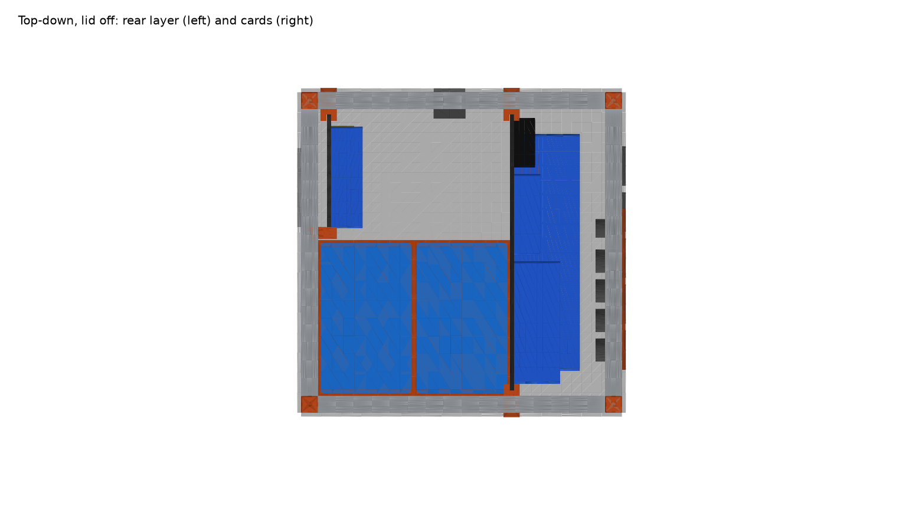

# 4Runner Electronics Card Cage

**Vehicle:** Toyota 4Runner, Goose Gear plate system
**Replaces:** the plywood battery box that sits on the plate against the IceBox 1.3 slotted back panel
**Status:** Concept v3 "cube" — parametric CAD done; 8 mod kits ordered; cargo-ceiling height still to measure (2026-10-04)

**Goal:** a cube built from **12 uncut Goose Gear mod-kit bars**. Each bar is the IceBox 1.3 width rail (~437 mm), so the frame is 487.4 mm in every direction: the IceBox's exact width, 71 mm shorter than the IceBox, standing against its slotted back panel. Everything inside is on cards that drop in from the top. Same look (1" extrusion frame, black corner cubes, black panels), 3D-printed interior, **no off-the-shelf extrusion and no saw cuts**.

| | |
|---|---|
| Interactive 3D | [Published viewer](https://claude.ai/artifact/6eBbQY1pbboG68gWnnFshe) or `viewer/index.html` (serve it: `cd battery-box/viewer && python3 -m http.server`, then open http://localhost:8000) |
| CAD source | `cad/cage.py` (CadQuery, every dimension is a parameter) |
| Printable parts | `stl/*.stl` (regenerated by `cage.py`) |
| Renders | `renders/*.png` |
| Photos of the current box | `photos/` |




---

## 1. What goes in it (owner's list, 2026-10-04)

Dimensions are manufacturer figures **as mounted in this design** (X along the box, Y across, Z up). Sources in [components.md](components.md).

| # | Component | As-mounted W×D×H (mm) | Weight | Where it goes |
|---|---|---|---|---|
| 1 | **Victron Lithium SuperPack 12.8V/60Ah** ×2 (M6 top terminals, internal BMS) | 138 deep × 229 wide × 213 tall each | 9.5 kg each | Rear layer, outboard, **end to end in depth**, one printed tray each |
| 2 | **Victron MultiPlus 12/800/35-16 120V** (800 W inverter/charger) | 100 deep × 360 wide × 240 tall, on its side | 6.4 kg | **Lower card**, on two printed feet, keyholes bolted through the card |
| 3 | **Victron SmartSolar MPPT 100/30** | 70 × 186 × 130, upright, terminals down | 1.3 kg | **Upper card**, bottom row |
| 4 | **Victron Orion XS 12/12-50A** DC-DC charger | 40 × 123 × 137, upright, terminals down | 0.33 kg | **Upper card**, bottom row, next to the MPPT |
| 5 | **Garmin PowerSwitch** (USB, cigarette-lighter and other 12 V loads) | 32 × 75 × 125, turned 90° | 0.28 kg | **Upper card**, same row as the MPPT and Orion |
| 6 | **Victron Cerbo GX** | 48 × 154 × 78 | ~0.5 kg | **Dist card**, top |
| 7 | **Victron SmartShunt 500A** | 46 × 120 × 54 | ~0.3 kg | **Dist card**, between breakers and bus bars |
| 8 | Covered 5-stud bus bars ×2 (Blue Sea 2300-class) | 35 × 155 × 32 each | — | **Dist card** |
| 9 | Battery circuit breakers ×2 (surface-mount, 285-style) | 43 × 48 × 74 each | — | **Dist card**, bottom, 150 mm from the battery terminals |
| 10 | Panel-mount 12 V / USB sockets ×4 + 1 smaller | 29 mm and 22 mm holes | — | Printed insert in the **front panel**, above the MultiPlus band, facing the cabin |
| 11 | **Anderson SB50** panel mounts ×2, solar ingress | 48 × 36 mm cutouts (verify) | — | Inboard side panel, rear layer, right by the dist card |
| 12 | 6 AWG wiring throughout | — | — | Battery → breakers → shunt/bus is all inside the 144 mm rear layer; bus → MultiPlus crosses the card gap at the bottom |

### Orientation notes
- **Orion XS and MPPT 100/30:** both upright on the upper card with terminals down, exactly as Victron asks (the vertical layout is what made this possible).
- **MultiPlus 12/800:** on its side (360 wide × 240 tall) on the lower card. The family manual only requires "a dry, well-ventilated and heatproof area" with free space around its vents; it doesn't mandate upright. The front panel has three rows of vent slots over the MultiPlus band, and its 5 mm gap to the panel keeps the vents open.
- **SuperPacks:** upright, end to end in depth, 200 mm of air above the lugs. No stacking needed in the cube.

---

## 2. Layout

Inside the cube the clear space is 437 × 437 wide and deep and 431 tall above the floor panel. Panels are screwed to the **outside** of the bars with T-nuts, the way Goose Gear does it, so the frame size is what matches the IceBox.

```
 side view (looking inboard)                  top view, lid off
 ┌──────────────────────────────┐  487        ┌───────────────┬──┬──────────┐
 │  lid                         │             │ dist card     │  │ cards    │  inboard
 │          ┌───┐  ┌──────────┐ │             ├───────────────┤  │          │  sockets on
 │  dist    │   │  │upper card│ │             │ batt 1│ batt 2│  │ MultiPlus│  the front
 │  card ───┤   │  ├──────────┤ │             │ (end to end   │  │ (front   │  panel
 │  (rear)  │   │  │lower card│ │             │  in depth)    │  │  layer)  │
 │ ┌──────┐ │   │  │ MultiPlus│ │             │               │  │          │  outboard
 └─┴──────┴─┴───┴──┴──────────┴─┘  0          └───────────────┴──┴──────────┘
   IceBox ◄── 292 ──►│6│◄─ 139 ─► front        IceBox ◄──────── 487 ────────► front
```

| Layer | Depth | What |
|---|---|---|
| **Rear** (against the IceBox) | 292 mm | Outboard: the two SuperPacks **end to end in depth**, each in its own printed tray (the 431 mm height can't take a stack any more). Inboard: the **dist card** (180 × 423) with breakers, SmartShunt, both bus bars and the Cerbo, in its own pair of posts. Anderson SB50 solar inlets in the inboard side panel. |
| **Cards** | 6 mm | **Lower card** (419 × 254): the MultiPlus on its side on two printed feet. **Upper card** (419 × 171): MPPT, Orion and the Garmin PowerSwitch (turned 90°) in one row, all upright with terminals down. Both ride in the same two guide posts; the upper sits on the lower's top edge. |
| **Front** | 139 mm | Nothing but the components standing off the cards. The removable front panel carries vent slots over the MultiPlus and the printed socket insert at 345 mm. |

Service: lid off, lift the upper card (3 kg, needs **658 mm** plate-to-ceiling), then the lower card (8 kg, 741 mm). The dist card is 423 mm tall and needs 910 mm straight up, so in the vehicle it comes out by lifting it clear of its posts and tilting forward into the front layer. The batteries lift straight out with the cards in place; there is 200 mm of clear air above their lugs.

Mass is about 36 kg. The cube is far more stable than the slab was, but still tie it down: T-nuts in the bottom rails to the plate, and a printed hook plate on the IceBox-side panel into the slotted panel.

### Printed parts (all in `stl/`)

| Part | Qty | Size (mm) | Notes |
|---|---|---|---|
| Corner cube | 8 | 25.4³ | Visual twin of the Goose Gear black corner; three 6.8 mm bores for 1/4-20 end-tap screws. Black ASA. |
| Rail splice | 4 | 60 × 22 × 22 | Cross key sliding into the four slots on both sides of the height-rail joint. |
| Guide post | 4 posts × 2 segments | 24 × 18 × ~215 (+20 mm tenon) | The cards' guides are free-standing printed posts, not wall channels: each has a 7.2 mm card slot down one face, a foot at the bottom that sits on the floor panel and bolts **through it into the bottom rail's T-slot**, and a foot at the top that bolts up into the top rail's slot. Segments stack on 20 mm tenons. Two posts on the depth rails for the main cards; for the dist card one post on the inboard depth rails and a divider post whose feet reach back to the back width rails. |
| Battery tray | 2 | 146 × 237 × 24 | One per battery, butted end to end; 20 mm lips, strap slot. |
| MultiPlus feet | 2 | 50 × 40 × 10 | Take the 6.4 kg on the lower card; the keyholes only locate. |
| Socket insert | 1 | 245 × 60 × 5 | Fills the cutout in the front panel; 4 × 29 mm + 1 × 22 mm. |

PETG or ASA, not PLA (hot vehicle). Cubes, feet and splices at 100 %; guides and rails 4 walls / 40 %.

### Frame: 12 uncut kit bars

Each Extrusion Frame Modification Kit x.31 bar is an IceBox width rail: 19-3/16" minus two 1" corner cubes, so **~437 mm** (verify on arrival). Eight kits give 16 bars; the cube uses **12 as they come, no cuts, no splices**, and leaves 4 spare (a lid stiffener, a divider, or the hook plate's backbone). The MaxLite die can't be copied on a printer, so this is the only all-aluminium frame that needs no saw.

The script's allocator confirms it: 12 rails at 437, 12 bars touched, 0 printed segments, 0 splices.

| Panel (6 mm, screwed to the outside of the bars with T-nuts; floor rests on the bottom rails) | Qty | Size |
|---|---|---|
| Floor (inside, on the rails) | 1 | 487 × 487 |
| Lid (on top of the top rails) | 1 | 487 × 487 |
| Sides | 2 | 487 × 487 (inboard gets two 48 × 36 Anderson cutouts) |
| Back (IceBox side) | 1 | 487 × 487, one 120 × 30 cable slot low down, lined up with the IceBox slots |
| Front (removable) | 1 | 487 × 487, 3 rows of vent slots + socket-insert cutout |

### How it sits against the IceBox 1.3


Same 487.4 mm width, so the vertical bars line up and the outboard faces are flush; the cube's deck sits 71 mm below the IceBox deck. Between the frames sit the two back panels (12 mm, `icebox_gap`). The cage's back panel has a cable slot at 40 mm up that lands on the IceBox's bottom row of slots, which is where the fridge cable and a printed hook plate go.

## 3. Phase 2 envelope check: four SuperPacks + MultiPlus-II 12/3000/120-50

| Item | Size (mm) |
|---|---|
| MultiPlus-II 12/3000/120-50 120V | 506 × 275 × 147 (h × w × d), ~19 kg (verify) |
| 4 × SuperPack 60Ah | 4 × (138 × 229 × 213) |

- **MultiPlus-II:** 506 mm in its long axis in any orientation, against 437 mm clear inside the cube. It does not fit. The MultiPlus 12/1600/70 (420 × 282 × 100) would, on its side on the lower card.
- **Four batteries:** a second end-to-end pair needs another 237 mm of width (437 clear minus the first pair's 237 leaves 200). Stacking is out at 431 mm of height. Four batteries need a second cube, or a wider/taller box than the uncut bars allow.

Phase 1 is built for exactly what you have today.

## 4. Open questions (answers change the model)

1. **Cargo ceiling height above the plate** where the box sits: the main cards need 658 and 741 mm to lift out in the vehicle; the dist card 910 mm or a tilt.
2. **Mod kit contents:** confirm 2 bars per kit and ~437 mm each when they arrive.
3. **Does the SuperPack's 213 mm include the terminal posts?** Less critical now (200 mm above the lugs), but it sets the tray lip height.
4. **Cables entering the box:** alternator feed to the Orion and chassis ground. Solar is on the inboard Andersons, the fridge goes through the back-panel slot. Tell me where the alternator feed arrives and I'll add a gland.
5. **MaxLite slot width:** measure one slot on the IceBox so the T-nut choice is right (1/4-20 roll-in T-nuts are consistent with Goose Gear's anchor kit, but it is not published).

---

## 5. Working with the model

```bash
cd battery-box/cad
python3 -m venv .venv && .venv/bin/pip install -r requirements.txt
.venv/bin/python cage.py      # prints fit report + cut list, writes stl/ and viewer/cage.json
.venv/bin/python render.py    # writes renders/*.png
```

Change a number in `P`, `COMPONENTS`, `FLOOR_LAYOUT` or `CARD_LAYOUT`, re-run, and the fit report tells you what no longer fits.

## Build log

| Date | Notes |
|---|---|
| 2026-10-04 | Project started. Identified components from photos, pulled datasheet dims, built parametric CadQuery model with drop-in card, printed-part STLs, renders and web viewer. Four Goose Gear mod kits on order. |
| 2026-10-04 | Owner confirmed the list: 2 × SuperPack 60Ah, MultiPlus 12/800/35, MPPT 100/30 with Anderson solar ingress, Cerbo, Orion XS 12/12-50, SmartShunt, Garmin PowerSwitch, battery breakers, 6 AWG. Dropped the unidentified parts. Added the IceBox 1.3 to the model and switched the frame to kit bars + printed rails. |
| 2026-10-04 | **v3:** cube from 12 uncut bars (487.4 mm each way, 71 mm under the IceBox). Batteries end to end in depth instead of stacked; Garmin joins the upper card turned 90°. Lift clearances drop to 658 / 741 mm. |
| 2026-10-04 | Card guides were floating: replaced with printed posts bolted into the top and bottom rail T-slots. Panels moved to the outside of the bars (Goose Gear style), which also gains 12 mm of inside width and 6 mm of height. |
| 2026-10-04 | Ordered 4 more mod kits (8 total, 16 bars). Frame is now all kit aluminium with a cut plan; no printed rail. |
| 2026-10-04 | **v2:** re-laid out as a half-depth twin of the IceBox (317.5 × 487.4 × 558.8). Batteries stacked, MultiPlus on its side on a lower card, MPPT/Orion/Garmin on an upper card, distribution on a third card beside the batteries. v1 long-box layout kept in git history (`cad/cage.py` before this commit). |
