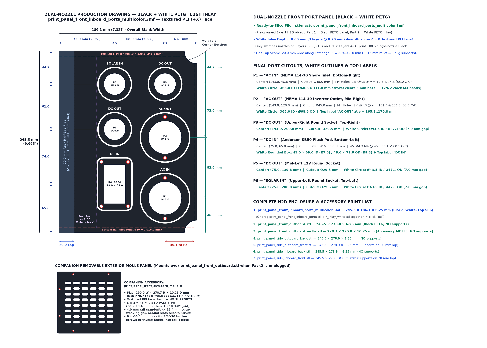

# Dual-Nozzle Front Port Panel & Removable Accessory MOLLE Panel — Production Spec

Source geometry verified directly from `stl/master/print_panel_front_inboard_ports_multicolor.3mf`, `stl/master/print_panel_front_inboard_ports.stl`, `stl/master/print_panel_front_inboard_ports_inlay_white.stl`, `stl/master/print_panel_front_outboard_molle.stl`, and `cad/cage.py`.

---

## 1. Dual-Nozzle Bambu H2D Setup — `print_panel_front_inboard_ports`

Because the panel prints **exterior face down on `Z = 0.00 mm` (Textured PEI plate)**, the `0.60 mm` (`3 × 0.20 mm` layers) White PETG circles, rounded rectangle, and port labels cure dead-flush inside the Black PETG panel face with zero raised snagging edges and only **3 nozzle swaps total** (Layers `1–3`, adding ~15 seconds on the H2D; Layers `4–31` print 100% single-nozzle Black PETG).

- **Option A — Single Multi-Part `.3mf` *(Easiest)*:** Import `stl/master/print_panel_front_inboard_ports_multicolor.3mf` into your Bambu Studio H2D project (`File -> Import -> Import 3MF/STL...`). In the **Objects** list, verify `panel_black` is assigned to your **Black PETG** nozzle and `inlay_white` is assigned to your **White PETG** nozzle, enable **Normal / Snug / On build plate only** supports for the `20 mm` half-lap, and slice.
- **Option B — Paired STLs:** Select **both** `stl/master/print_panel_front_inboard_ports.stl` and `stl/master/print_panel_front_inboard_ports_inlay_white.stl` together, drag them onto the Bambu Studio plate, click **Yes** (*"Load these files as a single object with multiple parts?"*), and set `inlay_white` to your White PETG nozzle.

---

## 2. Final Port Coordinates, White Outlines & Top Labels

Origin: **Left** `u = 0.0 mm` (`20.0 mm` rear half-lap seam), **Bottom** `v = 0.0 mm` (`6.9 mm` bottom rail slot tongue; exposed vertical rail daylight = `v = 6.9 .. 238.6 mm`):

| Port | Top Label | Center `(u, v)` (`mm`) | Cutout & M4 Mounting Holes | White PETG `0.60 mm` Flush Outline (`1.8 mm` Stroke) |
| :--- | :---: | :---: | :--- | :--- |
| **`P1`** *(Bottom-Right)* | **`AC IN`** | `(143.0, 46.8)` | **`Ø45.00 mm`** + `2 × Ø4.30 mm` M4 at 12 & 6 o'clock (`v = 19.3` & `74.3`, `55.0 mm` C-C) | **White Circle:** `Ø65.0 mm` ID / `Ø68.6 mm` OD *(clears `5 mm` bezel + M4 heads)* |
| **`P2`** *(Mid-Right)* | **`AC OUT`** | `(143.0, 128.8)` | **`Ø45.00 mm`** + `2 × Ø4.30 mm` M4 at 12 & 6 o'clock (`v = 101.3` & `156.3`, `55.0 mm` C-C) | **White Circle:** `Ø65.0 mm` ID / `Ø68.6 mm` OD |
| **`P3`** *(Top-Right)* | **`DC OUT`** | `(143.0, 200.8)` | **`Ø29.50 mm`** *(rear locknut)* | **White Circle:** `Ø43.5 mm` ID / `Ø47.1 mm` OD *(`7.0 mm` radial gap from hole)* |
| **`P4`** *(Bottom-Left)* | **`DC IN`** | `(75.0, 65.8)` | **`29.0 W × 53.0 H mm`** + `4 × Ø4.30 mm` M4 @ `45°` (`36.07 × 60.07 mm` C-C) | **White Rounded Box:** `45.0 × 69.0 mm` ID (`R7.5`) / `48.6 × 72.6 mm` OD (`R9.3`) |
| **`P5`** *(Mid-Left)* | **`DC OUT`** | `(75.0, 139.8)` | **`Ø29.50 mm`** *(rear locknut)* | **White Circle:** `Ø43.5 mm` ID / `Ø47.1 mm` OD *(`7.0 mm` radial gap from hole)* |
| **`P6`** *(Top-Left)* | **`SOLAR IN`** | `(75.0, 200.8)` | **`Ø29.50 mm`** *(rear locknut)* | **White Circle:** `Ø43.5 mm` ID / `Ø47.1 mm` OD *(`7.0 mm` radial gap from hole)* |

---

## 3. Removable Exterior Accessory MOLLE Panel — `print_panel_front_outboard_molle.stl`

Bolts directly onto the **outer `+X` T-slots** of the three front 25-series aluminum rails over `print_panel_front_outboard.stl` whenever the `Pack2` SB50 umbilical is not plugged in:

| Feature | Specification | Notes |
| :--- | :--- | :--- |
| **Overall Envelope** | `290.0 W × 278.7 H × 10.25 D mm` (`11.42" × 10.97" × 0.404"`) | `6.25 mm` main plate + `4.00 mm` integral rear rail-standoff pads |
| **H2D Print Footprint** | **`278.7 (X) × 290.0 (Y) × 10.25 (Z) mm`** | **1-piece H2D print**, Textured PEI face down on `Z = 0`, **NO supports** |
| **MIL-STD PALS Grid** | **`6 cols × 8 rows = 48` stadium slots** (`30.0 × 13.4 mm`) | True **`38.1 × 25.4 mm` (`1.50" × 1.00"`)** Natick PALS webbing & `1/4"`/`M6` bolt pitch |
| **Behind-Slot Strap Gap** | **`13.38 mm` (`0.53"`)** to `print_panel_front_outboard.stl` | `9.375 mm` rail slot recess + `4.0 mm` standoff pads (`8.4 mm` clear over SB50 bezel!) |
| **Frame Mounting** | **`6 × Ø6.8 mm` through-holes** (`1/4"-20` button screws or thumb knobs) | Threads into `6` drop-in T-nuts in Top (`Z = 269.2`), Bottom (`Z = 12.5`), and Outboard (`Y = 12.5`) rail outer slots |
